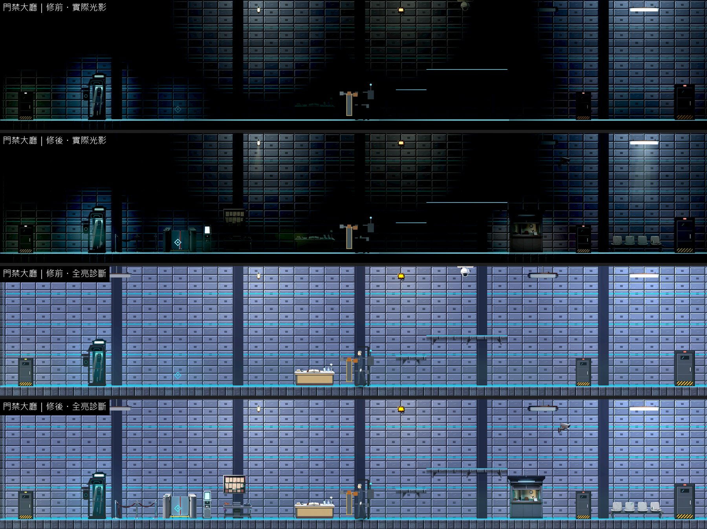
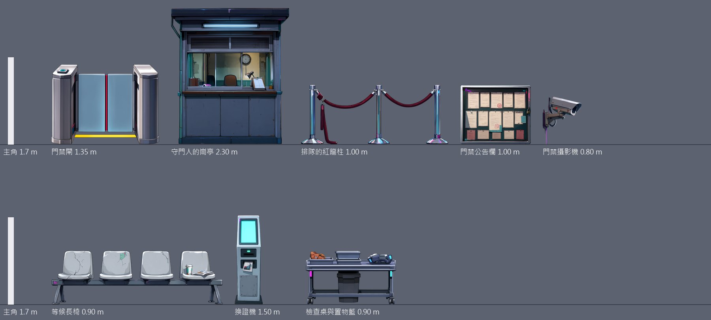
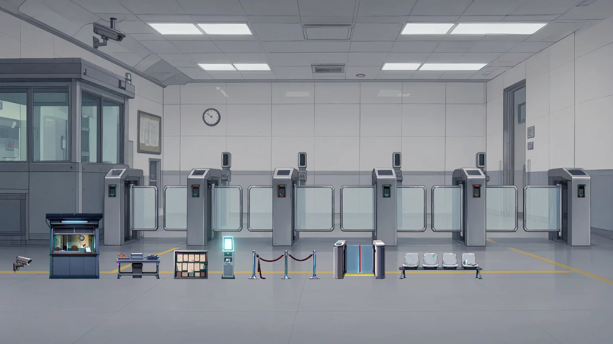

# [BG-39] 補上門禁大廳背景與專屬物件

> 狀態：審查中

## 內文

### 需求
第三章「門禁大廳」是守門人把關、玩家掃夾層證的地方，卻沒有自己的場景包：整區只有 3 件借來的東西（診所、會計大廳、電話亭），門禁閘的互動點旁邊 6 格內什麼都沒有，玩家對著空地按互動鍵。要有一張門禁大廳的背景與一包專屬物件，門禁閘要看得出是一道擋著路、要刷證的閘。

### 來源
2026-10-12，場景素材 Session 盤點第二、三章場景缺口（使用者要求：先用場景包預覽盤點缺背景與缺物件的場景，一項需求開一張 BG 票，依票補齊）。盤點方法與完整清單見[第二、三章場景缺口盤點](../../design/20-campaign-experience/CH2_CH3_SCENE_GAPS.md)。

### 驗收條件
- [x] 有「門禁大廳」場景背景圖與專屬物件包（至少 8 件），場景包預覽看得到
- [x] 門禁閘的互動點上有一道看得出用途的閘（刷證處、擋桿或閘門、狀態燈），守門人坐的位置有對應的崗亭或桌椅
- [x] 關卡改用這一包；整區擺設不少於 6 件，每件寫明支撐，戰鬥要用的空間不被擋住
- [x] 新圖是賽璐璐畫風（平塗、深色描邊、硬邊兩色陰影），依真實尺寸（公尺）對主角身高合理；提示詞與種子留在清單，可以重現；素材檢查通過
- [x] 實際光影下，光影品質「低」與「高」各量一次暗場可讀性：主角 ≥ 0.6、敵人 ≥ 0.45、地面邊緣 ≥ 1.0，沒有比改之前差
- [x] 場景巡覽（實際光影與全亮診斷各一組）修前修後並排附在票上；場景檢查 0 錯誤、0 警告

### 測試流程
1. 進第三章門禁大廳，走到門禁閘前
2. 確認閘、崗亭與守門人的相對位置合理；戰鬥時敵人與落點看得清楚

---

# 跟其他票的關係

- Blocks：無
- Blocked by：無
- Related：BG-11、BG-20、NE-253

---

# Commit-1

## 內文

**問題**：門禁大廳沒有自己的背景與物件，借診所、會計大廳與電話亭的物件，整區只有 3 件；「門禁閘」的互動點上什麼都沒有。

**改動**：
- 畫了「門禁大廳」場景背景（白色面板牆、一排閘機、崗亭、地上的黃色排隊線）與 8 件專屬物件：門禁閘（刷證頭、玻璃擋板、狀態燈）、守門人的崗亭、排隊的紅龍柱、門禁公告欄、門禁攝影機、等候長椅、換證機、檢查桌與置物籃。大小照真實尺寸（閘 1.35 公尺、崗亭 2.3 公尺、換證機 1.5 公尺）。
- 關卡改用這一包：入口的紅龍柱引到門禁閘（就在互動點上），閘後是換證機、檢查桌與牆上的公告欄；崗亭放在右側平台後面，不擋守門人站的位置，自己帶一盞暖色的燈（那一帶原本的吊燈是壞的，全黑）；攝影機掛在崗亭上方的牆上；長椅在護理通道門邊。整區擺設從 3 件變成 10 件，落地 7 件、掛牆 2 件，原本的電話亭與守門人櫃台留著。
- 戰鬥空間：新擺設都沒有碰撞，高的（崗亭）放在場地邊緣，場中央只有 1 公尺高的紅龍柱與檢查桌。

**驗收**：同一組格子修前修後各拍一輪（實際光影與全亮診斷）；暗場可讀性光影品質「高」「低」各量一次，都高於門檻也沒有比修前差。場景檢查 0 錯誤、0 警告；素材檢查通過；提示詞與種子（7201～7208、背景 7290）留在清單。

### 測試結果

| 區域 | 主角對比最低（高品質）修前 → 修後 | 主角對比最低（低品質）修前 → 修後 | 地面邊緣最低（高／低，修後） | 取樣格數 |
|---|---|---|---|---|
| 門禁大廳 | 0.81 → 0.81 | 0.81 → 0.81 | 19.17／19.18 | 7 |

| 項目 | 結果 |
|---|---|
| 場景檢查（第二、三章 19 張地圖） | 0 錯誤、0 警告 |
| 素材檢查 | 通過 |
| 受影響範圍的測試 | 56586 項檢查；新失敗 3、已知失敗 0。三項都是平行跑（14 個程序）時的計時檢查，和這張票無關：「滴水前進」「停電時燈具熄滅」單獨重跑環境測試 6953 項全過；音效「壓低後平順恢復」在乾淨的 main 單獨跑也會失敗 |

### 截圖

分支 `feature/scene-assets`；提交見[遠端 main 上本票的提交](https://github.com/deadline314/Nest-Egg/commits/main/pm/Nest-Egg-BG/%5BBG-39%5D%E8%A3%9C%E4%B8%8A%E9%96%80%E7%A6%81%E5%A4%A7%E5%BB%B3%E8%83%8C%E6%99%AF%E8%88%87%E5%B0%88%E5%B1%AC%E7%89%A9%E4%BB%B6.md)。
