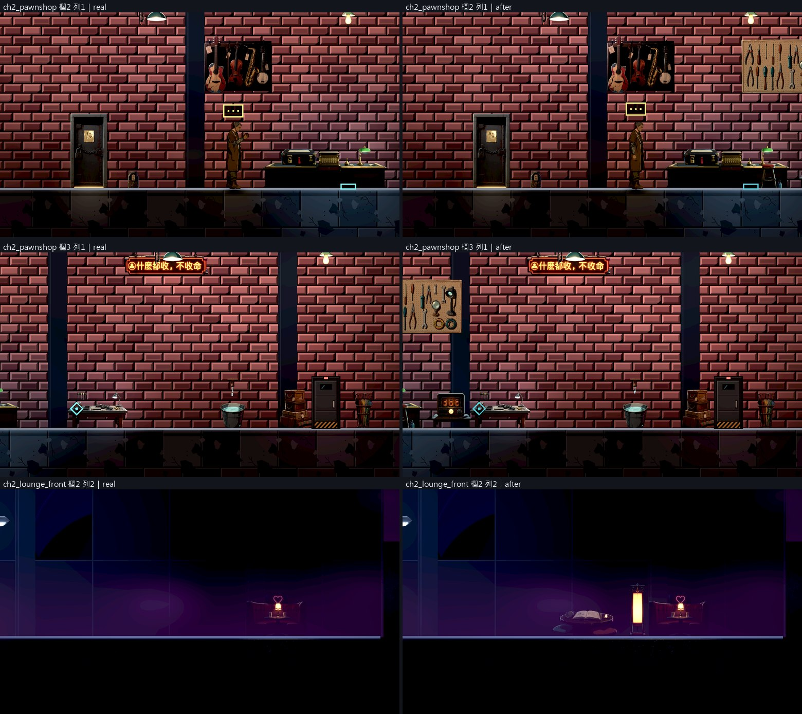
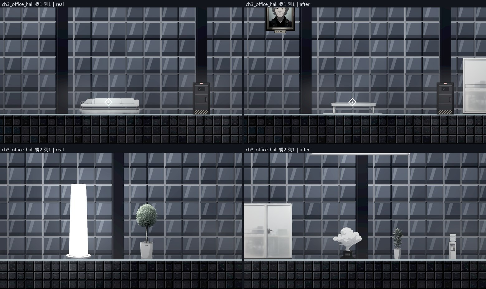
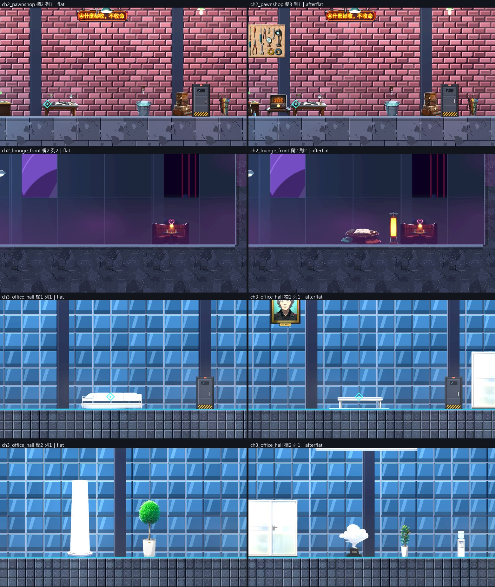
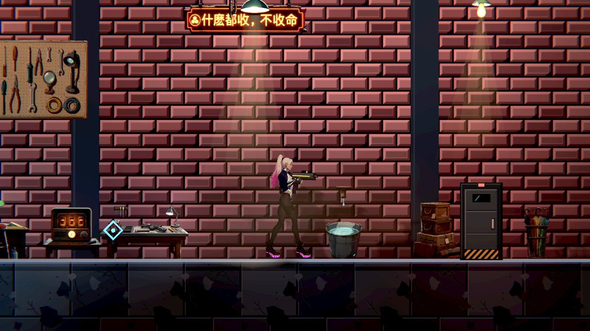
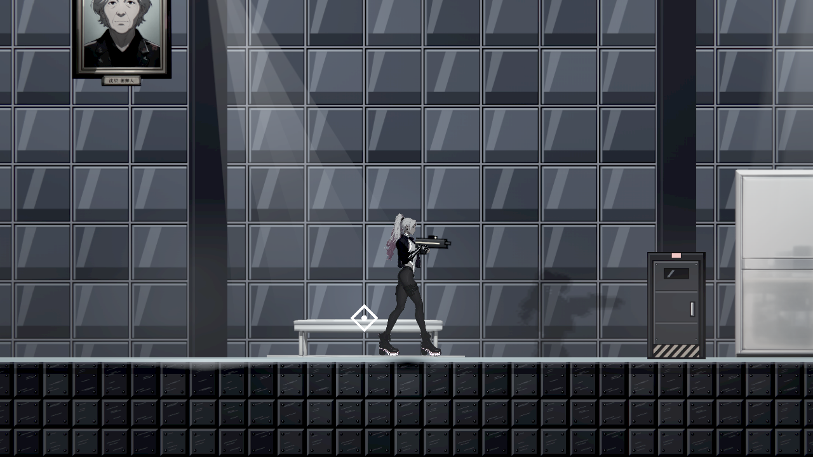

# [BG-40] 把已畫好的三包場景物件放進關卡

> 狀態：進行中

## 內文

### 需求
三個場景包早就畫好（各 10 件），關卡卻沒有用：第二章凜修收音機的互動點站在槍械工作台前，畫面上沒有收音機；復原館外「客人簿」的互動點旁邊 4 格內只有卡座沙發；第三章天穹辦公接待廊的過場舞台用的是天穹接待廊的背景，可走的關卡卻借會計大廳的物件，同一個地方兩種樣子。

### 來源
2026-10-12，場景素材 Session 盤點第二、三章場景缺口（使用者要求：先用場景包預覽盤點缺背景與缺物件的場景，一項需求開一張 BG 票，依票補齊）。盤點方法與完整清單見[第二、三章場景缺口盤點](../../design/20-campaign-experience/CH2_CH3_SCENE_GAPS.md)。

### 驗收條件
- [x] 第二章當舖：收音機的互動點上看得到工作檯與那台收音機
- [x] 第二章復原館外：客人簿的互動點上看得到客人簿（桌或檯面上）
- [x] 第三章天穹辦公接待廊：關卡擺設改用天穹接待廊這一包，和過場舞台是同一個地方的樣子
- [x] 放進去的每件物件大小、落地與前後遮擋合理，寫明支撐；沒有把整包十件硬塞進去
- [ ] 實際光影下，光影品質「低」與「高」各量一次暗場可讀性：主角 ≥ 0.6、敵人 ≥ 0.45、地面邊緣 ≥ 1.0，沒有比改之前差
- [x] 場景巡覽（實際光影與全亮診斷各一組）修前修後並排附在票上；場景檢查 0 錯誤、0 警告

### 測試流程
1. 第二章從當舖走到收音機前；走到復原館外的客人簿前
2. 第三章走進天穹辦公接待廊，和該場過場的畫面對照

---

# 跟其他票的關係

- Blocks：無
- Blocked by：無
- Related：BG-11、BG-20、BG-48

---

# Commit-1

## 內文

**問題**：三包早就畫好的場景物件（各 10 件）沒有放進關卡。第二章凜修收音機的互動點站在槍械工作台前，畫面上沒有收音機；復原館外「客人簿」的互動點旁邊只有 4 格外的卡座沙發；第三章天穹辦公接待廊的過場舞台是天穹接待廊的樣子，可走的關卡卻擺著會計大廳的沙發、樹與一根整支過曝成白色的燈柱。

**改動**：
- 第二章當舖：拆開的老收音機（真空管亮著）放在自己的小檯上，緊挨著工作檯，互動點就在它旁邊；牆上掛修東西用的工具板，前面一張坐著修的木凳。
- 第二章復原館外：攤開的客人簿放在矮桌上，旁邊一盞亮著的落地紙燈，互動點在桌前。
- 第三章天穹辦公接待廊：擺設換成天穹接待廊這一包——等候臺是走廊長凳、辦公內門旁是霧面玻璃隔間、牆上是巨幅畫像與燈條，另有雲的雕塑、白色盆栽與飲水機；會計大廳的沙發、樹與過曝的燈柱拿掉。樓層指示牌先留著，等 BG-45 換成公文取件格。
- 每一包只挑對得上用途的幾件（收音機 3 件、客人簿 2 件、接待廊 7 件），沒有整包塞進去；每件寫明站地或掛牆。

**驗收**：三個區域修前修後用同一組格子拍原生畫面，實際光影與全亮診斷各一組，逐格看過：新擺設都落在地面或掛在有牆的位置，互動點的標記就在收音機、客人簿與長凳上，沒有擋住出入口。場景檢查三區 0 錯誤、0 警告。

暗場可讀性那一條沒有勾：動到的格子都在門檻以上，但第二章復原館外有一格（路燈下、圓桌旁，這次沒有動到）光影品質「高」時主角對比只有 0.54～0.58，修前就是 0.55～0.57，低於門檻 0.6。畫面上主角看得清楚（白髮、被路燈照亮），數字低是因為背後的霧被路燈照亮、加上她自己投在牆上的影子。這是原本就有的問題，另開 BG-48 處理。

另外要說明：接待廊的擺設現在和過場舞台是同一批東西，但關卡的牆是深色玻璃帷幕，過場舞台是白色的走廊，整體色調仍然不一樣。換牆面材質會動到整個區域的光影，沒有在這張票做。

### 測試結果

主角最低對比（門檻 0.6）／地面邊緣最低對比（門檻 1.0），修前 → 修後：

| 區域 | 品質低 | 品質高 |
|---|---|---|
| 第二章當舖 | 0.70 → 0.70 ／ 10.34 → 10.31 | 0.70 → 0.70 ／ 10.22 → 10.17 |
| 第二章復原館外 | 0.84 → 0.85 ／ 21.49 → 21.26 | 0.55 → 0.54 ／ 21.31 → 21.08（未動到的那一格，見上） |
| 第三章天穹辦公接待廊 | 0.89 → 0.89 ／ 7.87 → 10.52 | 0.88 → 0.89 ／ 8.69 → 11.53 |

| 項目 | 結果 |
|---|---|
| 場景檢查（三區） | 0 錯誤、0 警告 |
| 第二、三章產生器重產 | 只有這三區的地圖與主題有變 |
| 受影響範圍的測試（併入最新 main 後） | 56085 項檢查；新失敗 1、已知失敗 0。那一項是音效套件的計時檢查「壓低後平順恢復」，和這張票無關：乾淨的 origin/main 單獨跑也間歇失敗。併入前那一輪另有人物走近反應 2 項在同時跑 14 個程序時失敗，單獨重跑 3 次都過，這一輪沒有再出現 |

### 截圖

左修前、右修後。

分支 `feature/scene-assets`；提交見[遠端 main 上本票的提交](https://github.com/deadline314/Nest-Egg/commits/main/pm/Nest-Egg-BG/%5BBG-40%5D%E6%8A%8A%E5%B7%B2%E7%95%AB%E5%A5%BD%E7%9A%84%E4%B8%89%E5%8C%85%E5%A0%B4%E6%99%AF%E7%89%A9%E4%BB%B6%E6%94%BE%E9%80%B2%E9%97%9C%E5%8D%A1.md)。

# Commit-2

## 內文

復原館外原本卡住的霧效已有 BG-48 局部候選修正；追加當舖收音機與第三章接待廊的高／低品質地面帶對照，保留原素材、支撐與擺設。

[本批逐區數值、範圍與原始證據](../../design/08-lighting/SCENE_READABILITY_FOLLOWUP.md)。使用軟體 Forward+，不拿它與先前實體 GPU 數字當同機比較，原本最後一條本機可讀性驗收維持未勾。票內 Commit-1 的歷史數據與實機照片保留。

### 截圖

排列的原場景相機，不是人工遊玩或完整地圖巡覽。

