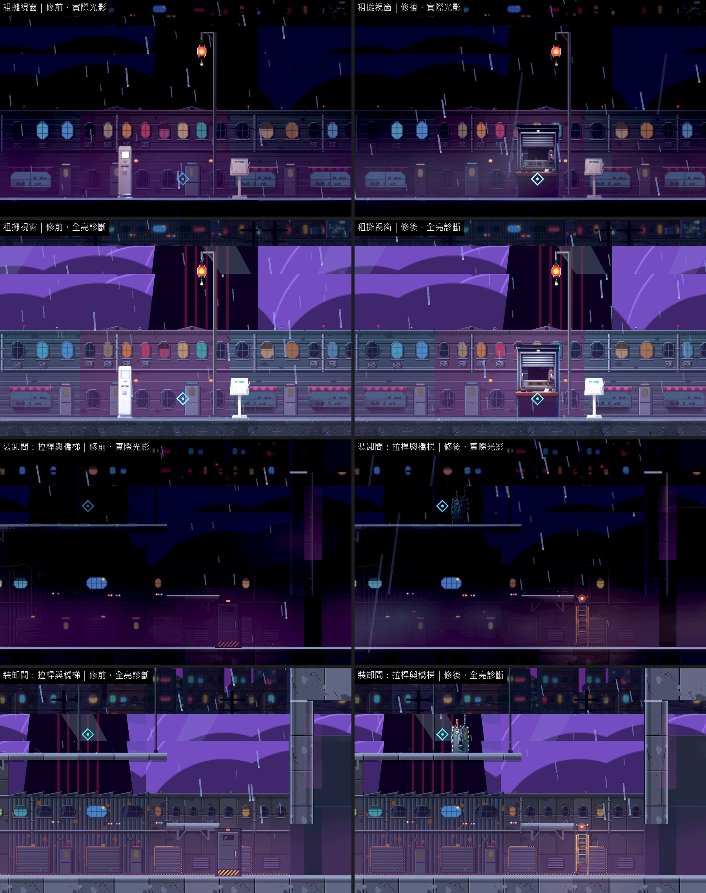
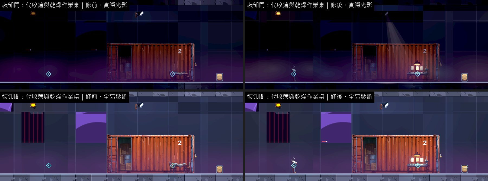
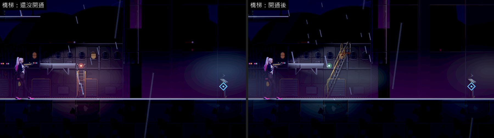
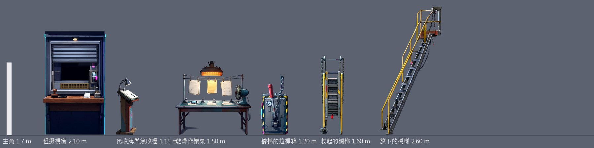

# [BG-41] 補上第二章市集與裝卸間互動點的物件

> 狀態：審查中

## 內文

### 需求
第二章公眾攤道與裝卸間有四個互動點沒有對應的東西：租攤視窗借會計大廳的售票機；橋梯拉桿方圓 21 格內沒有任何擺設，橋梯本身也沒有畫面；代收簿最近的擺設在 8 格外；乾燥作業桌借當舖廚房的餐桌。玩家只看到一行提示浮在空地上。

同一區「倚著牆的守衛」的互動點方圓 13 格內也沒有任何畫面，但那是一個人，需要角色外觀與倚牆的姿勢，交角色組處理；場景這邊只確認他靠的那面牆存在。

### 來源
2026-10-12，場景素材 Session 盤點第二、三章場景缺口（使用者要求：先用場景包預覽盤點缺背景與缺物件的場景，一項需求開一張 BG 票，依票補齊）。盤點方法與完整清單見[第二、三章場景缺口盤點](../../design/20-campaign-experience/CH2_CH3_SCENE_GAPS.md)。

### 驗收條件
- [x] 租攤視窗、橋梯與拉桿、代收簿（放在檯面或架上）、乾燥作業桌各有看得出用途的物件，就在互動點上
- [x] 橋梯有收起與放下兩種樣子，和捷徑開通的狀態一致
- [x] 每件寫明支撐，不擋路、不擋敵人與落點
- [x] 新圖是賽璐璐畫風（平塗、深色描邊、硬邊兩色陰影），依真實尺寸（公尺）對主角身高合理；提示詞與種子留在清單，可以重現；素材檢查通過
- [x] 實際光影下，光影品質「低」與「高」各量一次暗場可讀性：主角 ≥ 0.6、敵人 ≥ 0.45、地面邊緣 ≥ 1.0，沒有比改之前差
- [x] 場景巡覽（實際光影與全亮診斷各一組）修前修後並排附在票上；場景檢查 0 錯誤、0 警告

### 測試流程
1. 第二章走公眾攤道到租攤視窗；進裝卸間依序到代收簿、作業桌、拉桿
2. 放下橋梯，確認畫面跟著改變，走橋梯回代收處

---

# 跟其他票的關係

- Blocks：無
- Blocked by：無
- Related：BG-20、BG-21

---

# Commit-1

## 內文

**問題**：第二章市集的租攤視窗借會計大廳的售票機；裝卸間的橋梯拉桿旁 21 格內沒有任何擺設，橋梯本身沒有畫面（捷徑的出入口只是一扇門）；代收簿、乾燥作業桌也是借別處的物件。

**改動**：
- 新畫 6 件：租攤視窗（半拉下的鐵捲窗、櫃檯、收據與號碼牌，2.1 公尺）、橋梯的拉桿箱（1.2 公尺）、收起的橋梯與放下的橋梯（1.6／2.6 公尺）、代收簿與簽收檯（1.15 公尺）、乾燥作業桌（線上晾著紙、上面一盞烘燈，1.5 公尺）。每件都放在自己的互動點上，全部落地。租攤視窗與乾燥桌的燈會照亮周圍。
- 橋梯跟著捷徑的狀態換樣子：還沒開通時是摺起來立在出入口的梯子、頂端紅燈；開通後換成放下的梯子、燈轉綠。玩家在場時開通才演一次，之後回來直接是放下的樣子。原本那扇門拿掉，出入口就是梯子本身；梯子頂端的燈讓它在暗處也找得到。
- 擺設依劇情換樣子的做法這次一起補齊（換成另一件、開度指針、狀態燈照亮擺設本身），BG-43、BG-44 的機關共用；每一張關卡地圖寫到的反應都有自動檢查確認資料存在。
- 「倚著牆的守衛」是人物，需要角色外觀與姿勢，仍等角色組，不在這張票處理。

**驗收**：同一組格子修前修後各拍一輪（實際光影與全亮診斷）；橋梯開通前後用正式關卡原生拍下。暗場可讀性光影品質「高」「低」各量一次，都高於門檻；裝卸間右側有三格主角對比下降（最多 2.36 → 1.40，乾燥桌的烘燈在主角背後），仍遠高於門檻 0.6。場景檢查 0 錯誤、0 警告；素材檢查通過；提示詞與種子（7301～7306）留在清單。

### 測試結果

| 區域 | 主角對比最低（高品質）修前 → 修後 | 主角對比最低（低品質）修前 → 修後 | 地面邊緣最低（高／低，修後） | 取樣格數 |
|---|---|---|---|---|
| 公眾攤道 | 0.61 → 0.61 | 0.62 → 0.64 | 11.99／17.31 | 16 |
| 裝卸間 | 0.67 → 0.65 | 0.67 → 0.65 | 2.02／2.10 | 12 |

| 項目 | 結果 |
|---|---|
| 場景檢查（第二、三章 19 張地圖） | 0 錯誤、0 警告 |
| 素材檢查 | 通過 |
| 受影響範圍的測試 | 56586 項檢查；新失敗 3、已知失敗 0。三項都是平行跑（14 個程序）時的計時檢查，和這張票無關：「滴水前進」「停電時燈具熄滅」單獨重跑環境測試 6953 項全過；音效「壓低後平順恢復」在乾淨的 main 單獨跑也會失敗 |

### 截圖

分支 `feature/scene-assets`；提交見[遠端 main 上本票的提交](https://github.com/deadline314/Nest-Egg/commits/main/pm/Nest-Egg-BG/%5BBG-41%5D%E8%A3%9C%E4%B8%8A%E7%AC%AC%E4%BA%8C%E7%AB%A0%E5%B8%82%E9%9B%86%E8%88%87%E8%A3%9D%E5%8D%B8%E9%96%93%E4%BA%92%E5%8B%95%E9%BB%9E%E7%9A%84%E7%89%A9%E4%BB%B6.md)。
