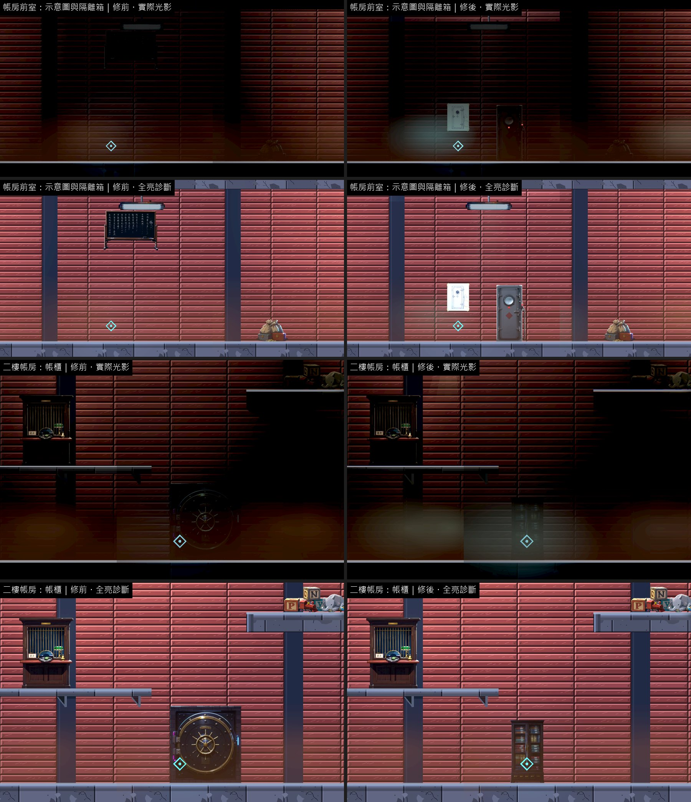
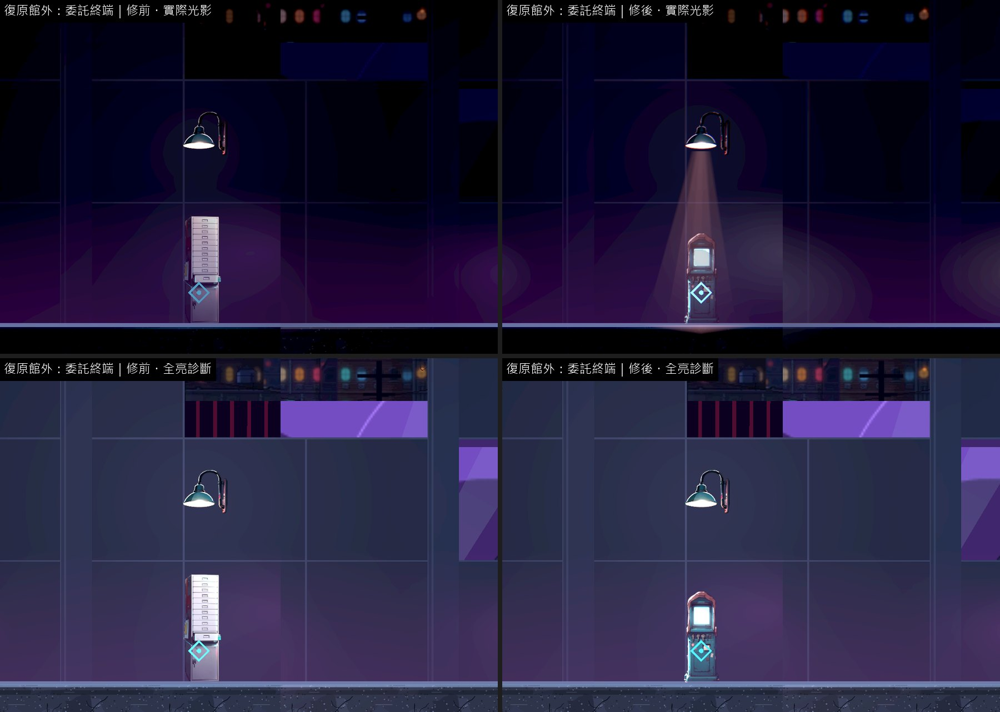
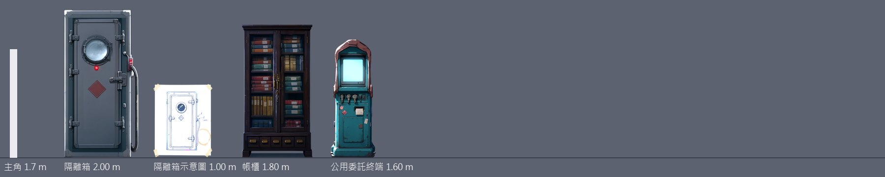
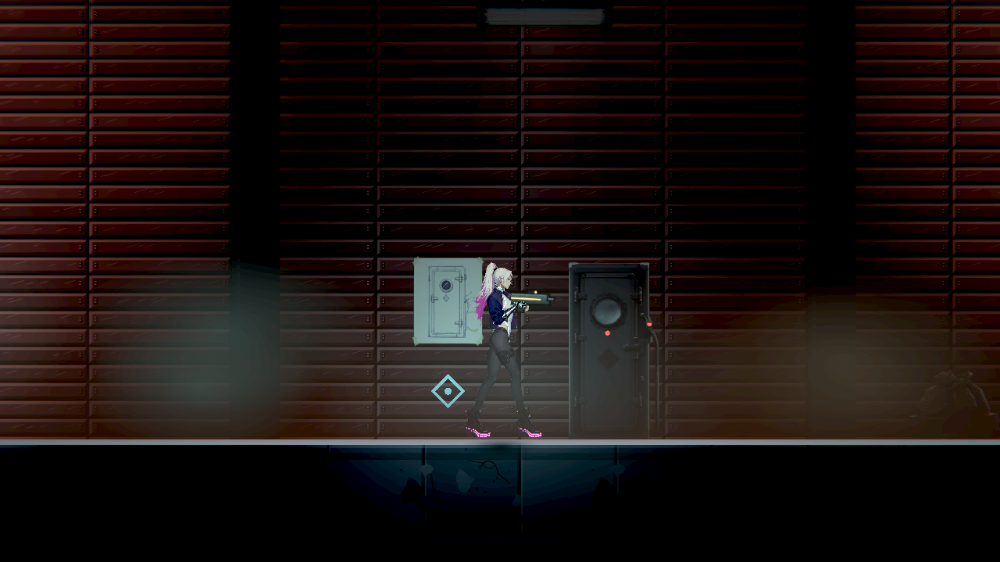
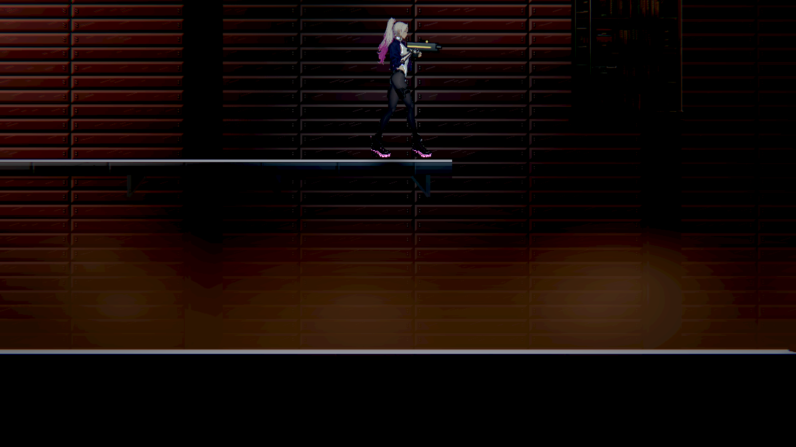
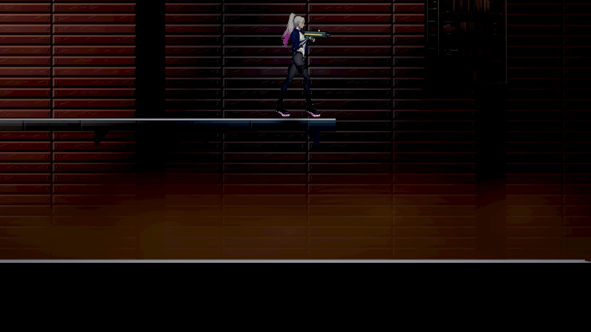

# [BG-42] 補上第二章帳房的隔離箱、帳櫃與委託終端

> 狀態：進行中（場景物件已交付；BG-48 局部修正已合入，保留本機原生可讀性驗收）

## 內文

### 需求
第二章帳房前室的「隔離箱示意圖」借債務黑板，劇情關鍵的隔離箱本身沒有物件；二樓帳房的帳櫃借保險箱；復原館外的公用委託終端借診所的報表櫃。三樣都是劇情裡玩家要操作或要看懂的東西。

### 來源
2026-10-12，場景素材 Session 盤點第二、三章場景缺口（使用者要求：先用場景包預覽盤點缺背景與缺物件的場景，一項需求開一張 BG 票，依票補齊）。盤點方法與完整清單見[第二、三章場景缺口盤點](../../design/20-campaign-experience/CH2_CH3_SCENE_GAPS.md)。

### 驗收條件
- [x] 隔離箱與它的示意圖、帳櫃、公用委託終端各有自己的物件，就在互動點上
- [x] 隔離箱看得出是裝人或裝東西的隔離容器，示意圖和實物對得起來
- [x] 每件寫明支撐
- [x] 新圖是賽璐璐畫風（平塗、深色描邊、硬邊兩色陰影），依真實尺寸（公尺）對主角身高合理；提示詞與種子留在清單，可以重現；素材檢查通過
- [ ] 實際光影下，光影品質「低」與「高」各量一次暗場可讀性：主角 ≥ 0.6、敵人 ≥ 0.45、地面邊緣 ≥ 1.0，沒有比改之前差（帳房前室、二樓帳房通過；復原館外路燈下那一格修前就低於 0.6，屬 BG-48，這一條等它修好再勾）
- [x] 場景巡覽（實際光影與全亮診斷各一組）修前修後並排附在票上；場景檢查 0 錯誤、0 警告

### 測試流程
1. 第二章進帳房前室看示意圖與隔離箱，進二樓帳房開帳櫃
2. 到復原館外的委託終端上傳證據

---

# 跟其他票的關係

- Blocks：無
- Blocked by：無
- Related：BG-20、BG-48

---

# Commit-1

## 內文

**問題**：第二章帳房前室的「隔離箱示意圖」借債務黑板，隔離箱本身沒有物件；二樓帳房的帳櫃借保險箱；復原館外的公用委託終端借診所的報表櫃。

**改動**：新畫 4 件並放到各自的互動點上：隔離箱（一人高的金屬箱、觀察窗與鎖扣，2 公尺）與貼在旁邊牆上的示意圖（線稿畫的就是這個箱子：直立的窄櫃、上半部一個圓形觀察窗、兩側鎖扣；1 公尺、離地約 1 公尺）、帳櫃（玻璃門後一排排帳冊，1.8 公尺）、公用委託終端（亮著的螢幕、投件口，1.6 公尺）。落地 3 件、掛牆 1 件。

**驗收**：同一組格子修前修後各拍一輪（實際光影與全亮診斷）；暗場可讀性光影品質「高」「低」各量一次。帳房前室、二樓帳房高於門檻也沒有比修前差。復原館外路燈下那一格修前就低於門檻（BG-48 已開票）：整輪巡覽輪到它時量到 0.55（修前）與 0.48（修後），但修後只量那一格、連量三次是 0.90、0.94、0.93——那盞燈會閃，量到暗的那一段數字就低，兩次的差別在這個範圍內。那一格離新放的終端 13 格，終端所在的那一格主角對比是上升的（1.34 → 1.61）。帳櫃在帳房偏暗的角落，和原本的保險箱一樣只看得到輪廓與玻璃反光。場景檢查 0 錯誤、0 警告；素材檢查通過；提示詞與種子（7401、7403、7404，示意圖重畫後是 7412）留在清單。

### 測試結果

| 區域 | 主角對比最低（高品質）修前 → 修後 | 主角對比最低（低品質）修前 → 修後 | 地面邊緣最低（高／低，修後） | 取樣格數 |
|---|---|---|---|---|
| 帳房前室 | 0.69 → 0.75 | 0.75 → 0.80 | 15.64／14.15 | 6 |
| 二樓帳房 | 0.72 → 0.70 | 0.77 → 0.79 | 12.38／9.93 | 6 |
| 復原館外 | 0.55 → 0.48 | 0.84 → 0.83 | 21.09／21.12 | 6 |

| 項目 | 結果 |
|---|---|
| 場景檢查（第二、三章 19 張地圖） | 0 錯誤、0 警告 |
| 素材檢查 | 通過 |
| 受影響範圍的測試 | 56586 項檢查；新失敗 3、已知失敗 0。三項都是平行跑（14 個程序）時的計時檢查，和這張票無關：「滴水前進」「停電時燈具熄滅」單獨重跑環境測試 6953 項全過；音效「壓低後平順恢復」在乾淨的 main 單獨跑也會失敗 |

### 截圖

分支 `feature/scene-assets`；提交見[遠端 main 上本票的提交](https://github.com/deadline314/Nest-Egg/commits/main/pm/Nest-Egg-BG/%5BBG-42%5D%E8%A3%9C%E4%B8%8A%E7%AC%AC%E4%BA%8C%E7%AB%A0%E5%B8%B3%E6%88%BF%E7%9A%84%E9%9A%94%E9%9B%A2%E7%AE%B1%E3%80%81%E5%B8%B3%E6%AB%83%E8%88%87%E5%A7%94%E8%A8%97%E7%B5%82%E7%AB%AF.md)。

# Commit-2

## 內文

追加帳房前室、二樓帳房與復原館外的本批可讀性證據。復原館外已採用 BG-48 的局部霧量修正；隔離箱、示意圖、帳櫃與委託終端的素材、尺寸和支撐保留。

[高／低品質地面帶數值、實際範圍與完整原始紀錄](../../design/08-lighting/SCENE_READABILITY_FOLLOWUP.md)；[復原館外完整九格、自然循環與相鄰區域對照](../../design/08-lighting/READABILITY_REPAIR.md)。本批使用軟體 Forward+，沒有冒稱與先前實體 GPU 數字為同機比較，最後一條本機原生條件維持未勾。Commit-1 的歷史原圖與結果保留。 本批帳房敵人最低對比為高品質 0.405、低品質 0.418，均低於原門檻 0.45；數值不算通過，保留在未完成驗收內。

### 截圖

排列的原場景鏡頭，不是人工通關或完整地圖巡覽。

