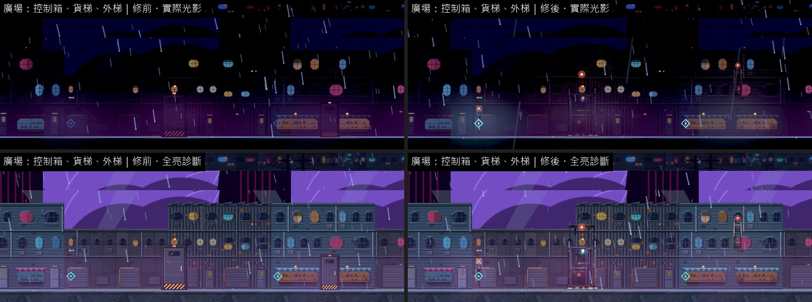
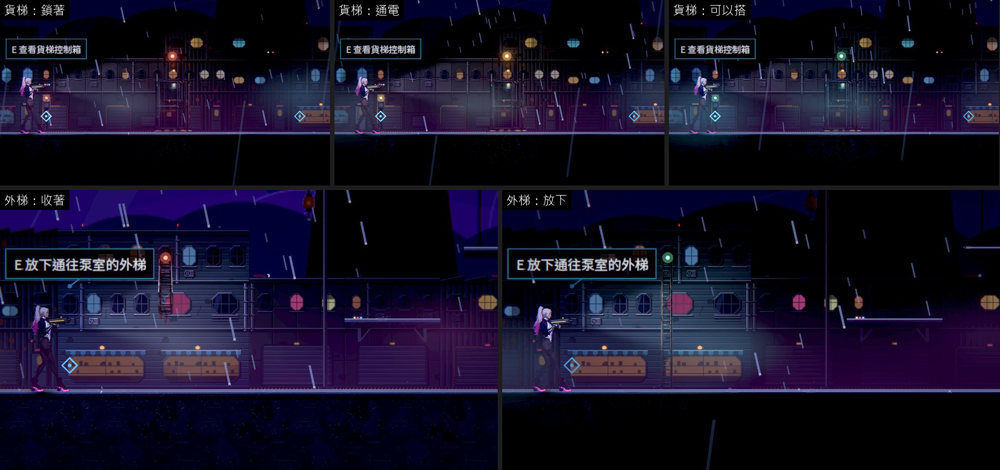
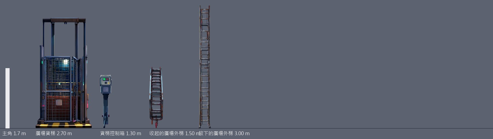

# [BG-43] 補上第三章廣場的貨梯、控制箱與外梯

> 狀態：審查中

## 內文

### 需求
第三章「廣場貨梯」這一區以貨梯為名，畫面上卻沒有貨梯：貨梯的位置沒有擺設，控制箱 5 格內只有水尺塔，通往泵室的外梯方圓 21 格內什麼都沒有。

### 來源
2026-10-12，場景素材 Session 盤點第二、三章場景缺口（使用者要求：先用場景包預覽盤點缺背景與缺物件的場景，一項需求開一張 BG 票，依票補齊）。盤點方法與完整清單見[第二、三章場景缺口盤點](../../design/20-campaign-experience/CH2_CH3_SCENE_GAPS.md)。

### 驗收條件
- [x] 貨梯（車廂或平台、導軌、閘門）、貨梯控制箱、廣場外梯各有物件，就在互動點與出入口上
- [x] 外梯有收起與放下兩種樣子，和捷徑開通的狀態一致；貨梯的狀態燈和能不能搭一致
- [x] 每件寫明支撐
- [x] 新圖是賽璐璐畫風（平塗、深色描邊、硬邊兩色陰影），依真實尺寸（公尺）對主角身高合理；提示詞與種子留在清單，可以重現；素材檢查通過
- [x] 實際光影下，光影品質「低」與「高」各量一次暗場可讀性：主角 ≥ 0.6、敵人 ≥ 0.45、地面邊緣 ≥ 1.0，沒有比改之前差
- [x] 場景巡覽（實際光影與全亮診斷各一組）修前修後並排附在票上；場景檢查 0 錯誤、0 警告

### 測試流程
1. 第三章到廣場，查看控制箱、搭貨梯
2. 放下外梯到泵室，再走回來

---

# 跟其他票的關係

- Blocks：無
- Blocked by：無
- Related：BG-20、BG-21

---

# Commit-1

## 內文

**問題**：第三章廣場的貨梯沒有物件（出入口只是一扇門），控制箱 5 格內只有水尺塔，廣場外梯 21 格內沒有擺設。「先去泵室排水、再回控制箱叫車廂」的進度在畫面上完全看不出來。

**改動**：
- 新畫 4 件：廣場貨梯（鐵網車廂、導軌與閘門，2.7 公尺）、貨梯控制箱（立柱上的按鈕盒，1.3 公尺）、收起的外梯與放下的外梯（1.5／3 公尺）。貨梯與外梯就是出入口的樣子，原本那兩扇門拿掉。
- 貨梯與控制箱的燈跟著進度換色：鎖著是紅燈、通電是琥珀色緩慢起伏、可以搭是綠燈；燈的光照在車廂上，暗的廣場裡也找得到貨梯。
- 外梯收起時掛在牆上高處、頂端紅燈；放下後從同一個高度往下延伸到地面、燈轉綠。
- 支撐：貨梯與控制箱落地，外梯掛牆。

**驗收**：同一組格子修前修後各拍一輪（實際光影與全亮診斷）；貨梯三種狀態與外梯兩種狀態用正式關卡原生拍下。暗場可讀性光影品質「高」「低」各量一次，都高於門檻；貨梯與控制箱旁三格的主角對比下降（最多 1.47 → 0.96，機關的燈在主角背後），仍高於門檻 0.6。場景檢查 0 錯誤、0 警告；素材檢查通過；提示詞與種子（7501～7504）留在清單。

### 測試結果

| 區域 | 主角對比最低（高品質）修前 → 修後 | 主角對比最低（低品質）修前 → 修後 | 地面邊緣最低（高／低，修後） | 取樣格數 |
|---|---|---|---|---|
| 廣場 | 0.61 → 0.63 | 0.76 → 0.73 | 16.28／21.04 | 10 |

| 項目 | 結果 |
|---|---|
| 場景檢查（第二、三章 19 張地圖） | 0 錯誤、0 警告 |
| 素材檢查 | 通過 |
| 受影響範圍的測試 | 56586 項檢查；新失敗 3、已知失敗 0。三項都是平行跑（14 個程序）時的計時檢查，和這張票無關：「滴水前進」「停電時燈具熄滅」單獨重跑環境測試 6953 項全過；音效「壓低後平順恢復」在乾淨的 main 單獨跑也會失敗 |

### 截圖

分支 `feature/scene-assets`；提交見[遠端 main 上本票的提交](https://github.com/deadline314/Nest-Egg/commits/main/pm/Nest-Egg-BG/%5BBG-43%5D%E8%A3%9C%E4%B8%8A%E7%AC%AC%E4%B8%89%E7%AB%A0%E5%BB%A3%E5%A0%B4%E7%9A%84%E8%B2%A8%E6%A2%AF%E3%80%81%E6%8E%A7%E5%88%B6%E7%AE%B1%E8%88%87%E5%A4%96%E6%A2%AF.md)。
