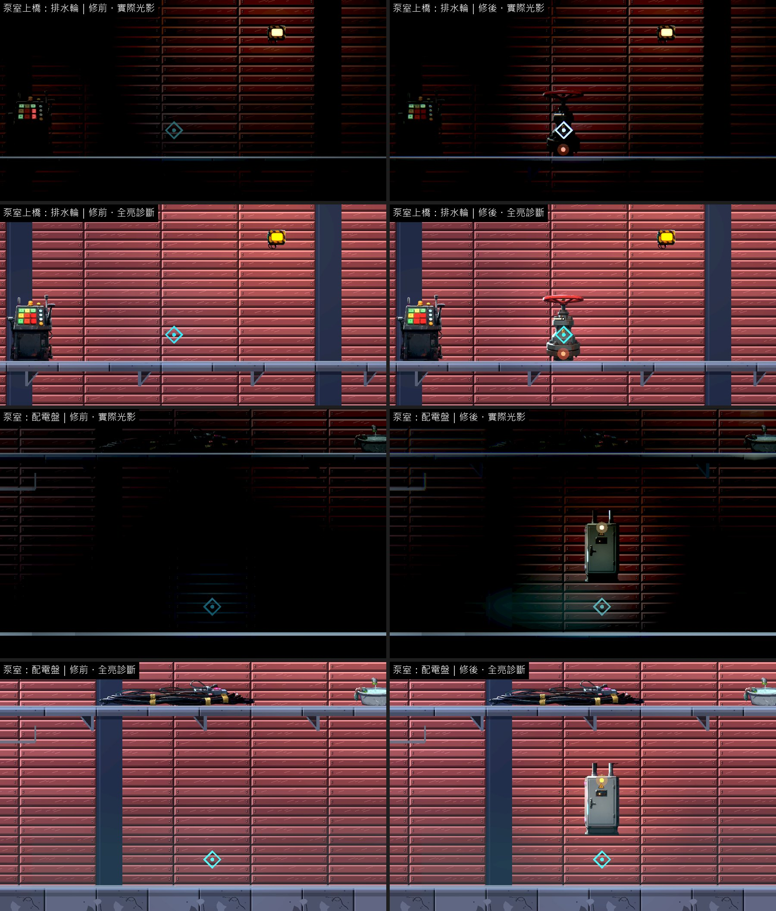
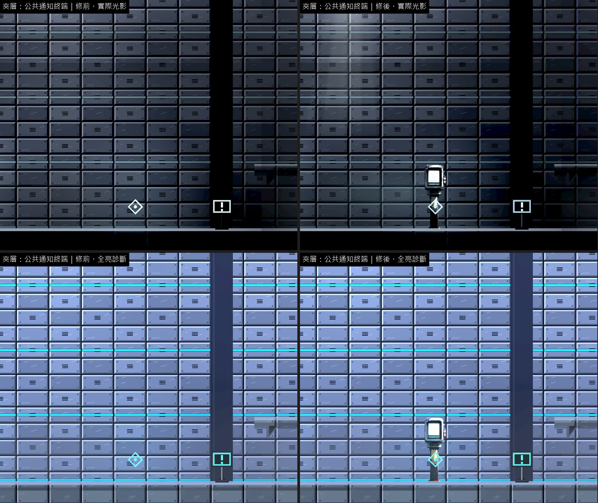
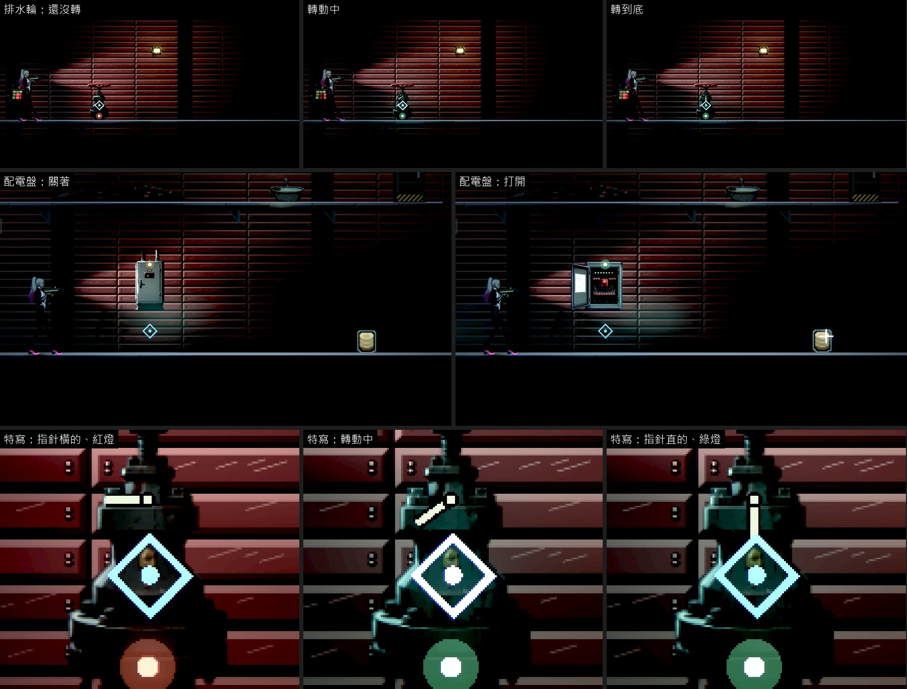
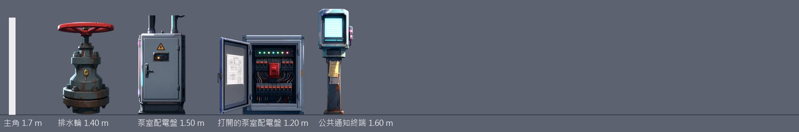

# [BG-44] 補上第三章泵室機關與夾層公告終端

> 狀態：審查中

## 內文

### 需求
第三章泵室的排水輪 4 格內沒有對應的東西，配電盤借地上的電纜束；夾層通道的公共通知終端 8.5 格內沒有擺設。三樣都是玩家要操作的機關或要讀的資訊。

### 來源
2026-10-12，場景素材 Session 盤點第二、三章場景缺口（使用者要求：先用場景包預覽盤點缺背景與缺物件的場景，一項需求開一張 BG 票，依票補齊）。盤點方法與完整清單見[第二、三章場景缺口盤點](../../design/20-campaign-experience/CH2_CH3_SCENE_GAPS.md)。

### 驗收條件
- [x] 排水輪、泵室配電盤、公共通知終端各有物件，就在互動點上
- [x] 排水輪看得出能轉，轉動前後有可見的差別（輪的角度或水流）；配電盤有開與關兩種樣子
- [x] 每件寫明支撐
- [x] 新圖是賽璐璐畫風（平塗、深色描邊、硬邊兩色陰影），依真實尺寸（公尺）對主角身高合理；提示詞與種子留在清單，可以重現；素材檢查通過
- [x] 實際光影下，光影品質「低」與「高」各量一次暗場可讀性：主角 ≥ 0.6、敵人 ≥ 0.45、地面邊緣 ≥ 1.0，沒有比改之前差
- [x] 場景巡覽（實際光影與全亮診斷各一組）修前修後並排附在票上；場景檢查 0 錯誤、0 警告

### 測試流程
1. 第三章進泵室轉排水輪、開配電盤
2. 到夾層通道看公共通知終端

---

# 跟其他票的關係

- Blocks：無
- Blocked by：無
- Related：BG-20、BG-25

---

# Commit-1

## 內文

**問題**：第三章泵室的排水輪旁 4 格內沒有擺設，配電盤借地上的電纜束；夾層通道的公共通知終端 8 格內沒有擺設。

**改動**：
- 新畫 4 件：排水輪（紅色手輪的閘閥，1.4 公尺，立在上橋的互動點旁）、泵室配電盤的關與開兩個樣子（掛牆，箱體一樣大；打開的那張看得到斷路器與貼在門內的線路圖）、公共通知終端（亮著的螢幕，1.6 公尺）。
- 排水輪轉過看得出來：閥身上一根開度指針，從橫的慢慢轉到直的（約 1.4 秒，轉到底喀一聲），底座的燈由紅轉綠。指針與燈是兩種線索，不只靠顏色。
- 配電盤關支路後換成打開的樣子，燈由琥珀轉綠；配電盤所在的牆面原本全黑，燈的光讓它看得到。
- 支撐：排水輪落在上橋的平台上、終端落地、配電盤掛牆。

**驗收**：同一組格子修前修後各拍一輪（實際光影與全亮診斷）；排水輪轉動前、轉動中、轉到底與配電盤開關兩個樣子用正式關卡原生拍下。暗場可讀性光影品質「高」「低」各量一次，都高於門檻也沒有比修前差。場景檢查 0 錯誤、0 警告；素材檢查通過；提示詞與種子（7601～7604）留在清單。

### 測試結果

| 區域 | 主角對比最低（高品質）修前 → 修後 | 主角對比最低（低品質）修前 → 修後 | 地面邊緣最低（高／低，修後） | 取樣格數 |
|---|---|---|---|---|
| 泵室 | 0.70 → 0.71 | 0.71 → 0.69 | 2.93／2.96 | 6 |
| 夾層通道 | 0.86 → 0.87 | 0.89 → 0.91 | 14.68／14.51 | 9 |

| 項目 | 結果 |
|---|---|
| 場景檢查（第二、三章 19 張地圖） | 0 錯誤、0 警告 |
| 素材檢查 | 通過 |
| 受影響範圍的測試 | 56586 項檢查；新失敗 3、已知失敗 0。三項都是平行跑（14 個程序）時的計時檢查，和這張票無關：「滴水前進」「停電時燈具熄滅」單獨重跑環境測試 6953 項全過；音效「壓低後平順恢復」在乾淨的 main 單獨跑也會失敗 |

### 截圖

分支 `feature/scene-assets`；提交見[遠端 main 上本票的提交](https://github.com/deadline314/Nest-Egg/commits/main/pm/Nest-Egg-BG/%5BBG-44%5D%E8%A3%9C%E4%B8%8A%E7%AC%AC%E4%B8%89%E7%AB%A0%E6%B3%B5%E5%AE%A4%E6%A9%9F%E9%97%9C%E8%88%87%E5%A4%BE%E5%B1%A4%E5%85%AC%E5%91%8A%E7%B5%82%E7%AB%AF.md)。
