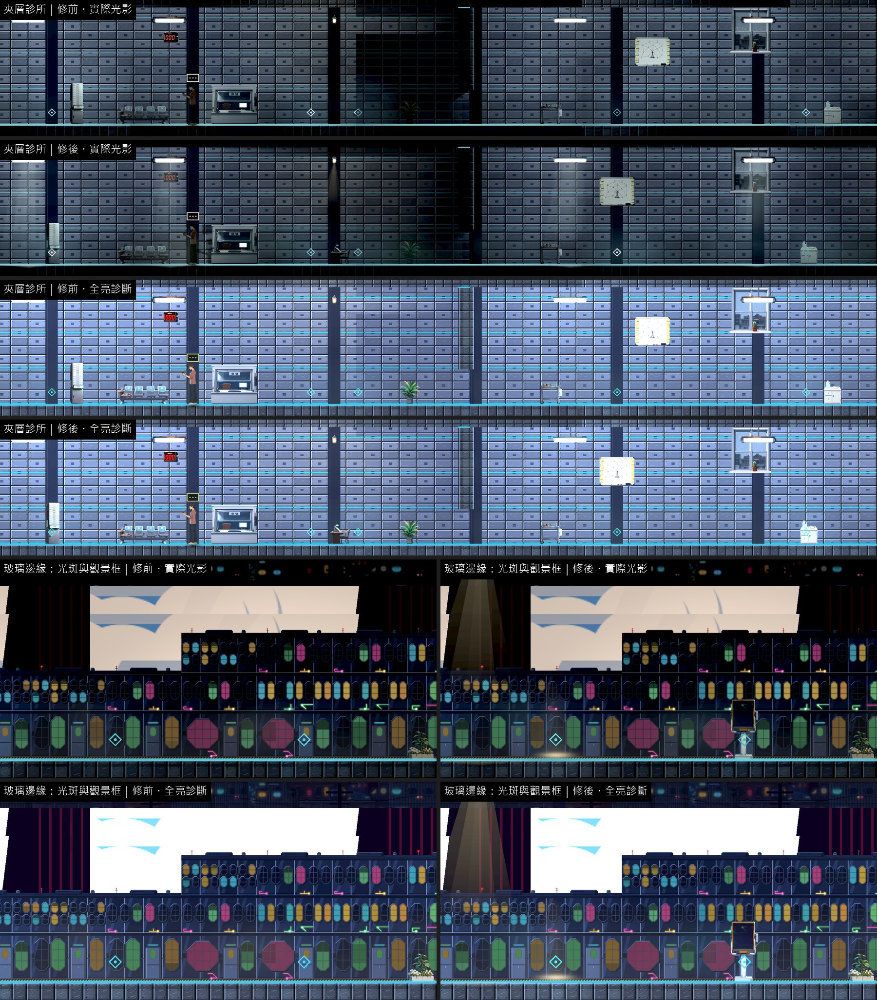
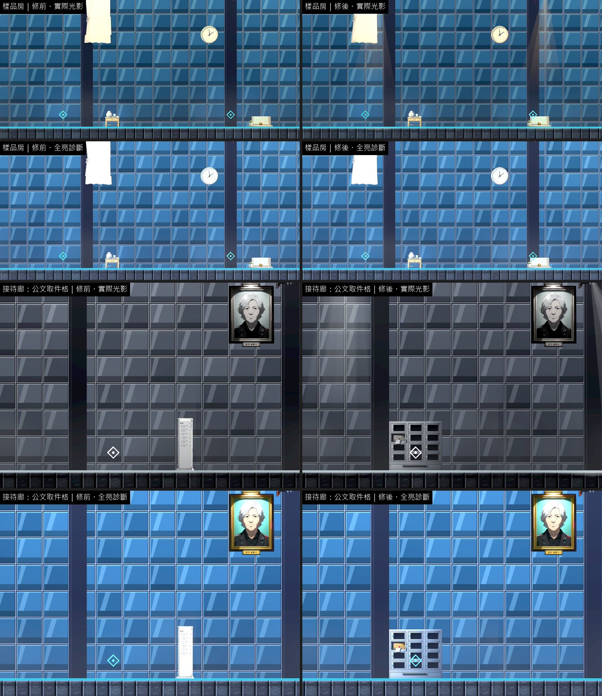
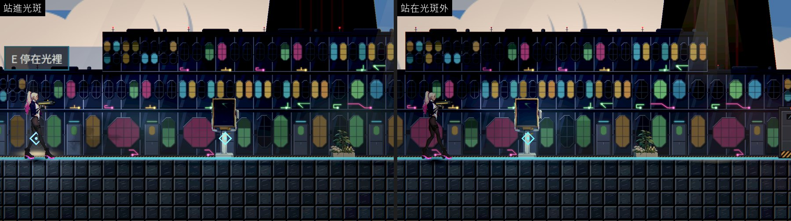
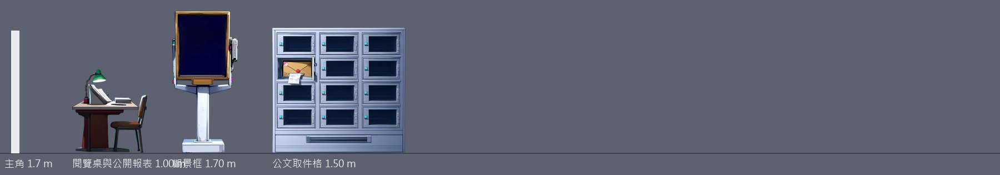

# [BG-45] 補上第三章閱覽桌、觀景框與取件格

> 狀態：審查中

## 內文

### 需求
第三章有幾個安靜的互動點沒有對應的東西：夾層診所的閱覽桌與桌上的公開報表（最近的是 4 格外的盆栽）、玻璃邊緣的觀景框與地上的光斑（6 格內沒有擺設）、天穹接待廊的公文取件格（借樓層指示牌）。另外診所的門邊閱覽櫃、護理輪班表、寄存櫃與樣品房三扇窗，對應的擺設離互動點 2 格。

### 來源
2026-10-12，場景素材 Session 盤點第二、三章場景缺口（使用者要求：先用場景包預覽盤點缺背景與缺物件的場景，一項需求開一張 BG 票，依票補齊）。盤點方法與完整清單見[第二、三章場景缺口盤點](../../design/20-campaign-experience/CH2_CH3_SCENE_GAPS.md)。

### 驗收條件
- [x] 閱覽桌（桌上有報表）、觀景框、公文取件格各有物件，就在互動點上
- [x] 地上的光斑是一塊真的從上方照下來的光，站進去主角會被照亮；不是貼在地上的圖
- [x] 診所的閱覽櫃、輪班表、寄存櫃與樣品房三扇窗的擺設移到各自的互動點上
- [x] 每件寫明支撐
- [x] 新圖是賽璐璐畫風（平塗、深色描邊、硬邊兩色陰影），依真實尺寸（公尺）對主角身高合理；提示詞與種子留在清單，可以重現；素材檢查通過
- [x] 實際光影下，光影品質「低」與「高」各量一次暗場可讀性：主角 ≥ 0.6、敵人 ≥ 0.45、地面邊緣 ≥ 1.0，沒有比改之前差
- [x] 場景巡覽（實際光影與全亮診斷各一組）修前修後並排附在票上；場景檢查 0 錯誤、0 警告

### 測試流程
1. 第三章夾層診所：到閱覽桌核對資料；玻璃邊緣：站進光斑、看觀景框
2. 天穹接待廊：到取件格取回執

---

# 跟其他票的關係

- Blocks：無
- Blocked by：無
- Related：BG-20、BG-33

---

# Commit-1

## 內文

**問題**：第三章夾層診所的閱覽桌、玻璃邊緣的觀景框與地上的光斑、天穹接待廊的公文取件格都沒有物件（取件格借樓層指示牌）；診所的閱覽櫃、輪班表、寄存櫃與樣品房三扇窗的擺設離各自的互動點 2 格。

**改動**：
- 新畫 3 件：閱覽桌與公開報表（1 公尺，放在兩個互動點之間）、觀景框（立架上的取景框，1.7 公尺）、公文取件格（一格一格的金屬信箱牆，1.5 公尺）；都落地、放在互動點上。
- 地上的光斑用程式畫：一道由上往下漸寬、邊緣全部淡出的日光，落地處一圈較亮；它本身帶一盞暖色的光，主角站進去會被照亮。沒有描邊，也沒有模仿光線的粒子。
- 診所的報表櫃、白板（輪班表）、床邊櫃（寄存櫃），樣品房的窗簾、窗台與掛鐘移到各自的互動點上。

**驗收**：同一組格子修前修後各拍一輪（實際光影與全亮診斷）；主角站進光斑與站在外面各拍一張原生畫面對照。暗場可讀性光影品質「高」「低」各量一次，都高於門檻也沒有比修前差。場景檢查 0 錯誤、0 警告；素材檢查通過；生成物件的提示詞與種子（7701～7703）留在清單，光斑由素材工具重跑即可重現。

### 測試結果

| 區域 | 主角對比最低（高品質）修前 → 修後 | 主角對比最低（低品質）修前 → 修後 | 地面邊緣最低（高／低，修後） | 取樣格數 |
|---|---|---|---|---|
| 夾層診所 | 0.91 → 0.91 | 0.92 → 0.92 | 32.18／32.15 | 10 |
| 玻璃邊緣 | 0.86 → 0.87 | 0.85 → 0.87 | 6.30／5.96 | 8 |
| 樣品房 | 0.89 → 0.89 | 0.89 → 0.90 | 4.24／4.08 | 10 |
| 天穹接待廊 | 0.89 → 0.89 | 0.89 → 0.90 | 11.53／10.52 | 8 |

| 項目 | 結果 |
|---|---|
| 場景檢查（第二、三章 19 張地圖） | 0 錯誤、0 警告 |
| 素材檢查 | 通過 |
| 受影響範圍的測試 | 56586 項檢查；新失敗 3、已知失敗 0。三項都是平行跑（14 個程序）時的計時檢查，和這張票無關：「滴水前進」「停電時燈具熄滅」單獨重跑環境測試 6953 項全過；音效「壓低後平順恢復」在乾淨的 main 單獨跑也會失敗 |

### 截圖

分支 `feature/scene-assets`；提交見[遠端 main 上本票的提交](https://github.com/deadline314/Nest-Egg/commits/main/pm/Nest-Egg-BG/%5BBG-45%5D%E8%A3%9C%E4%B8%8A%E7%AC%AC%E4%B8%89%E7%AB%A0%E9%96%B1%E8%A6%BD%E6%A1%8C%E3%80%81%E8%A7%80%E6%99%AF%E6%A1%86%E8%88%87%E5%8F%96%E4%BB%B6%E6%A0%BC.md)。
