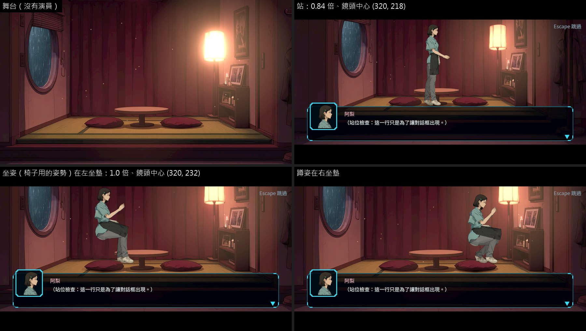
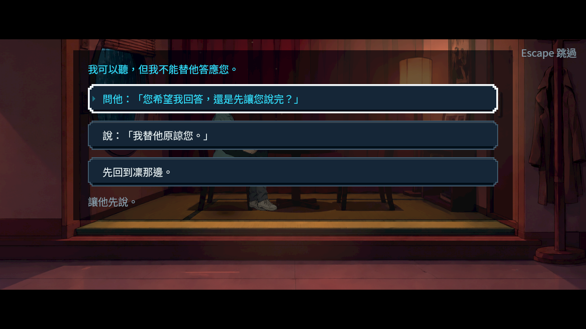
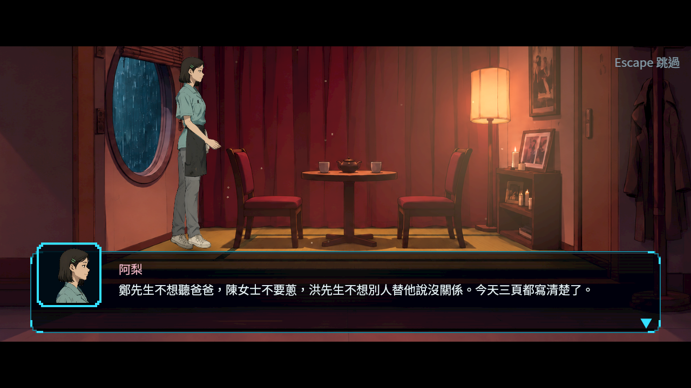

# [BG-46] 建立客人簿間章的過場舞台

> 狀態：審查中

## 內文

### 需求
第二章的間章「客人簿」（阿梨視角）背景圖與物件都畫好了，卻沒有過場舞台，劇本那幾段也沒有指定舞台，播放時沒有屬於這個房間的畫面。

### 來源
2026-10-12，場景素材 Session 盤點第二、三章場景缺口（使用者要求：先用場景包預覽盤點缺背景與缺物件的場景，一項需求開一張 BG 票，依票補齊）。盤點方法與完整清單見[第二、三章場景缺口盤點](../../design/20-campaign-experience/CH2_CH3_SCENE_GAPS.md)。

### 驗收條件
- [x] 有客人簿房間的過場舞台：背景對齊地面線、登記立繪裡的家具（位置、頂面、種類）、柔光與塵粒依需要
- [x] 阿梨在舞台上的站位與坐位有支撐，頭不被上黑邊切掉、腳不被對話框蓋住，過場檢查 0 問題
- [x] 舞台 id 與可用的站位寫在票上交給故事組接進劇本；接進去之前不算完成
- [x] 原生 Forward+ 的舞台畫面附在票上

### 測試流程
1. 用過場截圖工具播放接上舞台的那幾段
2. 對照比例表檢查家具與演員

---

# 跟其他票的關係

- Blocks：無
- Blocked by：無
- Related：ST-10、BG-11

---

# Commit-1

## 內文

**問題**：第二章間章「客人簿」的背景圖與物件早就畫好，卻沒有過場舞台，劇本那幾段也沒有指定舞台。

**改動**：
- 建了舞台 `ch2_guest_book_room`：用畫好的客人簿房間當背景，立燈有緩慢起伏的暖光，空氣裡有少量塵粒。地面線在 y＝278（舞台座標，畫面 640×360）。
- 登記了立繪裡的三件家具：中間的矮桌（頂面 y＝236）、左右各一個坐墊（座面 y＝262，中心 x＝226 與 x＝398）。比例表新增「矮桌」與「坐墊」兩種家具，尺寸來源（矮桌高 30～40 公分、坐墊約 55×59 公分）記在[舞台參考尺寸](../../design/10-presentation/STAGING_REFERENCE.md)。
- 新增一支站位檢查工具：舞台還沒接進劇本時，也能在舞台上放一個演員，用正式的過場播放器（含上下黑邊與對話框）拍原生畫面。

**給故事組的接法**：
- 家具是照 3.8～4.0 倍的演員畫的。演員用 3.9 倍時，站著的鏡頭要拉遠到 0.84 倍、鏡頭中心 (320, 218)，頭才不會被上黑邊切掉、腳也在對話框之上；坐在墊上用 1.0 倍、鏡頭中心 (320, 232)，坐墊才不會被對話框蓋住。
- 站位：腳底 y＝278；矮桌在 x＝250～370，演員畫在家具前面，站在這一段會擋住桌子，建議站在桌子兩側。
- 坐位：左坐墊 (226, 262)、右坐墊 (398, 262)。

**還沒完成**：
- 目前沒有「跪坐或盤腿坐在地上」的姿勢。現有的坐姿是坐椅子用的，放在 16 像素高的坐墊上腿會懸空（見截圖左下）；蹲姿（右下）比較接近但不是坐。需要角色組補一個坐在地上的姿勢，這場戲才能照劇本坐著演。
- 間章還沒有任何一段指定這個舞台，所以「演員的站位與坐位有支撐、過場檢查 0 問題」與「交給故事組接進劇本」兩條還不能勾；接上以後用同一支工具重拍。

**驗收**：舞台檔通過舞台與比例的自動檢查（家具種類、頂面高度、座面在比例表的範圍內）；原生 Forward+ 拍了舞台本身，以及阿梨站著、坐姿、蹲姿各一張。站著那一張頭頂在上黑邊之下、腳在對話框之上。

### 測試結果

| 項目 | 結果 |
|---|---|
| 舞台與比例的自動檢查（場景合理性、過場） | 通過 |
| 原生舞台畫面（Forward+、Arc B580） | 4 張，記錄檔沒有錯誤 |
| 受影響範圍的測試 | 56586 項檢查；新失敗 3、已知失敗 0。三項都是平行跑（14 個程序）時的計時檢查，和這張票無關：「滴水前進」「停電時燈具熄滅」單獨重跑環境測試 6953 項全過；音效「壓低後平順恢復」在乾淨的 main 單獨跑也會失敗 |

### 截圖

分支 `feature/scene-assets`；提交見[遠端 main 上本票的提交](https://github.com/deadline314/Nest-Egg/commits/main/pm/Nest-Egg-BG/%5BBG-46%5D%E5%BB%BA%E7%AB%8B%E5%AE%A2%E4%BA%BA%E7%B0%BF%E9%96%93%E7%AB%A0%E7%9A%84%E9%81%8E%E5%A0%B4%E8%88%9E%E5%8F%B0.md)。

---

# Commit-2

## 內文

**問題**：舞台還沒接入劇本，地墊也無法支撐椅子的坐姿。

**改動**：房間換成有成人椅與茶桌的構圖，18段正式客人簿演出接上舞台；坐談、開簿、收簿都有合適站位，問題節點可返回後再繼續。

**驗收**：原生客人入口的重選、返回、接續與不重複付款全過；站坐四張最後校準圖過場構圖0問題。圖片是NE-218坐姿、NE-267頭像與本票的合併候選，分票交付；完整來源與分票整合核對有紀錄，沒有當成從序章人工通關。

舞台`ch2_guest_book_room`；站x150、坐x232，腳底y265.5、scale3.9；鏡頭(320,206.3)、zoom0.84；坐深0.50。家具與原圖尺寸見[舞台及全部證據](attachments/BG-46-guest-book-connected/README.md)。

[本票提交](https://github.com/deadline314/Nest-Egg/commits/main/pm/Nest-Egg-BG/%5BBG-46%5D%E5%BB%BA%E7%AB%8B%E5%AE%A2%E4%BA%BA%E7%B0%BF%E9%96%93%E7%AB%A0%E7%9A%84%E9%81%8E%E5%A0%B4%E8%88%9E%E5%8F%B0.md)。
