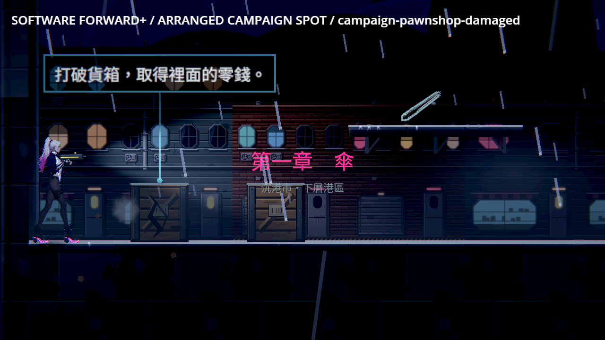
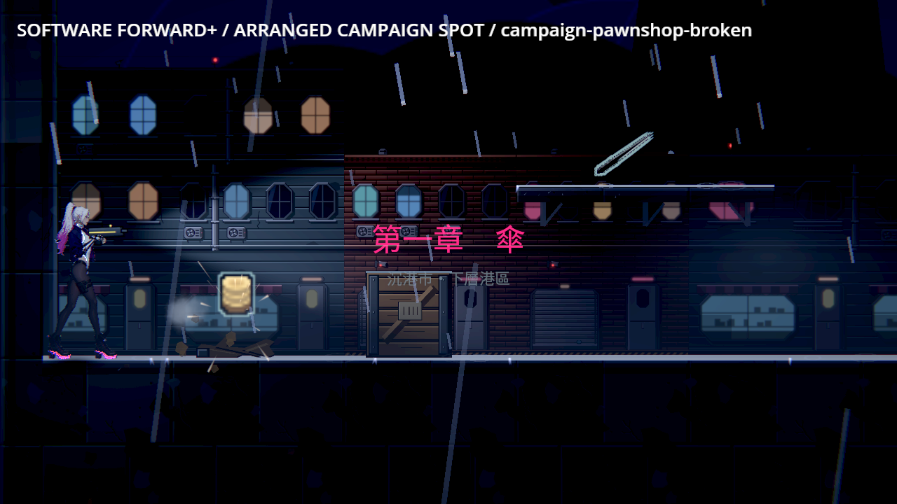
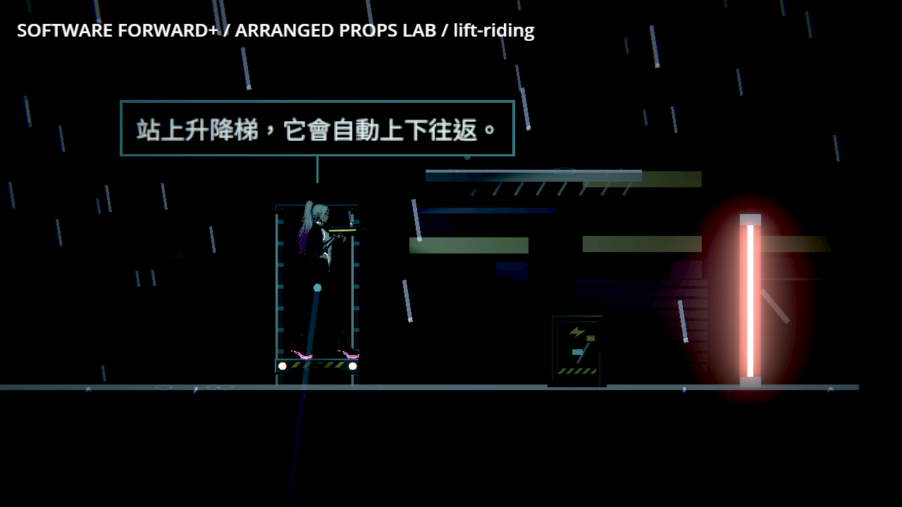
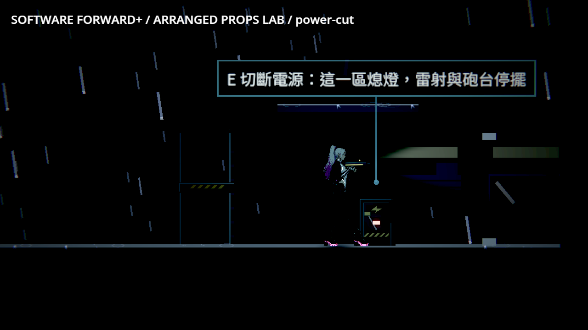

# [BG-47] 替程式暫代的可擊碎物與升降平台換上正式外觀

> 狀態：進行中

## 內文

### 需求
BG-21 換掉了門、梯子、提示牌、開關箱、可擊碎牆與閘門，但木箱、油桶、玻璃三種可擊碎物、升降平台與停電謎題的電源開關仍是程式畫的色塊與簡單造型，放進關卡就看得出是占位。章節稽核在第一章當舖已找到 2 個這樣的木箱；第二、三章與場地投擲（油桶會爆炸）落地後還會更多。

替這五種物件做符合現有賽璐璐／像素風格的正式外觀：完整、受損與碎裂各有狀態，大小與碰撞、安裝面和用途一致，貼圖讀不到時照舊退回簡單畫法並記錄路徑。

### 來源
2026-10-12，NE-233 的章節逐區稽核（程式暫代物件清單）；缺口原本記在[關卡固定物件的素材清單](../../design/20-campaign-experience/FIXTURE_ASSETS.md)「這一批沒有涵蓋的缺口」。

### 驗收條件
- [x] 木箱、油桶、玻璃、升降平台、電源開關各有正式貼圖，色盤、線條與 BG-21 的固定物件一致。
- [x] 可擊碎物有完整、受損、碎裂的狀態；油桶的引信與爆炸前預兆看得出來，和 NE-254 的投擲規則一致。
- [x] 升降平台看得出軌道與承載面，電源開關有安裝面與狀態燈；畫面尺寸和碰撞、可站的範圍一致。
- [ ] 章節稽核（`tools/chapter_audit.tscn`）的程式暫代物件清單在序章至第三章歸零。
- [ ] 本機 Forward+ 實際畫面看過光影、支撐與前後遮擋；貼圖缺檔時遊戲不崩潰並記錄路徑。

### 測試流程
1. 跑章節稽核，確認程式暫代物件清單歸零。
2. 在第一章當舖與有這些物件的區域打破木箱、玻璃，射油桶，搭升降平台，切電源開關，截圖前後狀態。

---

# 跟其他票的關係

- Blocks：NE-233、NE-234、NE-235
- Blocked by：無
- Related：BG-21、NE-254

---

# Commit-1

## 內文

木箱、油桶與玻璃現在各有完整、受損與碎裂外觀；升降台有固定導軌與承載面，電源面板能辨識供電和斷電。碎裂不增加碰撞、掉落或傷害，讀檔不重播。油桶沿用原引信與爆炸規則，減閃光保留警示。

[五款同類型遊戲圖片參考](../../design/08-lighting/READABILITY_REFERENCES.md)；[狀態設計與驗證](../../design/20-campaign-experience/FIXTURE_STATES.md)；[完整證據、歷史失敗與 SHA](attachments/BG-47-fixture-states/README.md)。

### 測試結果

| 項目 | 結果 |
|---|---|
| 受影響範圍 | 51 群、55,603 checks，0 新／已知失敗；原選擇器與門檻 |
| 真道具狀態 | 軟體 Forward+，29 項 0 失敗、17 圖、exit 0；修前六項缺圖失敗 |
| 素材／缺圖回退 | 素材檢查通過；缺圖記錄並維持原碰撞及互動 |
| 章節占位 | 第一至三章 30 區歸零；序章沒有獨立稽核列 |
| 原生執行 log | 最終 v2 前後無 ERROR；早期退出錯誤完整保留，未宣稱引擎根因修復 |

### 截圖

排列鏡頭經真投射物碰撞驅動；不是人工通關或實體 GPU 驗收。

