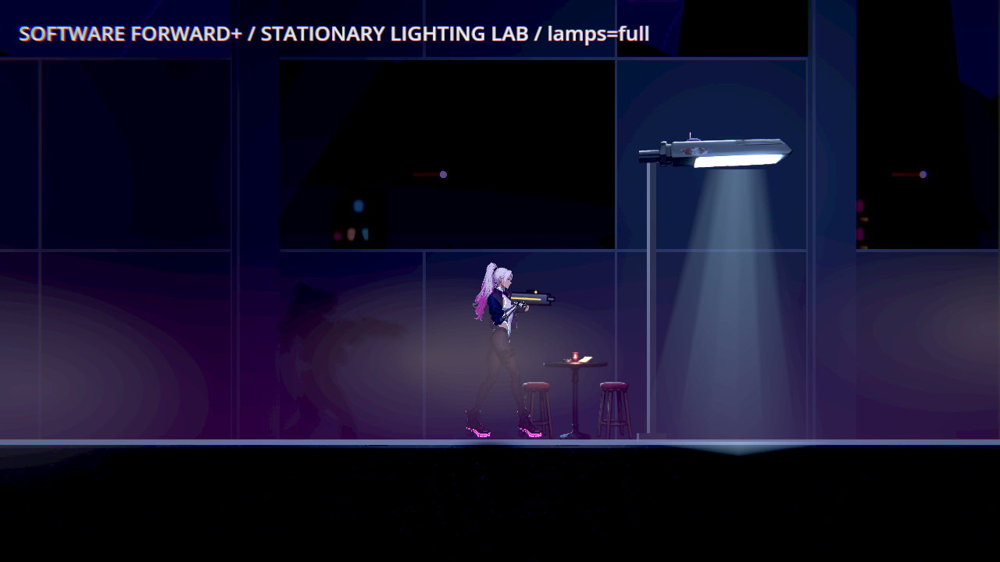
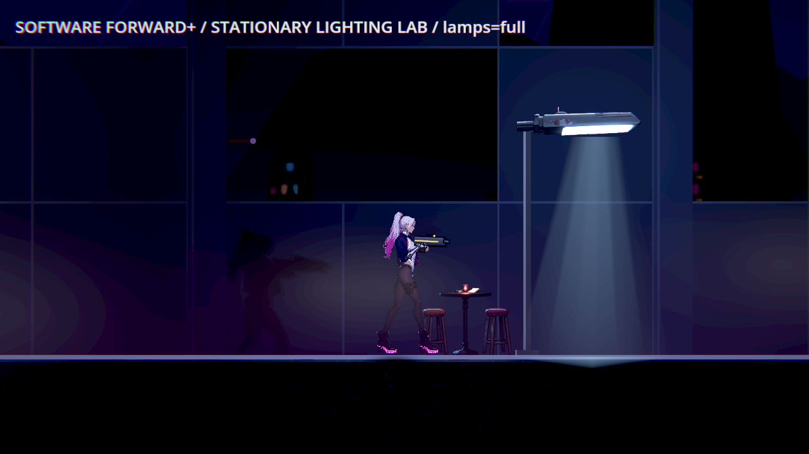
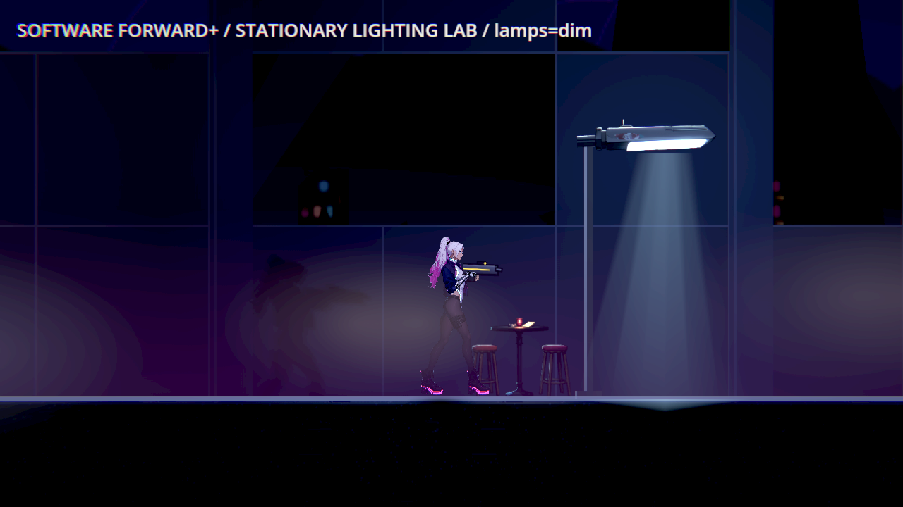
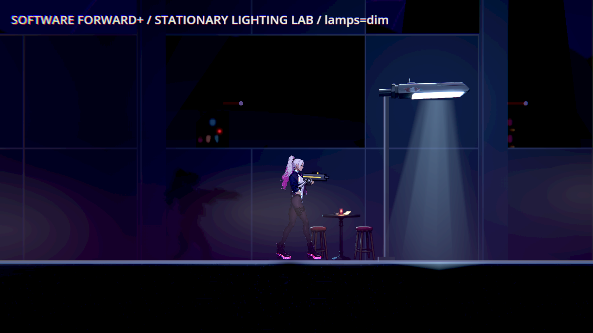
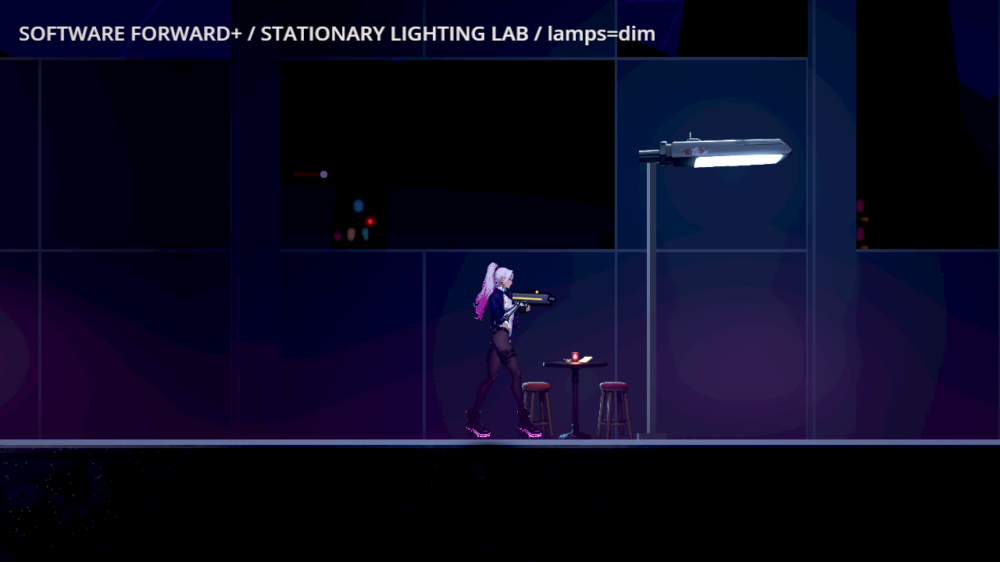

# [BG-48] 修正第二章復原館外路燈下主角對比不足

> 狀態：進行中

## 內文

### 需求
第二章「復原館外」路燈下、圓桌旁那一段，光影品質「高」時主角和背景的對比低於門檻：量到 0.54～0.58（門檻 0.6），光影品質「低」是 0.84。畫面上主角還看得到，但這一段是全章對比最低的地方，背後被路燈照亮的霧和她自己投在牆上的影子把輪廓吃掉了一部分。要讓這一段在兩種品質下都回到門檻以上，而且不靠把整區調亮。

補充（2026-10-12，做 BG-42 時重量）：同一格只量它自己、連量三次是 0.90、0.94、0.93；整輪巡覽輪到這一格時才量到 0.48～0.59。這盞路燈會閃，量到暗的那一段數字就低。所以要查的可能是「燈在暗的那一段時主角對比掉到門檻以下」，量測時要把燈的亮暗兩段都量到，不能只量一次。

### 來源
2026-10-12，場景素材 Session 做 BG-40 時量到；修前就存在，不是 BG-40 造成的（BG-40 Commit-1 的量測表）。同一套光影設定的第一章交接櫃區在同樣的路燈下是 0.72。

### 驗收條件
- [ ] 第二章復原館外每一格，光影品質「低」與「高」主角對比都 ≥ 0.6、地面邊緣 ≥ 1.0（場景巡覽帶主角量測）
- [ ] 找出是哪一項造成的（路燈下的霧、牆上的影子、補光），修前修後各量一次並附同一格的原生畫面
- [ ] 同一套光影設定的其他區域（第一章交接櫃區、第二章市集入口與公眾攤道）重量一次，沒有比修前差
- [x] 沒有用調高整區環境光或關掉影子的方式過關

### 測試流程
1. 場景巡覽帶主角量第二章復原館外，品質低、高各一次
2. 走到路燈下的圓桌旁，確認主角輪廓清楚

---

# 跟其他票的關係

- Blocks：無
- Blocked by：無
- Related：BG-40、BG-33、BG-34、BG-42、BG-49

---

# Commit-1

## 內文

原巡覽圓桌旁在路燈亮、暗段都重現輪廓不足；只量委託終端會漏掉。現在只降低復原館外的霧量，保留路燈、陰影與環境光；附近物件與支撐不變，新區段保留原環境音和配樂。

[五款同類遊戲圖片](../../design/08-lighting/READABILITY_REFERENCES.md)；[設計與比較](../../design/08-lighting/READABILITY_REPAIR.md)；[原圖、每點數值、歷史失敗與測試](attachments/BG-48-lounge-readability/README.md)。

### 測試結果

以下為軟體 Forward+ 同機候選，不取代 User-guide 的硬體原生條件。圓桌旁主角對比 full 0.499→0.832、dim 0.514→0.808；移除霧的診斷為 1.572，正式畫面保留霧與牆影。

| 全區巡覽 | 主角最低 | 地面最低／循環最低 |
|---|---|---|
| tour-high-full | 0.796 | 21.993 |
| tour-high-dim | 0.927 | 21.891 |
| tour-low | 1.103 | 21.975 |
| cycle-high | 0.802 | 21.893；循環最低 0.856／16.974 |
| cycle-low | 0.992 | 20.760；循環最低 0.930／19.751 |

每輪九格中六格有可站位置、三格無地面。相鄰區域原有未通過記錄：ch2_market_gate／地面戰區（high），主角 0.590→0.590，前／後通過 False／False。此區資料未改，逐點保留，不宣稱其他區域全部通過，也不把動態差異當成已修復。 相鄰共用設定區域的前後數值保存逐點比較；受影響測試 64401 checks 零新／已知失敗，原門檻與過濾器不變。正式候選巡覽與循環的原 log ERROR 數：{'bg48-after-tour-high-full': 0, 'bg48-after-tour-high-dim': 0, 'bg48-after-tour-low': 0, 'bg48-after-cycle-high': 0, 'bg48-after-cycle-low': 0}。

### 截圖

| 原位置修前 | 同位置修後 |
|---|---|
|  |  |
|  |  |

