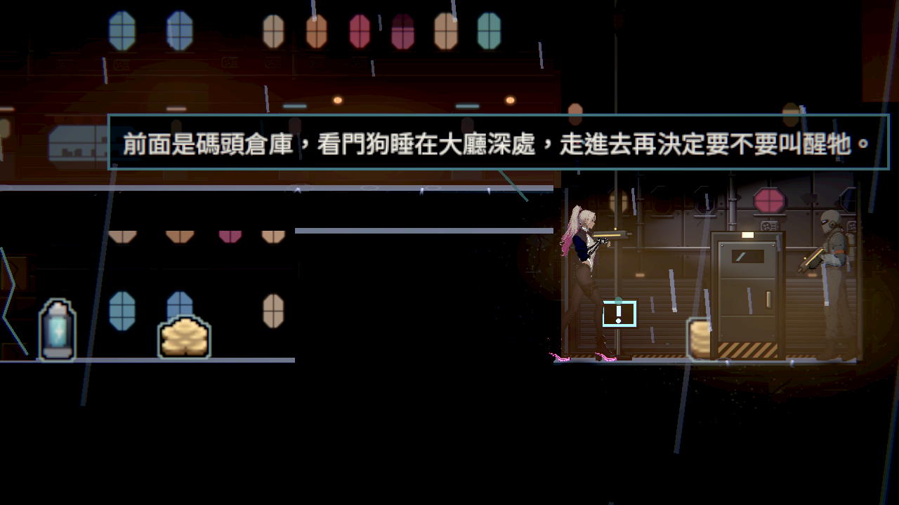
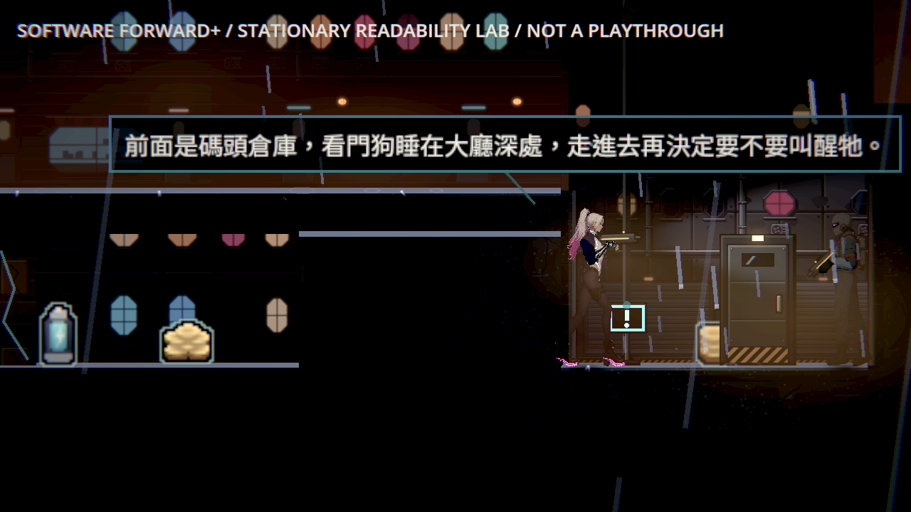
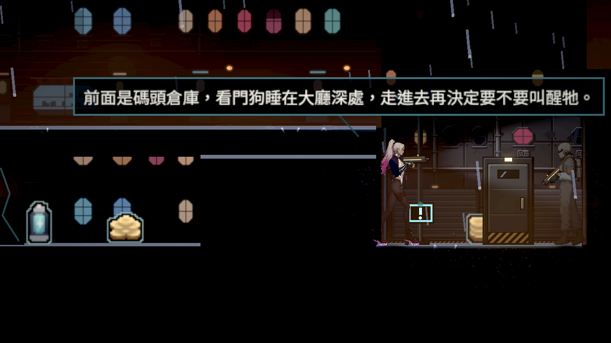
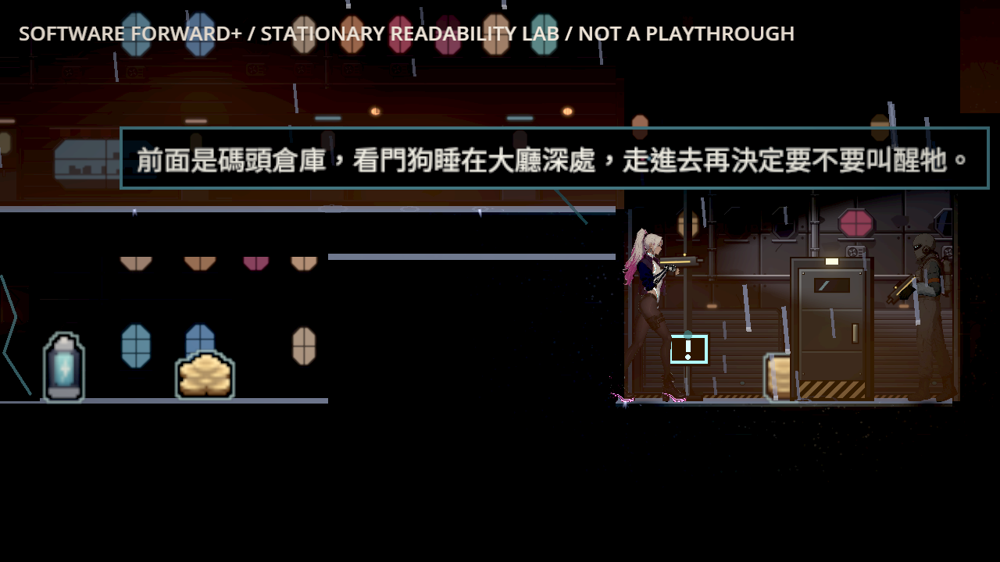

# [BG-49] 提高第一章碼頭入口的敵人對比

> 狀態：進行中

## 內文

### 需求
第一章街道末段「碼頭入口」這個取樣點，敵人輪廓和背景的對比只有 0.43～0.44，低於門檻 0.45；光影品質「高」與「低」都一樣。主角（0.80）與地面邊緣（9.1）在同一點沒有問題。敵人站在這裡比其他地方難從背景分出來，而這裡正是進倉庫前最後一段有敵人的路。

### 來源
2026-10-12，場景素材 Session 重量第一章暗場可讀性時量到（原生 Forward+、Arc B580）。和當天的鏡頭修改（NE-256）無關：沒有那份修改的 main（`feb9645d`）同一點是 0.44。第一章其餘 17 個取樣點都通過。

### 驗收條件
- [ ] 第一章可讀性量測，光影品質「高」「低」各一次：「碼頭入口」敵人對比 ≥ 0.45，主角 ≥ 0.6、地面邊緣 ≥ 1.0
- [ ] 其餘 17 個取樣點都還通過，主角與敵人對比不比修前低 0.05 以上
- [ ] 那一帶的光池量測（燈下牆面比光池外亮幾倍）不低於修前
- [ ] 修前修後同位置的原生截圖並排附在票上；敵人身上不過曝（全白像素比例 ≤ 2%）

### 測試流程
1. 原生執行第一章可讀性量測，光影品質高、低各一次，記下「碼頭入口」的三個數字
2. 走到街道末段的碼頭入口，看收帳員站在那裡時輪廓清不清楚

---

# 跟其他票的關係

- Blocks：無
- Blocked by：無
- Related：BG-48、BG-20、NE-256

---

# Commit-1

## 內文

碼頭入口的敵人補光與背牆太接近；現在以本段獨立的明暗分層讓敵人輪廓更清楚，原路燈、霧、陰影與霓虹保留。環境音層、音量及平靜／安全／戰鬥／頭目配樂沿用原區域。

[五款相近遊戲圖片](../../design/08-lighting/READABILITY_REFERENCES.md)；[設計與逐點證據](../../design/08-lighting/HARBOR_READABILITY.md)；[完整 raw、曝光及光池結果](attachments/BG-49-harbor-readability/README.md)。

### 測試結果

軟體 Forward+、HDR、亮度 0.5 的同機對照；未替代本機原生驗收。

| 品質 | 敵人、主角、地面（修前→後） |
|---|---|
| high | 0.446 → 0.481 ／ 0.830 → 0.820 ／ 9.294 → 9.679 |
| low | 0.442 → 0.476 ／ 0.788 → 1.145 ／ 9.670 → 9.160 |

其餘 17 點兩品質均通過，主角與敵人未下降超過 0.05。碼頭完整外觀矩形有全白像素，尚不能用含背景的分母判定敵人比例；曝光條件維持未勾。
原光池數值有下降（中位 7.697→7.542），該條維持未勾，完整個別燈數字保留。受影響測試 63 群、64392 checks，零新／已知失敗；音訊負控制確實失敗，正式對應還原後通過。high exit 0，ERROR 1；low exit 0，ERROR 0。引擎錯誤完整保留，不當成乾淨原生驗收。 最終執行 log 與歷史錯誤分開索引，不宣稱全部 raw 無 ERROR。

### 截圖

排列的靜止取樣敵人，沒有人工通關。

| 修前 | 修後 |
|---|---|
|  |  |
|  |  |
