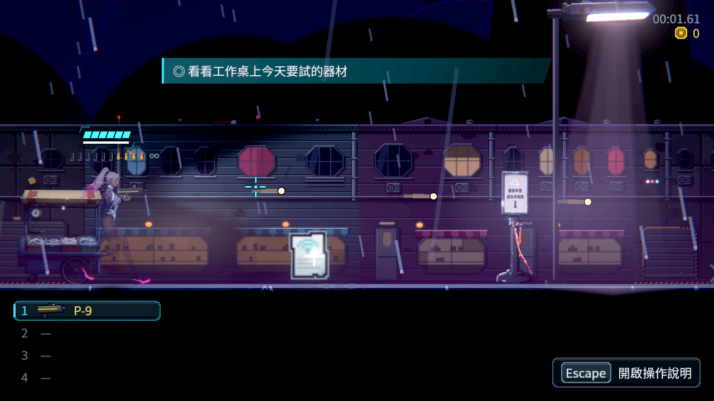
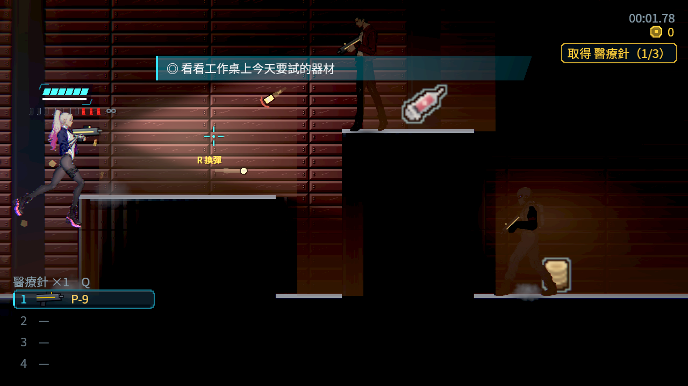

# [BG-50] 修正進區後預載貼圖造成的戰鬥停頓

> 狀態：進行中（修正已完成並量過；剩「檔案沒被快取時」的原生量測與使用者實際玩過確認）

## 內文

### 需求
使用者回報現在的版本玩起來會卡：從編輯器全螢幕（2560×1440、200 Hz）執行，第一章街道與倉庫戰鬥時偶爾突然停一下，當時機器上多半還有別的工作階段在跑。要找出停頓的來源並修掉，而且留下可以重跑的量測方法，之後再有人說卡可以直接量。

### 來源
2026-10-12，使用者在場景素材 Session 回報「現在版本的遊戲好 Lag」，並回答：偶爾突然停一下、編輯器執行放大或全螢幕、當時應該有其他工作在跑、主要在第一章街道與倉庫。

### 驗收條件
- [x] 有一支可重跑的量測工具：在正式關卡實際跑、跳、開槍，回報每一格間隔的中位數、第 95／99 百分位、超過 16.7 與 33.3 毫秒的格數、最長的幾格在哪裡
- [x] 找出停頓的來源並有對照量測（開與關、修前與修後）
- [x] 第一章街道與倉庫，2560×1440 全螢幕實際跑打 14 秒：超過 33.3 毫秒的停頓 0 次，預載單張最久不超過 10 毫秒
- [x] 原本的預載規則不變：每一格最多載一張、換區會取消還沒載的、快取有上限；有自動檢查
- [ ] 檔案沒被系統快取時（重開機或剛更新版本後第一次進第一章街道）原生再量一次，超過 33.3 毫秒的停頓不多於 1 次
- [ ] 使用者在機器上沒有其他重工作時，實際玩第一章街道與倉庫，確認不再突然停一下

### 測試流程
1. 原生執行 `tools/frame_time_probe.tscn`（加 `--fullscreen`），關卡選第一章街道與倉庫，看停頓次數與預載單張最久
2. 重開機後不要先開別的東西，直接從編輯器全螢幕執行，新遊戲玩到第一章街道，邊跑邊打約一分鐘
3. 同一段在別的工作階段跑測試時再玩一次，對照感受

---

# 跟其他票的關係

- Blocks：無
- Blocked by：無
- Related：BG-31、BG-32、BG-23

---

# Commit-1

## 內文

**問題**：為了縮短換區的讀取時間，進關卡後會預先載入隔壁區域的貼圖（第一章街道約 255 張）。在這個引擎版本的原生畫面上，這件事是主線每一格同步載一張；檔案不在系統的檔案快取裡、或機器上有別的工作在搶磁碟時，主線就停在那裡等磁碟，畫面跟著停。量到單張最久 65 毫秒，14 秒內有 10 次超過 33 毫秒的停頓；把預載關掉就完全沒有。

**改動**：
- 讀檔搬到背景：貼圖排進佇列後先由背景執行緒把檔案讀進系統快取，主線只載已經讀過的那幾張，每一格仍然最多一張。背景沒回應時 3 秒後照舊由主線載，不會卡住。
- 上一格已經比平常慢很多時，這一格先不載。
- 新增量測工具：機器人在正式關卡實際跑、跳、開槍，記錄每一格的間隔；可以關掉某一類東西（預載、光源、陰影、敵人、天氣…）再量，找出是誰的成本。用法補進畫面驗證的技能。
- 做法、量測與做不到的地方寫在[跨區預載的設計文件](../../design/20-campaign-experience/PREFETCH_LIFETIME.md)的「主線載入不等磁碟」。

**驗收**（2560×1440 全螢幕、Arc B580、每關實際跑打 14 秒）：

| 第一章街道 | 超過 16.7 毫秒的格 | 超過 33.3 毫秒的停頓 | 最長一格 | 預載單張最久 |
|---|---|---|---|---|
| 修前，檔案沒被快取、機器忙 | 56 | 10 | 79.6 ms | 65 ms |
| 修前，關掉預載（對照） | 1 | 0 | 22.3 ms | — |
| 修前，檔案已在快取 | 2 | 0 | 30.4 ms | 4.0 ms |
| 修後（兩輪） | 1、2 | 0、0 | 20.8、21.8 ms | 3.3、3.8 ms |

倉庫修後兩輪：超過 33.3 毫秒 0 次，預載單張最久 7.8 毫秒。第二章市集一起量：0 次、7.8 毫秒。

- 修後這兩輪檔案已經在系統快取裡（今天量了很多次），所以它證明的是「新做法沒有變慢、規則沒壞」；「檔案沒被快取時不再停頓」靠的是自動檢查（主線只在背景讀完之後才載）加上修前的對照，原生的冷量測要重開機後才量得到，留在未勾的那一條。
- 同一份量測也比了今天之前的版本（`b54c8614`）與現在的 main：1280×720 視窗下兩邊各量兩輪，八個關卡中位數都在 2.6～5.8 毫秒、幾乎沒有超過 16.7 毫秒的格，沒有量到穩定的退步（機器上同時有別的專案在跑，單次差異在雜訊內）。
- 另外量到但這次沒有處理：主角與鏡頭每秒更新 60 次，在 200 Hz 的螢幕上每一步會被顯示 3 格或 4 格，移動看起來不夠順。這不是停頓，要動到角色與戰鬥的更新方式，寫在設計文件裡另外評估。
- 處理器被別的工作佔滿時（例如同時跑 14 個程序的測試），遊戲本身也會變慢，這不是這張票能解的；量測與試玩時請避開。

### 測試結果

| 項目 | 結果 |
|---|---|
| 第一章地圖與預載的自動檢查（新增 7 項：讀的是引擎實際載入的匯入檔、背景讀完主線才載、每格最多一張、逾時照舊由主線載、換範圍不載取消的） | 1882 項全過 |
| 原生量測（街道、倉庫、市集，修後兩輪） | 超過 33.3 毫秒的停頓 0 次 |
| 受影響範圍的測試 | 53885 項檢查；新失敗 3、已知失敗 0。三項都是平行跑（14 個程序）時的計時檢查，和這張票無關：「彈帶平滑移動」單獨重跑兩次都過、「滴水前進」單獨跑環境測試全過、音效「壓低後平順恢復」在乾淨的 main 單獨跑也會失敗 |

原始數字在 [attachments/BG-50-frame-time](attachments/BG-50-frame-time/)。分支 `feature/scene-assets`；提交見[遠端 main 上本票的提交](https://github.com/deadline314/Nest-Egg/commits/main/pm/Nest-Egg-BG/%5BBG-50%5D%E4%BF%AE%E6%AD%A3%E9%80%B2%E5%8D%80%E5%BE%8C%E9%A0%90%E8%BC%89%E8%B2%BC%E5%9C%96%E9%80%A0%E6%88%90%E7%9A%84%E6%88%B0%E9%AC%A5%E5%81%9C%E9%A0%93.md)。

# Commit-2

## 內文

貼圖已由背景讀完，若本格因時間預算延後，原本可能丟掉完成紀錄、無故等滿三秒。現在延後會保留已完成狀態，下格可以接著載；原每格一張、時間預算、備援及快取上限保持。

先讀User-guide與原量測研究，採真讀檔／真競爭負控制。兩輪不同失敗與首次退出留存都保留，不補造缺少的根因狀態。[設計與參照](../../design/20-campaign-experience/PREFETCH_BUDGET_READINESS.md)、[全部成功／失敗與原圖](attachments/BG-50-budget-readiness/README.md)。

### 測試結果

| 項目 | 結果 |
|---|---|
| 真讀檔／真鎖競爭，原2ms預算 | 修前5／2失敗，修後5／0 |
| 原三組前置流程＋5項 | 修前2368／2，修後2368／0；原斷言／輸入／等待保持 |
| 前兩輪原50組 | 55,025／1爆炸效能、55,025／2通訊守門；原暖檔檢查均通過 |
| 整合後原50組，基準ad8c1cfe | checks: 55034, new failures: 0, known failures (tests/known_failures.txt): 0  (wall time 1090 s) |
| 正式街道／倉庫原生 | 最後0引擎ERROR／0退出洩漏診斷，最新四圖逐張檢視；首次退出留存未定位，原log保留 |

軟體GPU整體幀時間不達硬體門檻，原冷啟與親手實玩條件維持。

### 本作原生圖

