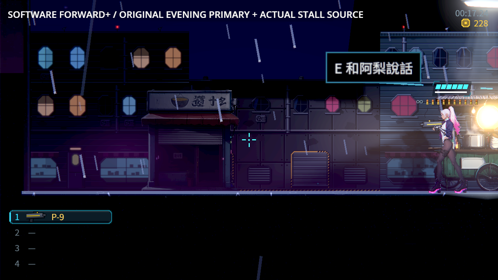

# [BG-51] 修正無頭貼圖併發配置洩漏

> 狀態：完成

## 內文

### 需求
背景載入貼圖及退出時不遺留渲染資源，不因為功能檢查與退出碼正常就漏掉引擎錯誤。保持既有背景載入、原生畫面與音訊功能。

### 來源
2026-10-26，使用者要求實際完成所有票、提高穩定性且不破壞既有功能。NE-228 原麵攤冷讀嚴格檢查發現一個渲染資源洩漏；獨立無遊戲對照在四個背景工作下可重現相同類型問題，單工作對照沒有錯誤。

[設計與原始重現範圍](../../design/20-campaign-experience/DUMMY_TEXTURE_CONCURRENCY.md)。

### 驗收條件
- [x] 獨立最小專案單工作與四工作各建立及釋放 8,192 個貼圖，沒有引擎錯誤、重複／無效識別碼或退出洩漏。
- [x] 原麵攤冷讀的正常功能與嚴格錯誤檢查都通過，原主檔及失敗輸出保留。
- [x] 固定版本建置與快取能拒絕損毀或不相符的修補、來源及二進位，不覆寫無關來源。
- [x] 全部測試及實際音訊混音通過，原生 Forward+ 仍可執行；不以關閉背景載入、音訊或忽略錯誤通過。

### 測試流程
1. 使用相同最小專案，單工作與四工作分別執行，核對原始診斷。
2. 重跑原始冷讀及完整測試，保留退出診斷；驗證實際混音與 Forward+。
3. 更改快取或修補的測試副本，確認建置拒絕，原檔不被覆寫。

---

# 跟其他票的關係

- Blocks：無
- Blocked by：無
- Related：BG-31、BG-50、NE-280、NE-228、ST-9

---

# Commit-1

## 內文

原冷讀功能已通過，卻在退出時遺留一個渲染資源，因此嚴格檢查拒絕交付。現在背景工作建立貼圖時正確同步，不再互相損壞配置；保留原載入、音訊、原生渲染與輔助功能。固定來源、修補與快取都要核對完整身分，指定建置環境也不會被換成另一個直譯器。引擎變更會確實觸發完整測試，原錯誤輸出不被忽略。

### 測試結果

| 項目 | 結果 |
|---|---|
| 無遊戲的相同原探針 | 四工作 8,192 次配置，362 個錯誤／100 個退出資源 → 0／0；單工作對照保持通過 |
| 同份公開貼圖探針 | 修前嚴格失敗；修後兩程序 32,810／0，逐張實際像素與釋放驗證 |
| 完整遊戲測試 | 88 組 98,066／0，757 秒，0 新／0 已知失敗 |
| 原保存／冷讀 | 麵攤 47 程序 1,253／0，週日 8 程序 133／0，原故障程序主檔另三程序 21／0 |
| 快取／建置與測試觸發 | 12／0 與 12／0，原斷言保留；完整日誌檢查另4／0 |
| 實際混音與原生渲染 | 音訊八程序全過；軟體 Forward+ 原 Main 冷讀 7／0，無錯誤或退出洩漏 |

[修前／後來源、原始故障、主檔、全部日誌、固定引擎與實際畫面](attachments/BG-51-dummy-textures/README.md)。原單一診斷沒有資源身分，不能因此宣稱已唯一定位較早週日那個物件；其故障與未再現對照原樣保留。
