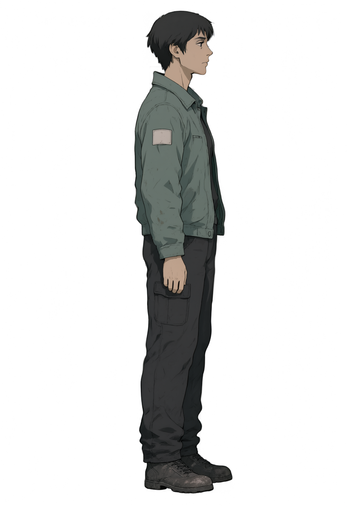

# [BG-52] 支援9070XT本機素材生成

> 狀態：完成

## 內文

### 需求
顯示卡換成 Radeon RX 9070 XT 後，現有 NVIDIA 生成環境無法直接使用。讓本機素材生成流程可使用新顯示卡，保留既有模型、來源與定稿，並能清楚指出環境不相容的原因。

### 來源
使用者 2026-11-11 要求持續交付所有票，可使用本機 GPU 生成角色與場景，並提醒顯示卡已換成 9070 XT。設計見 `design/03-art-pipeline/RADEON_RUNTIME.md`。

### 驗收條件
- [x] 本機實際辨識 9070 XT 並以該裝置完成張量運算，保留版本與執行紀錄
- [x] 既有角色工作流實際完成一張原生透明圖片，保留工作紀錄、來源與 alpha 檢查
- [x] 啟動、停止與重試沿用同一環境；不相容時指出原因，不靜默改用 CPU
- [x] 舊環境與已批准素材保留，生成與遊戲驗證不爭用 GPU

### 測試流程
1. 啟動本機生成服務，確認顯卡與加速後端。
2. 以既有角色工作流生成一張透明圖片，核對實際輸出與透明邊緣。
3. 停止並重新啟動，確認仍使用相同環境，且 Godot 可在釋放後正常使用顯卡。

---

# 跟其他票的關係

- Blocks：無
- Blocked by：無
- Related：BG-9、NE-242、NE-267、NE-255

---

# Commit-1

## 內文

顯卡更換後，原本的 CUDA 環境無法作為 AMD 生成環境。現在可以明確選擇獨立 Radeon 環境，啟動前預覽實際裝置、後端與埠；啟停與重試保持同一選擇，不相容就回報原因，不靜默改用 CPU。舊環境、模型與批准素材保留。

9070 XT 上的實際張量計算得到預期結果。既有角色工作流也透過同版本加速套件的共享服務正常排隊，完成一張原生透明圖；獨立服務則另驗啟動、重用、重新啟動及停止。兩者分開保存，沒有冒稱獨立服務完成模型生成，也沒有接管其他工作持有的服務。本 repo 的生成與原生遊戲驗證依序取得 GPU 鎖。

首次服務雖可連線，仍有共用資料庫遷移錯誤；查明後修正為獨立資料庫，最終啟動與重新啟動均無該錯誤，原失敗完整保留。透明圖經黑、灰、白底檢查，仍有低透明度雜點且身份呈現不足，只作環境樣本，不當成角色定稿。

### 測試結果

| 項目 | 結果 |
|---|---|
| 實際 GPU 計算 | 9070 XT，0～15 平方和為 1240，無 CPU 回退 |
| 原生透明工作流 | 832×1216、25 步、seed 26711；原始 RGBA、工作圖與 alpha 分布保存 |
| 最終獨立服務生命週期 | 四命令 exit 0；停止後不可連線；三份服務 log 無 ERROR／Traceback／節點匯入失敗 |
| 後端與啟停回歸、既有快取及鎖 | 8＋7＋2 項，全過 |
| 原始證據與來源驗證 | 101 項、0 失敗 |
| 遊戲影響選擇 | 0 組；以上直接專項另外執行 |

[原始紀錄、環境版本、失敗對照及驗證界線](attachments/BG-52-rocm-runtime/README.md)。兩組角色流程技能的環境說明已同步。

### 截圖

