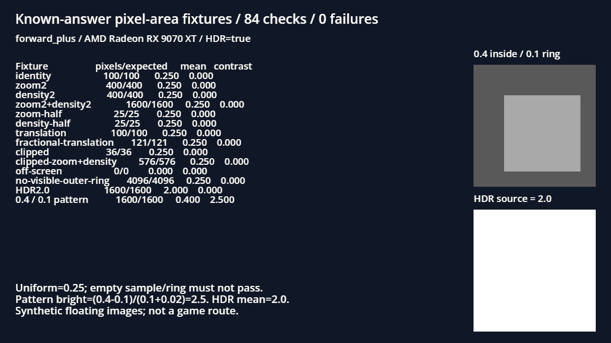

# [BG-53] 修正可讀性量測的像素面積

> 狀態：完成

## 內文

### 需求
可讀性量測在相機縮放或取樣被裁切時，亮度的分子與分母使用不同像素範圍，可能產生假對比。讓量測反映真正取到的像素，並重新驗證受影響場景，避免依錯誤數字結案。

### 來源
2026-11-11 本機 9070 XT 驗證 BG-48 時發現。固定灰階圖應為 0.25，舊工具在放大後算成 1.0；成因與契約見 `design/08-lighting/CONTRAST_PIXEL_AREA.md`。

### 驗收條件
- [x] 均勻影像的平均亮度在縮放、平移與裁切下保持正確，均勻區域不產生假對比
- [x] 已知明暗塊的內外亮度與對比符合獨立手算；完全在畫面外的取樣不會假通過
- [x] HDR 線性資料與既有驗收門檻保留，原生取樣與幾何檢查通過
- [x] 原始失敗與修後資料留存，受影響的光影票分別以修正工具重驗

### 測試流程
1. 在固定灰階與明暗圖形上改變相機縮放、視窗倍率及取樣位置。
2. 對照實際像素數與手算亮度、對比。
3. 用修正工具重跑復原館外與相關區域，保留前後紀錄。

---

# 跟其他票的關係

- Blocks：BG-40、BG-42、BG-48、BG-49、BG-55
- Blocked by：無
- Related：BG-52

---

# Commit-1

## 內文

固定灰階在放大後被算成1.0、均勻圖產生假對比。現在以真正可見的同一批像素計算亮度與面積；縮放、平移、裁切與完全離畫面有獨立手算答案，HDR2.0保留，原門檻不變。

原工具84項中38項失敗；凍結同一份測試後，修正結果84／0。最終本機Radeon Forward+固定圖84／0，受影響6組測試3893項、新失敗0、已知失敗0、exit0。測試保留既有退出診斷過濾，不宣稱所有原始log無ERROR。

[紅綠原始收據、獨立期望值與測試log](attachments/BG-53-pixel-area-tests/README.md)；[各受影響票的新量測、原圖及原byte ZIP](attachments/BG-53-corrected-lighting-2026-11-11/README.md)。復原館外主角與地面通過；第一章工具回報過門檻，但說明框污染外圈，不作BG-49場景驗收。帳房及市集入口敵人仍有低於門檻的真實結果，相關票按各自條件保持進行中。量測修正完成沒有取代那些場景的驗收。

### 截圖

