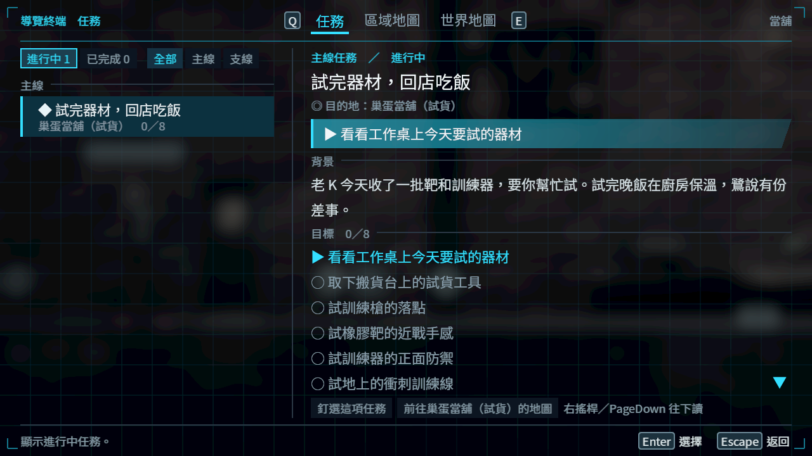
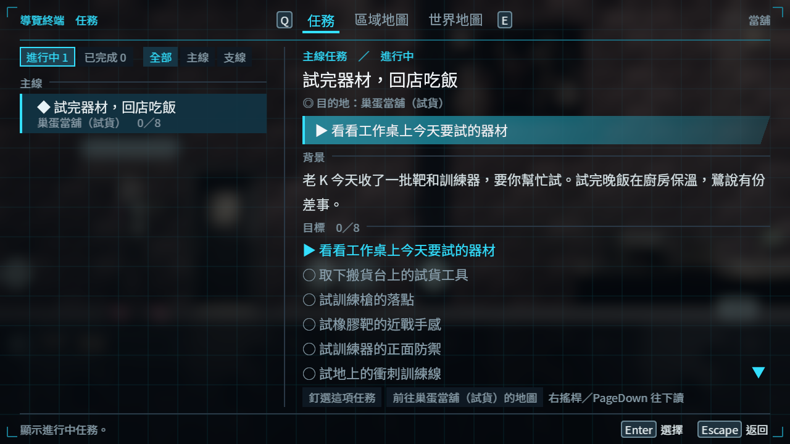
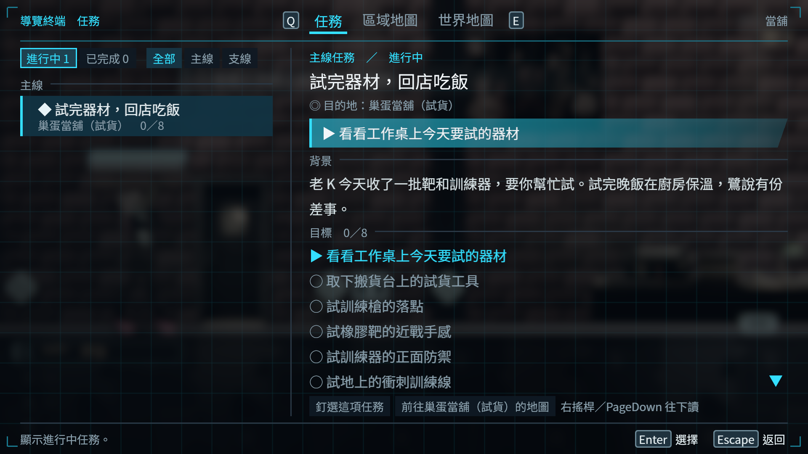

# [BG-54] 保留暗部截圖的色彩精度

> 狀態：完成

## 內文

### 需求
資訊頁與暗場的原生 PNG 出現色帶，可能讓正確的遊戲畫面被誤判成材質或背景損壞。讓截圖保留來源的暗部漸層、尺寸與透明度，不以調整遊戲亮度掩蓋擷取失真。

### 來源
2026-11-11，NE-223 本機畫面診斷：凍結後的直接來源與各縮圖正常，暗化截圖卻出現有機色帶。設計與單因素驗證要求見 `design/10-presentation/CAPTURE_PRECISION.md`。

### 驗收條件
- [x] 已知低亮度浮點漸層在 PNG 保留正確 sRGB 色階，並有舊流程失敗對照
- [x] HDR、非 HDR、尺寸與 alpha 回歸通過，沒有重複轉換或插值放大
- [x] 同一原生影格的浮點資料與獨立公式驗證一致，未改遊戲光影或材質來過關
- [x] 受影響的任務背景與可擊碎物原生畫面重新擷取、逐張檢視並保留前後證據

### 測試流程
1. 擷取暗色漸層、中間灰、HDR 亮部與透明圖形。
2. 以來源浮點數值手算 sRGB，核對輸出像素、色階、尺寸與 alpha。
3. 同場景重拍任務頁與正式關卡物件，確認擷取與來源一致。

---

# 跟其他票的關係

- Blocks：NE-223、BG-47
- Blocked by：無
- Related：BG-53、NE-255

---

# Commit-1

## 內文

原本正確的暗場在 PNG 出現大塊色帶，讓任務背景看似失真。現在保留暗部色階後再輸出，當舖的柔和背景與正式物件的明暗能正確呈現；透明度、尺寸與非 HDR 圖保持一致，沒有調整遊戲光影或材質。

已知暗色漸層的舊流程 12 項中失敗 4 項，同一測試來源修正後 12／0，暗部從 8 個提升為 49 個色階。真正可暫停的當舖於 720p、1080p 重拍世界、暫停與任務；每格以相同浮點來源保留前後 PNG。六張共 8,985,600 像素逐一對照獨立公式，最大誤差不超過一個位元組階。正式物件亦以新工具重新擷取，逐張檢視後保留全部來源。

### 測試結果

| 項目 | 結果 |
|---|---|
| 浮點暗色漸層負控制／修正後 | 12／4 → 12／0；透明度、尺寸、來源與非 HDR 資料保持 |
| 原生灰階、暗色、HDR／非 HDR 回歸 | 通過，exit 0，無 SCRIPT ERROR 或引擎 ERROR |
| 真正 1280×720／1920×1080 當舖 | 11／0、14／0；兩輪 exit 0，無 SCRIPT ERROR 或引擎 ERROR；玩家、鏡頭及時間實測凍結 |
| 獨立原始資料驗證 | 141 個成員／來源收據；六張全像素最大 sRGB 誤差 0.00392131，alpha 誤差 0 |
| 原選擇器受影響回歸 | 6 組、3,893 項、0 新／0 已知失敗、exit 0；測的是含 BG-53 的共享工作樹，關閉時資源診斷詳見附件，未宣稱單票來源一致或 0 ERROR |
| 正式物件重新擷取 | 一般 106／0、備援 68／0、倉庫 4／0；24 張原圖逐張檢視，備援的刻意載入錯誤另保留 |

[完整原始封包、SHA、逐像素驗證與回歸範圍](attachments/BG-54-capture-precision/README.md)。第一次標示 1920、實際卻為 1280 的執行完整保留，未計入 1080p 驗收；真正尺寸重新執行並核對。

### 截圖

