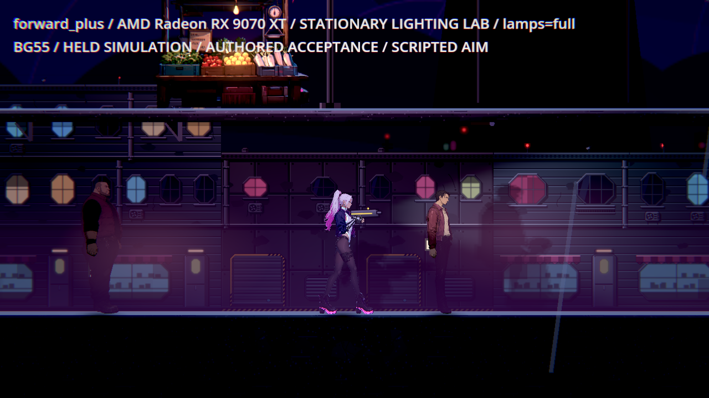
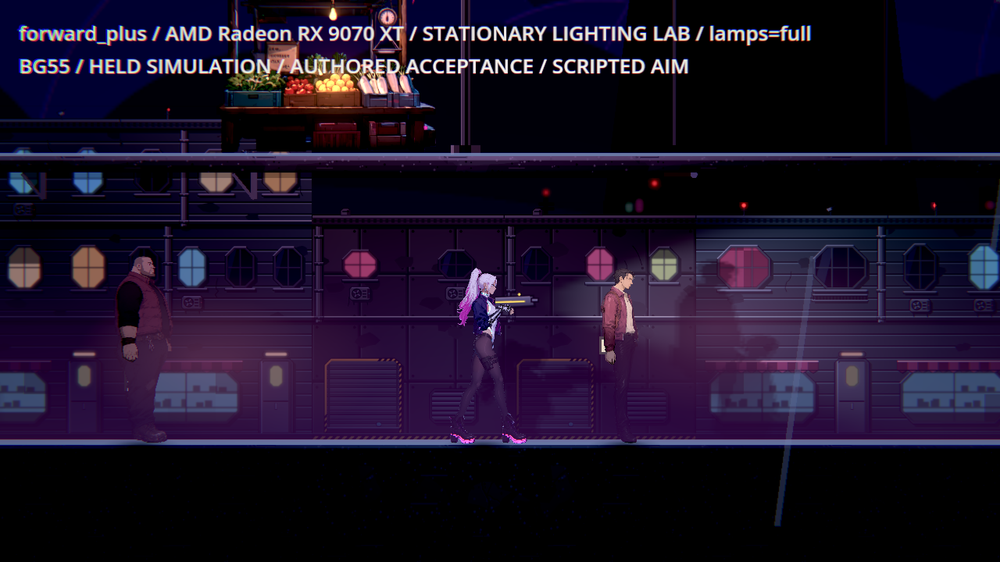
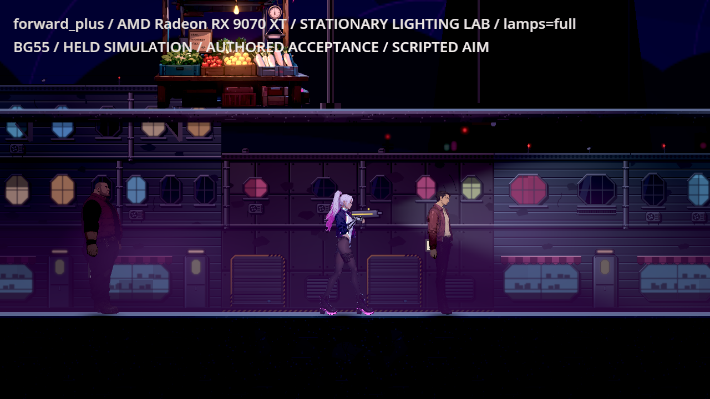
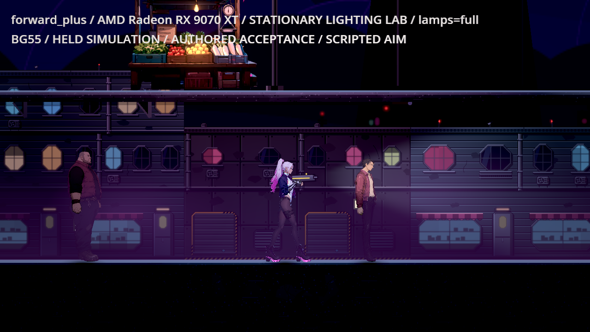

# [BG-55] 修正市集入口敵人對比不足

> 狀態：進行中

## 內文

### 需求
第二章市集入口的敵人在紫霧與背牆前不易辨識。修正量測後，高／低光影品質都有敵人低於原門檻；需要讓輪廓與動作清楚，保留場景的雨霧與暗部風格。

### 來源
2026-11-11，BG-53 修正工具後重驗 BG-48 相關區域。原生高品質一格敵人約 0.153、低品質約 0.103，低於 0.45；完整觀察與範圍見 `design/08-lighting/MARKET_GATE_ENEMY_CONTRAST.md`。

### 驗收條件
- [x] 明確定位不易辨識的敵人與成因，附同條件原生修前／後圖及原始量測
- [x] 市集入口全部可站區域於高、低品質下，敵人對比 ≥0.45、主角 ≥0.6、地面邊緣 ≥1.0
- [x] 霧與陰影保留，沒有藉提高全區環境光、降低門檻或改變敵人玩法過關
- [ ] 共用外觀與相關區域同條件回歸通過，敵人身份、動作及攻擊仍正常

### 測試流程
1. 在市集入口逐區觀察敵人輪廓與攻擊，光影品質高、低各一輪。
2. 固定同一位置、朝向與動畫時間對照修前／後，量主角、敵人及地面邊緣。
3. 重驗公眾攤道、復原館外及使用共用敵人外觀的第一章區域。

---

# 跟其他票的關係

- Blocks：無
- Blocked by：BG-53、BG-56
- Related：BG-48、BG-42、NE-97、NE-234

---

# Commit-1

## 內文

市集入口的押運手與投帳手在紫霧與背牆前偏暗。現在只提高該入口敵人的補光比例，保留原環境光、雨霧、陰影、造型與攻擊。

真正接地、保留腳下陰影後，高低品質各巡覽 21 格、14 個可站點；敵人最低對比為 0.760／0.787、主角 3.468／3.060、地面 3.426／3.434，全部高於原門檻。原本最暗的押運手在同格由 0.208／0.270 提升至 0.984／1.027。修前／後角色姿勢、雨霧與相機一致，恢復原設定後的整張原始影像完全相同。

公眾攤道、復原館外與第一章共用外觀區域的修前後原始影像完全相同。第一章仍保留原有敵人低對比與平台亮邊不足的失敗數值，沒有冒稱這些原門檻也已通過。安排主角位置與耐久觀察原 AI，押運手的蓄力／突進／恢復及投帳手的真投射物都正常；這是原生測試場地觀察，不是真人通關或實體手把驗收。

### 測試結果

| 項目 | 結果 |
| --- | --- |
| 受影響隔離完整測試 | 88 套件、98,446 檢查，0 新失敗／0 已知失敗，exit0 |
| 實際接地與光影控制 | 88／0；8 種證據破壞負控制全部拒絕 |
| 市集入口高低品質 | 各 21 格，原三項門檻全過；獨立重算與原始影像一致 |
| 相關區域 | 修前後原始影像無差異；第一章原有不足保留失敗退出碼 |
| 原 AI 攻擊 | 高低各 2 類敵人，敵人原 HP 不變；投帳手每品質 5 個真敵方投射物 |
| 執行紀錄 | 最終原生 10 程序無引擎 ERROR；完整測試有原篩選規則允許的退出診斷，無 SCRIPT ERROR |

原始資料、所有工具診斷／未完成輪次、逐像素重算、來源 SHA 與原位元組封包見[驗收紀錄](attachments/BG-55-market-gate-2026-11-11/README.md)。

### 截圖

