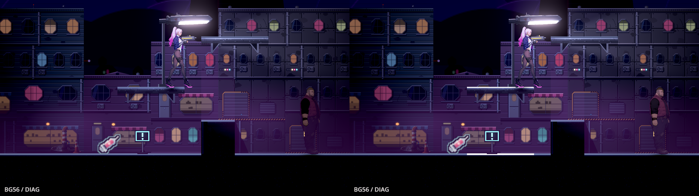
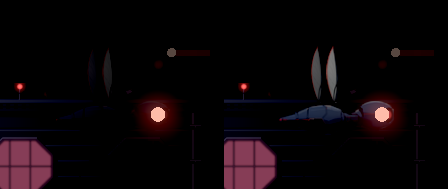
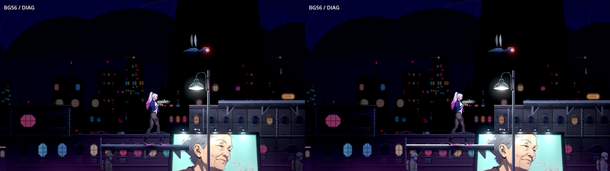

# [BG-56] 修正港區街道敵人與平台對比

> 狀態：完成

## 內文

### 需求
第一章港區街道的高台與近戰教學區，有敵人衣物和背牆明暗太接近，平台頂邊也不夠清楚。正確面積、真接地的本機原生量測中，打手對比高0.212734／低0.300872、清掃兵0.415826／0.413017，低於0.45；平台邊緣高0.503747／低0.237566，低於1.0。保留原夜雨街景、人物外觀、燈影與戰鬥安排，以局部修正讓敵人和落點可辨。

### 來源
2026-11-11，BG55第一章共用外觀區回歸發現。真支撐與接觸陰影已確認，原值與現況同格影像完全一致，屬原有不足；與第二章帳房BG42及街尾碼頭入口BG49分開。見[失敗原圖及精準位置](attachments/BG-55-market-gate-2026-11-11/selected-related-failures-grounded.json)、[修復設計](../../design/08-lighting/STREET_SHARED_APPEARANCE_CONTRAST.md)。

### 驗收條件
- [x] 本機Forward+、亮度0.5，高低品質各掃完整港區街道全部可站格：主角≥0.6、敵人≥0.45、地面邊緣≥1.0，包含打手(2136,320)、清掃兵(1352,320)及主角接地平台(2008,約256)原失敗點
- [x] 同位置原生修前後全圖與原尺寸近拍並排，敵人實體全白像素比例≤2%；衣物、濕路、平台支撐與雨霧層次保留
- [x] 敵人身份、出場位置、攻擊及傷害保持，原AI實際攻擊／受光可辨，主角與敵人仍真實接地
- [x] 碼頭入口、電話亭巷、第二章市集入口及共用材質區同條件高低品質不退步，原有光池、陰影、槍燈、環境音、配樂與腳步聲保持

### 測試流程
1. 到港區街道高台／近戰教學區，看清掃兵、打手及高處平台落點；原相機與位置量高低品質並保存原始圖。
2. 掃完整街道，觀察原敵人實際攻擊；重驗相鄰碼頭與共用區的光影及聲音。

---

# 跟其他票的關係

- Blocks：BG-55
- Blocked by：無
- Related：BG-30、BG-33、BG-49、BG-53

---

# Commit-1

## 內文

港區街道原本有打手、清掃兵與高台落點融進暗色背牆，完整巡覽另找到不易辨認的監視蜂與平台細邊。現在只加強需要的街道敵人補光及窄平台邊緣，保留深夜雨霧、衣物色彩、濕路、燈影與作者敵人的戰鬥安排。

本機Forward+、亮度0.5，高低品質各40點涵蓋原33相機格、8座平台與16名實際敵人。兩品質主角／敵人／邊緣原門檻全通，實體全白比例的最高保守上限為1.8031%／1.8446%。打手、清掃兵、監視蜂均實際完成原攻擊流程；受傷第一幀閃白、恢復與原死亡演出保留。碼頭、電話亭與市集入口同條件高低品質無退步，原環境音、配樂、濕地腳步與落地聲路由保持。

完整數值、原尺寸並排、真接地與物理／燈影控制、失敗原資料及獨立重算入口見[原始驗收證據](attachments/BG-56-street-contrast-2026-11-12/README.md)。原產品紅格、工具失敗及未能成立的中間候選均保留。

### 測試結果

| 項目 | 結果 |
|---|---|
| 高低品質完整街道 | 各40點全通；各28個可站主角觀測、8平台、16敵人實例 |
| 原主角／敵人／邊緣門檻 | 高最低1.493795／0.480648／1.657118；低1.443194／0.466708／1.219430 |
| 實體曝光 | 最高上限高1.8031%／低1.8446%，原2%門檻保持 |
| 預設關閉及區段還原 | 高低原生像素與材質綁定全部還原 |
| 原AI／受擊／死亡 | 高低品質原生與獨立檢查通過；受擊停頓仍保留真碰撞空間 |
| 相關區域 | 碼頭／電話亭各原點，市集入口各21格，五步原圖逐byte不變 |
| 正式受影響範圍 | 18個候選檔於已發布基底實跑74套、95,701 checks，0新／0已知失敗，真正exit0；914.403秒，來源前後不變 |
| 生物補光直接檢查／既有元件套件 | 64／0、108／0；後者保留原故意缺資源的1條預期錯誤，無新腳本／退出錯誤 |
| 資料／空間過渡／原主題控制 | 1818／0、16660／0；10個原主題輸出逐byte同 |
| 必須拒絕的負控制 | 缺音樂路由、空遮罩與8px錯位均實際拒絕 |

### 截圖

