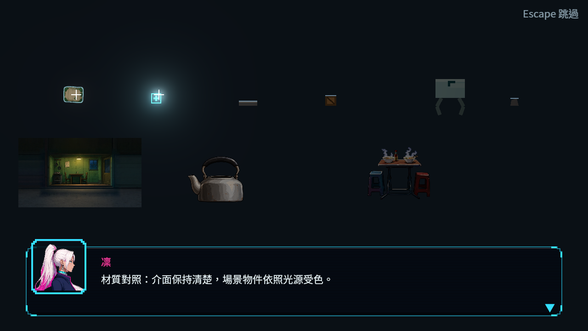
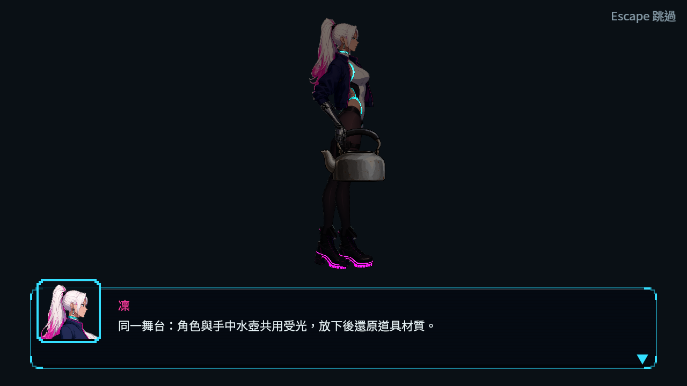

# [BG-57] 統一場景物件與舞台受光

> 狀態：完成

## 內文

### 需求
修正拾取物、投擲物、載具與舞台物件的反射本體和發光混用，並保持品質切換一致。

### 來源
2026-11-13，使用者要求三章類銀河戰士惡魔城地圖與全場景光影一致；設計見 [立體探索與一致受光](../../design/21-metroidvania/DESIGN.md)。

### 驗收條件
- [x] 拾取物、投擲物及舊載具本體受場景光照，提示與警示發光保留
- [x] 道具貼圖缺失的安全呈現仍遵循同一受光規則
- [x] 舞台實體道具及狀態切換使用可用法線，完整背板不重複套用實體光
- [x] 舞台人物與實體物件在各自光影情境下相容
- [x] 低品質離開關卡後仍維持低品質，改高品質及新載入物件正確恢復

### 測試流程
1. 依設計列出的正常與缺失資料情境操作，檢查結果與提示。
2. 在同一場景切換對應狀態，確認既有玩法與持久內容沒有改變。
3. 執行受影響測試；畫面變動保存原生截圖與對照。

---

# 跟其他票的關係

- Blocks：無
- Blocked by：無
- Related：ST-4

---

# Commit-1

## 內文

拾取物、投擲物與舊載具的實體本體會隨場景光照改變，提示、警示與裝飾發光保留。圖片缺失時的安全替代呈現也遵循相同受光規則。

舞台人物與實體道具使用相容光影，字幕與選項保持可見。切換物件狀態或高低品質可正確回復；低品質離開關卡後不會自行改回高品質。

### 測試結果

| 項目 | 結果 |
|---|---|
| 受影響測試（四票整合） | 87 組、99,550 檢查；新失敗 0、已知失敗 0 |
| 腳本與解析診斷 | 0；刻意拒收損毀資料的原始紀錄另存附件 |
| 場景受光與缺失素材 | 347 檢查通過；實體與發光原生對照通過 |
| 舞台人物、持物與文字 | 同場受光、持物材質交還及文字可見性對照通過 |
| 品質往返 | 低品質離場、恢復高品質與新載入物件通過 |

完整原圖、負控制及來源見[驗證附件](attachments/BG-57-scene-lighting-2026-11-13/README.md)與[整合驗收](attachments/BG-57-scene-lighting-2026-11-13/official-v1/README.md)。

### 截圖

