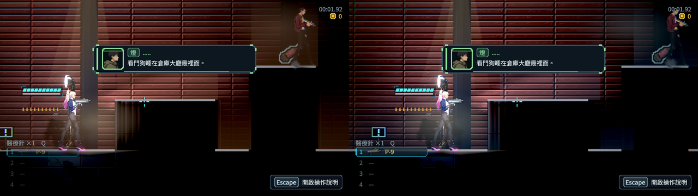

# [BG-58] 營造碼頭倉庫入口的視野與光色

> 狀態：完成

## 內文

### 需求

讓第一次踏入碼頭倉庫的玩家先看見近處，再隨腳步看清前廳。入口保留碼頭冷色，往內漸變為琥珀色工作燈。[場景設計](../../design/20-campaign-experience/EXPLORATION_AND_ATMOSPHERE.md)

### 來源

2026-11-24，使用者要求加強遊戲氛圍，並探索限制視野如何帶來張力。

### 驗收條件

- [x] 同一段正常移動可看到冷色入口與較短的前方構圖，進入倉內逐步恢復。
- [x] 減少動態及交戰時可使用原前瞻，保留正常的移動、垂直取景及傷害預兆。
- [x] 入口與倉內音場連續，場景在原生 Forward+ 可辨認角色、台階與提示。

### 測試流程

1. 進入碼頭倉庫，沿走道往右，比對入口和倉內光色及前瞻。
2. 在入口切換減少動態，再確認旁邊平台與角色仍清楚可辨。

---

# 跟其他票的關係

- Blocks：無
- Blocked by：無
- Related：BG-49、NE-256、NE-312

---

# Commit-1

## 內文

使用 RX 9070 XT、Godot 4.7.2、原生 720p Forward+ 以相同輸入走到同一落點。入口前瞻由 106 調為 68 世界像素。減少動態時為 106。冷色逐步回到原倉內光色，角色、平台與通訊在前後兩張都清楚可見。

### 測試結果

受影響測試 72 組、92,830 項檢查全過。三章產生器檢查全過。畫面的繪製呼叫為 354 與 350。

### 截圖

