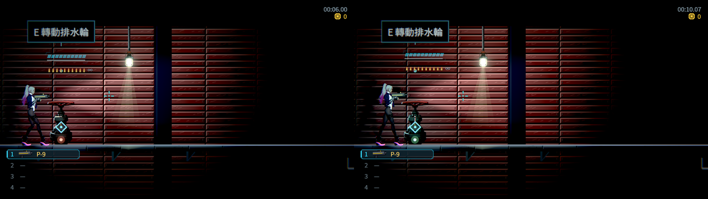

# [BG-59] 用泵室光色和霧量表達排水結果

> 狀態：完成

## 內文

### 需求

讓玩家看見第三章排水輪改變環境。水位降到低線後，泵室工作燈變亮且薄霧散開。[場景設計](../../design/20-campaign-experience/EXPLORATION_AND_ATMOSPHERE.md)

### 來源

2026-11-24，使用者要求加強場景光影與環境氛圍。

### 驗收條件

- [x] 正常轉動排水輪完成後，工作燈與霧量逐步改變。
- [x] 轉錯方向維持原光色。離開光影範圍會恢復入口原光色。
- [x] 折返後保留低水位光色，角色、輪盤和地形提示可辨認。

### 測試流程

1. 到泵室排水輪，試轉向主槽，退出並比對霧量。
2. 轉向蓄水槽，再比較同位置光影。走出入口再返回泵室。

---

# 跟其他票的關係

- Blocks：無
- Blocked by：無
- Related：BG-58、ST-21

---

# Commit-1

## 內文

用原排水輪逐次選擇錯誤方向、取消，再選蓄水槽方向。完成前霧量是 0.90，完成後逐步降到 0.43。工作燈的環境光提高，入口仍維持原光色。回到泵室會依當前低水位恢復較清楚的視野。

### 測試結果

RX 9070 XT Forward+ 的原生驗收 13 項全過。第三章專項 73 項全過。受影響測試 72 組、99,297 項全過。章節產生器檢查全過。

### 截圖

