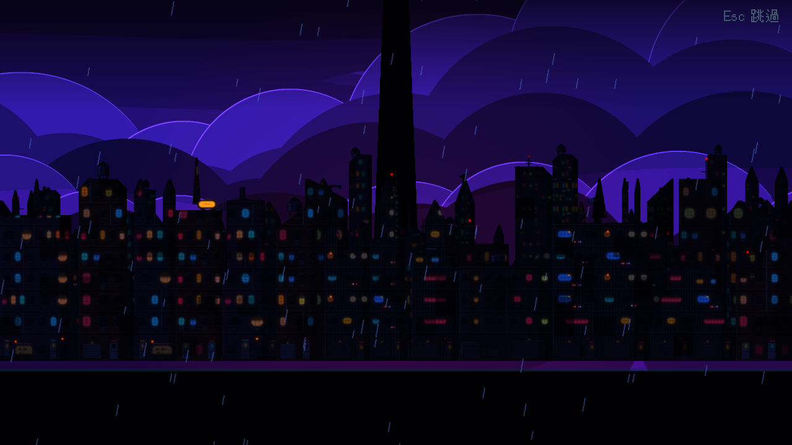
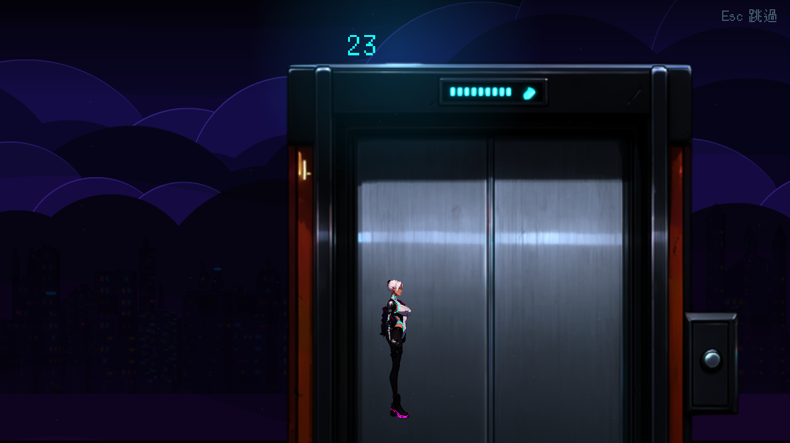
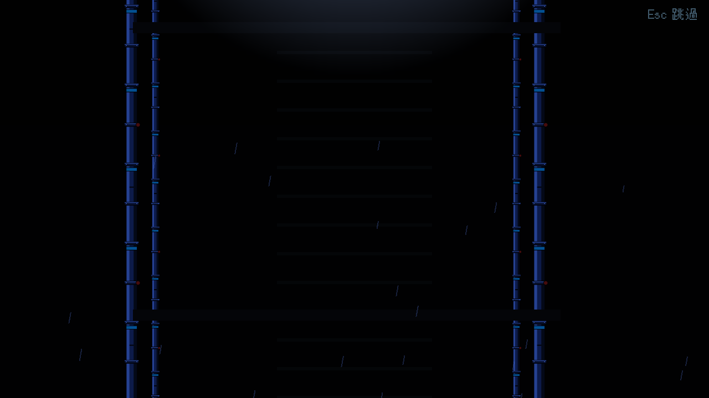

# [BG-5] 改用賽璐璐畫風重做舊的過場舞台

> 狀態：完成

## 內文

### 需求
雨夜沉港、藍天縫隙、電梯上升、升降井下降這四個過場舞台，是用寫實的天空、天際線與管線做的。室內舞台（老 K 的舖子、機庫、終端室、轉運站走廊、白房間）已改成賽璐璐畫風（NE-65），這四個要跟上，整部過場動畫的畫風才一致。

### 來源
2026-10-03，使用者決定道具與場景改走賽璐璐畫風：「賽璐璐風格吧」。NE-65 只換了六個室內舞台，這四個舞台仍是寫實。設計見 `design/11-free-assets/DESIGN.md`。

### 驗收條件
- [x] 四個舞台改為賽璐璐畫風，導演腳本與演出順序不需要改
- [x] 保留原有動畫：窗光閃爍、屋頂信標明滅、電梯樓層計數、升降井的鏡頭下降與管線
- [x] 鏡頭推拉與視差時畫質足夠，不出現接縫與模糊
- [x] 角色站位與地板線吻合；所有既有過場動畫仍能完整播放，略過鍵正常

### 測試流程
1. 逐一預覽四個舞台
2. 播放第一章結尾與第二章的過場動畫，確認演出不變
3. 執行過場動畫、章節過場相關測試套件

---

# 跟其他票的關係

- Blocks：NE-66
- Blocked by：BG-2、BG-4
- Related：NE-65、NE-38

---

# Commit-1

## 內文

雨夜沉港、藍天縫隙、電梯上升、升降井下降四個過場舞台的天空與天際線隨 BG-2、BG-4 已經是賽璐璐畫風，這張票補上剩下寫實的部分：升降井的管線（59 根）改成程式繪製的賽璐璐管線（BG-10），電梯舞台的電梯門換成賽璐璐版（BG-7）。電梯門貼圖解析度提高一倍，舞台圖層的縮放跟著調回 1.0、改用線性濾鏡，畫面大小與舊版相同且不起格子。導演腳本、演出順序、電梯樓層計數與升降井鏡頭下降都沒有改。
驗收：四個舞台逐一預覽；第二章記憶過場從頭播放到結束，推近鏡頭時畫面清楚；過場動畫與章節過場相關測試套件通過。

### 測試結果

| 項目 | 結果 |
|---|---|
| 相關測試套件（環境元件、道具、過場動畫、第二章、轉場） | 通過 1518 / 1518 |
| 素材檢查（大小與總量） | 通過（環境素材 22.8 MB／60 MB，單檔最大 0.6 MB） |
| 執行 log | 無非預期的 ERROR |

### 截圖

