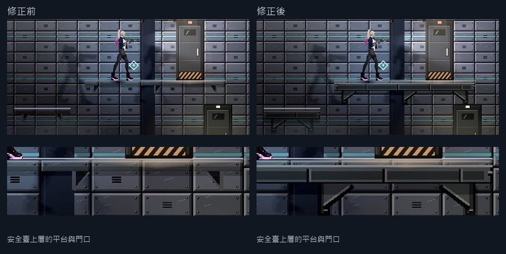

# [BG-60] 讓高架平台接合場景

> 狀態：完成

## 內文

### 需求

玩家能在背景的金屬壁板前辨認站立面。升到高處時，可以從平台的厚度、端點和支撐讀出高架如何接到廠房或建築。

### 來源

Stanley 在 2026-11-26 的對話附上高架平台截圖，指出踏面與背景重疊，平台看起來像另外貼上去。

### 驗收條件

- [x] 安全臺、其他廠房區段與屋外的普通高架有清楚可見的踏面和前緣厚度。
- [x] 背牆或上方結構能從固定片、斜撐及吊掛辨認，平台端點接到建築時能看得出接點。
- [x] 從下方跳上去、落地站穩仍使用原本的單向平台。

### 測試流程

1. 在安全臺及廠房把角色移到高架上，同時觀察與背牆和垂直結構的接合。
2. 在戶外觀察平台端面、背牆下方和開放區段的支撐。
3. 從下方跳過踏面頂端，落下時檢查腳底與踏面頂線對齊。

---

# 跟其他票的關係

- Blocks：無
- Blocked by：無
- Related：無

---

# Commit-1

## 內文

踏面的材質依場景區段銜接，門下的鋼樑有前緣、分段收邊和接觸陰影。平台沿背牆使用帶固定板的斜撐，露空處以吊桿或立柱接到能承重的位置。落腳高度以既有平台線為準。

### 測試結果

| 項目 | 結果 |
| --- | --- |
| 受影響的測試 | 8 組，42,856 項檢查全過 |
| 獨立碰撞與支撐探針 | 13 項全過，包含從下方穿過、落地及跨區塊 |
| 原生畫面 | RX 9070 XT Forward+，安全臺、裝卸帶與街景落腳線一致 |

### 截圖

