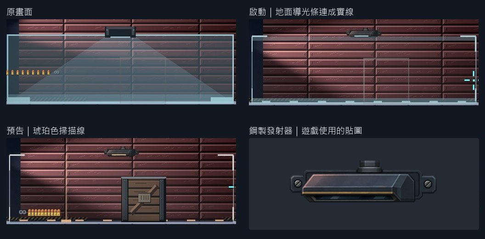

# [BG-61] 打磨清理線的光影提示

> 狀態：完成

## 內文

### 需求

操作工作帶時，玩家能分辨預告、有效傷害區和休止期。測試箱的無害演示先教會玩家辨認同一套光影。使用減少動態或減少閃光仍能判斷何時通行。

### 來源

Stanley 在 2026-11-26 的對話附上清理線截圖，指出大片光框與光錐太突兀，要求換成符合廠房的美術。

### 驗收條件

- [x] 玩家能從嵌牆的發射器、範圍的角標及地面導光條辨認裝置與掃描階段。
- [x] 啟動時的導光條連成清楚的危險範圍，牆面和通行層看得清楚。
- [x] 減少動態與減少閃光仍保有固定可讀的標記，休止與取消可以消除效果。
- [x] 正常穿越、受傷、永久地板及讀檔行為與機關進度一致。

### 測試流程

1. 在舊廠觀看測試箱演示，取消後重新開始。
2. 進入工作帶看底層預告及噴發，換到上層後由下層繞過另一道掃描區。
3. 開啟減少動態和減少閃光重複走查，再存檔並重新開啟遊戲。

---

# 跟其他票的關係

- Blocks：無
- Blocked by：無
- Related：無

---

# Commit-1

## 內文

發射器改成有固定耳、螺栓和收光鏡片的鋼製設備。預告是琥珀色的移動掃描和地面燈槽，啟動後導光條連成冷色實線，細邊界保留攻擊高度。待機時外殼留在原位。貼圖暫缺時，掃描提示仍會顯示。

### 測試結果

| 項目 | 結果 |
| --- | --- |
| 受影響的測試 | 22 組，7,562 項檢查，0 項失敗 |
| RX 9070 XT Forward+ | 正常與減少動態／閃光各走一次工作帶，已查看預告和啟動畫面 |
| 流程與讀檔 | 預告無傷、有效區扣血並清除指定掩體，固定地板和另一層繞路可用，獨立程序重啟讀檔成功 |
| 示範與素材容錯 | 取消後可以重試，完成後清除指定掩體。貼圖共用與缺圖降級各驗證一次 |

### 截圖

