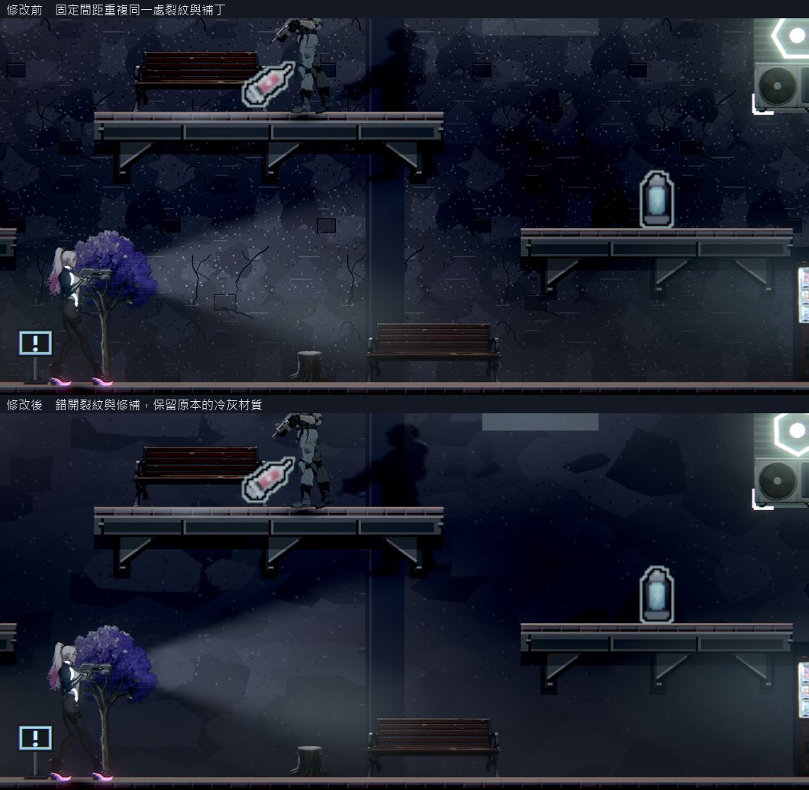

# [BG-62] 錯開深色牆面與濕路的裂紋

> 狀態：完成

## 內文

### 需求

第二章中庭牆上每隔相同距離就會出現同一塊方形補丁和裂紋。重畫這張共用材質，讓裂紋、修補與磨痕分布自然，保留中庭和濕路的暗藍灰色。

### 來源

[第二章中庭與場景美術](../../design/10-presentation/DESIGN.md)

### 驗收條件

- [x] 左右移動時，短距離內看不到相同的裂紋與方形補丁整齊重複。長紋理首尾接合，保留中庭的冷灰色調。
- [x] 中庭牆面和所有使用共用柏油材質的區段套用新圖案。步行、碰撞、腳步音與地面邊條保持原樣。
- [x] 使用 Forward+ 查看中庭與市集，角色、敵人和地面邊緣通過場景可讀性門檻。

### 測試流程

1. 在第二章中庭從一側走往另一側，查看牆面裂紋與修補。
2. 在第一章霓虹市集檢查濕路本體和頂緣，確認陰影下仍能看清角色。
3. 檢查原生材質尺寸、關卡索引與受影響的套件。

---

# 跟其他票的關係

- Blocks：無
- Blocked by：無
- Related：BG-1、BG-60

---

# Commit-1

## 內文

保留冷灰色底與顆粒，以較長的材質分散短裂紋、淡磨痕和不規則修補。圖樣橫向重複距離由 64 增至 384 世界像素，頂面與側邊保留原貼圖。底色與法線仍由既有分塊按世界座標取樣。

### 測試結果

| 項目 | 結果 |
|---|---|
| 重跑產生器與循環接縫 | 兩張新圖可逐位元重現，循環接縫比 1.20／1.18，原頂面與側面色圖和法線像素一致 |
| RX 9070 XT Forward+ 中庭 | 玩家／地面邊緣／敵人對比 2.13／2.23／1.15，全部達標 |
| RX 9070 XT Forward+ 市集 | 玩家／地面邊緣／敵人對比 2.95／3.57／3.11，全部達標 |
| 官方關卡、地圖與預載索引 | 53 區域全部通過 |
| 受影響的回歸 | 16 組、48,774 項，0 新失敗、0 已知失敗、0 非預期診斷 |
| 第二章中庭實際行走 | 向東、向西都跨過同一繪製區塊交界，腳底維持在同一高度 |

### 截圖

