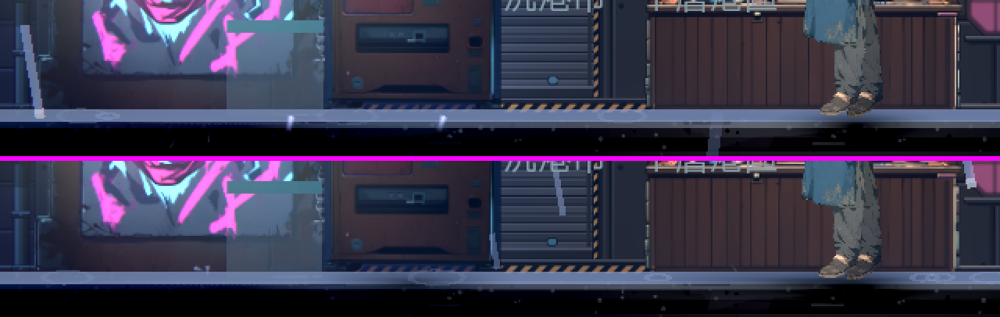

# [BG-63] 讓站在地上的擺設有接地陰影

> 狀態：完成

## 內文

### 需求
站在地面上的擺設（箱子、推車、路燈、販賣機、垃圾箱）腳下沒有任何陰影，明暗和地板沒有關係，看起來像貼在畫面上的貼紙。這張票讓它們在接觸地面的地方有柔邊陰影，像真的放在地上。

### 來源
2026-11-27，使用者指出地圖、介面與玩法看起來簡陋死板、圖片像被直接貼上，要求參考業界做法加入動畫與互動、讓物件融入場景，並調整光照、渲染與效能。設計見[畫面活化與融入](../../design/22-living-scenes/DESIGN.md)，研究依據見[研究](../../design/22-living-scenes/RESEARCH.md)。

### 驗收條件
- [x] 以地面為支撐的擺設，在實際接觸地面的範圍底下有柔邊陰影，陰影落在地板面並略壓住擺設底緣；修前修後同鏡頭截圖並排可看出差別
- [x] 貼牆、懸掛、放在別的擺設上的東西，以及水窪這類本來就是平的東西，沒有陰影
- [x] 陰影寬度跟擺設接觸地面的範圍一致，不懸在平台邊緣外，不穿到下一層樓
- [x] 陰影不蓋住地面上的拾取物提示、危險預兆與角色腳下的陰影；三個畫質檔都看得到
- [x] 個別擺設可以在資料裡關掉陰影；資料缺漏時擺設照常顯示並記錄是哪一件
- [x] 關卡建立後沒有每影格成本；第一章街道同鏡頭的影格時間與修前相同（數字記在票上）
- [x] 受影響範圍的測試全過

### 測試流程
1. 進第一章街道與第二章市集，看箱子、推車、路燈、販賣機腳下
2. 預期每件站在地上的擺設底下有一道柔邊陰影，牆上的招牌與水管沒有
3. 切換低、中、高畫質，預期陰影都在

---

# 跟其他票的關係

- Blocks：BG-66
- Blocked by：無
- Related：BG-29、BG-34、BG-64

---

# Commit-1

## 內文

站在地面上的擺設腳下沒有任何陰影，地板的亮邊直接貼著擺設底部，販賣機、攤車、路燈看起來像貼在畫面上的貼紙。
現在以地面為支撐的擺設，在實際接觸地面的範圍底下有一道柔邊陰影：輪子、腳架這些真正碰到地面的地方較深，整個底部再罩一層淡影，一半落在地板面、一半壓住擺設底緣。貼牆、懸掛、放在別的擺設上的東西，以及水窪、前景擺設和太扁的地面物件沒有陰影；個別擺設可以在資料裡關掉。路燈的燈臂、樹冠這些懸空的部分不會在地上拖出一大片。
第一章街道與第二章市集用同一格鏡頭拍有陰影與沒有陰影的畫面並放大比對，販賣機、攤車、路燈底座與垃圾箱輪子都看得到陰影，牆上的招牌與冷氣沒有。陰影在關卡建立時畫一次，沒有每影格成本。

### 測試結果

| 項目 | 結果 |
|---|---|
| 受影響範圍的測試（69 個套件） | 通過 94337 / 94337 |
| 腳本錯誤 | 0 |
| 第一章街道靜止鏡頭的影格時間中位數（開／關各三輪交替） | 開 2.16、2.16、2.13 毫秒；關 2.20、2.16、2.09 毫秒，沒有差異 |
| 節點數 | 開與關都是 1890 |

### 截圖

上：沒有接地陰影；下：有接地陰影（第一章街道同一格鏡頭，放大兩倍）。

