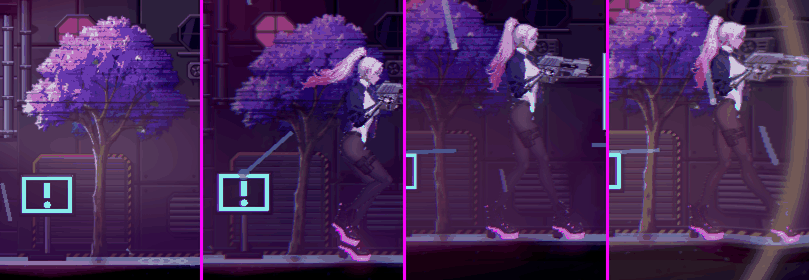

# [BG-64] 讓會搖的擺設被經過與爆炸帶動

> 狀態：完成

## 內文

### 需求
植物、布簾、纜線、鏈條、燈籠串只會用固定幅度被風吹，玩家衝過去或旁邊有爆炸時完全沒有反應，場景像一張不會被碰到的背景。這張票讓它們被經過與爆炸帶動，往受力方向多擺一下再回彈停下。

### 來源
2026-11-27，使用者指出地圖、介面與玩法看起來簡陋死板、圖片像被直接貼上，要求參考業界做法加入動畫與互動、讓物件融入場景，並調整光照、渲染與效能。設計見[畫面活化與融入](../../design/22-living-scenes/DESIGN.md)，研究依據見[研究](../../design/22-living-scenes/RESEARCH.md)。

### 驗收條件
- [x] 玩家或敵人穿過會搖的擺設時，擺設往移動方向多擺一下再回彈停下；走過的幅度小、衝刺的幅度大
- [x] 附近有爆炸時，範圍內會搖的擺設往遠離爆炸的方向擺動，越近越大
- [x] 擺動幅度有上限，連續觸發不會越擺越大；停下後回到原本的風吹，不殘留偏移
- [x] 固定支架與硬的擺設不動；擺設沒有碰撞，不擋子彈、不影響敵人行為
- [x] 「減少動態」開啟時不加這段額外擺動，原本的風吹不變
- [x] 擺設靜止時不計算；暫停時停住、恢復後接續；切區與重進關卡不累積節點
- [x] 附原生連續三格（經過前、最大擺幅、回彈後）；受影響範圍的測試全過

### 測試流程
1. 進有樹或衣繩的街道，從擺設旁邊走過、再衝刺穿過
2. 預期擺設往移動方向擺一下再回彈，衝刺時擺得比較大
3. 在擺設旁邊引爆油桶，預期擺設往外甩再回彈
4. 開啟「減少動態」重複一次，預期只剩原本的風吹

---

# 跟其他票的關係

- Blocks：BG-66
- Blocked by：無
- Related：BG-25、BG-63

---

# Commit-1

## 內文

樹、布簾、衣繩、鏈條、吊燈這些會搖的擺設只有固定幅度的風吹，玩家衝過去或旁邊爆炸時完全沒有反應。
現在玩家或敵人穿過會搖的擺設時，擺設往移動方向多擺一下再來回擺幾下停住；走過輕、衝刺重。附近有爆炸時，範圍內的擺設往遠離爆炸的方向甩，越近越大。擺幅有上限，連續觸發不會越擺越大，停下後回到原本的風吹。「減少動態」開啟時只保留風吹。擺設仍然沒有碰撞，不擋子彈也不影響敵人。
在第一章街道讓主角實際按鍵衝刺穿過紫花樹，再在樹旁引爆：衝刺時樹頂最多擺出 5.66 像素、爆炸 6.88 像素，兩次都回到原位並停止計算。

### 測試結果

| 項目 | 結果 |
|---|---|
| 受影響範圍的測試 | 通過 93275 / 93275 |
| 腳本錯誤 | 0 |
| 原生情境（衝刺穿過、爆炸） | 衝刺最大擺幅 5.66 像素、爆炸 6.88 像素，結束時位移 0、已停止計算 |
| 靜止的擺設 | 不跑每影格更新（自動檢查） |

### 截圖

由左到右：穿過之前、衝刺穿過時擺到最遠、回彈停下、爆炸時擺到最遠（第一章街道，原生 Forward+）。

