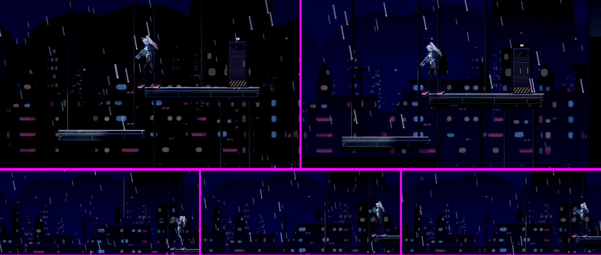

# [BG-65] 讓遠景層自己移動並拉開遠近

> 狀態：完成

## 內文

### 需求
遠景的建築貼圖層本身是靜止的，層與層之間沒有空氣感，遠近只靠捲動速度區分；鏡頭一停下，背景就像一張照片。這張票讓遠景層可以自己緩慢移動，並在層與層之間加上隨距離變淡的霧色。

### 來源
2026-11-27，使用者指出地圖、介面與玩法看起來簡陋死板、圖片像被直接貼上，要求參考業界做法加入動畫與互動、讓物件融入場景，並調整光照、渲染與效能。設計見[畫面活化與融入](../../design/22-living-scenes/DESIGN.md)，研究依據見[研究](../../design/22-living-scenes/RESEARCH.md)。

### 驗收條件
- [x] 遠景層可以在資料裡設定自己的橫向漂移速度；鏡頭靜止時，設定了漂移的層仍在緩慢移動，左右接縫無跳動
- [x] 層與層之間有由地平線往上變淡的霧色（被城市燈光染亮的水氣），越遠的層前面霧越濃；修前修後同鏡頭截圖並排可看出遠近層次
- [x] 霧色跟著關卡光影區段的顏色變化，室內區段不出現室外霧色
- [x] 遠景不搶過可走地形、角色與敵人的對比（既有可讀性檢查通過）
- [x] 低畫質保留漂移、關掉霧色；資料缺漏時沿用靜止的原樣並記錄是哪一層
- [x] 附原生連續三格證明漂移；受影響範圍的測試全過

### 測試流程
1. 進第一章街道，站著不動看遠景十秒
2. 預期雲或遠處的層緩慢橫移，近的建築比遠的清楚
3. 走進室內再走出來，預期室內沒有室外霧色

---

# 跟其他票的關係

- Blocks：BG-66
- Blocked by：無
- Related：BG-2、BG-4、BG-30

---

# Commit-1

## 內文

夜景裡的遠景樓群幾乎是全黑的，只看得到一顆顆窗光漂在黑底上，分不出哪一棟在前、哪一棟在後；鏡頭停下時整個背景像一張照片。
現在每一層遠景可以在資料裡設定自己的橫向漂移，所有章節的天空都設了緩慢的漂移，鏡頭不動時雲層仍在移動。層與層之間加上被城市燈光染亮的霧色，越遠的層前面霧越濃、最近的一層沒有，樓群的輪廓因此從黑底浮出來並分出前後。霧色會乘上關卡光影區段的背景色調，低畫質不畫霧色但保留漂移。資料裡可以個別指定或關掉某一層的霧色；漂移或霧色的數值損毀時當成不動、沒有霧，並在檢查時指出是哪一層。
屋頂關卡同場景比對有霧色與沒有霧色的畫面；主角站著不動每隔 4 秒拍一格，天空層在畫面上每 4 秒移動約 23 像素，其他層不動。第二章室內關卡看不到室外霧色。

### 測試結果

| 項目 | 結果 |
|---|---|
| 受影響範圍的測試 | 通過 64708 / 64708（54 個套件） |
| 腳本錯誤 | 0 |
| 原生量測（屋頂站著不動 8 秒） | 天空層畫面位置 -348.4 → -371.5 → -394.6，其餘七層不變 |

### 截圖

上排：左沒有霧色、右有霧色（第一章屋頂）。下排：間隔 4 秒的連續三格，天空雲層往左漂移。

