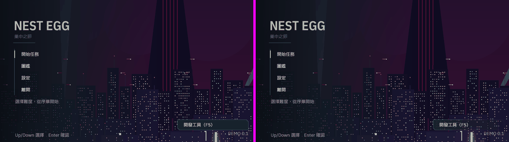

# [BG-66] 量測並降低場景常駐動態的成本

> 狀態：完成

## 內文

### 需求
這一輪新增了擺設陰影、擺設受力擺動與遠景漂移，遠景裡原本也有每影格整層重畫的層。這張票量測這些常駐動態的成本，把不必要的每影格重畫拿掉，確保畫面變活的同時不變慢。

### 來源
2026-11-27，使用者指出地圖、介面與玩法看起來簡陋死板、圖片像被直接貼上，要求參考業界做法加入動畫與互動、讓物件融入場景，並調整光照、渲染與效能。設計見[畫面活化與融入](../../design/22-living-scenes/DESIGN.md)，研究依據見[研究](../../design/22-living-scenes/RESEARCH.md)。

### 驗收條件
- [x] 同一台機器、同一場景，量測 BG-63、BG-64、BG-65 開與關的影格時間與節點數，數字記在票上
- [x] 遠景裡每影格整層重畫的層改成只在內容改變時重畫或交給著色器，畫面與修前相同（同鏡頭截圖並排）
- [x] 第一章街道與第二章市集的影格時間不因本輪新增的場景效果變差（同一版本把新增效果開與關成對交替量測；超過 16.7 毫秒的格數一併記錄）
- [x] 三個畫質檔的畫面差異與原本一致；暫停時常駐動態停止
- [x] 受影響範圍的測試全過

### 測試流程
1. 用負載量測工具跑第一章街道與第二章市集，記錄影格時間
2. 逐項關掉新增動態再量一次
3. 預期修後數字不比修前差

---

# 跟其他票的關係

- Blocks：無
- Blocked by：BG-63、BG-64、BG-65
- Related：BG-12、BG-16

---

# Commit-1

## 內文

這一輪新增了擺設的接地陰影、擺設被帶動與遠景霧色，遠景裡的車流、探照燈與巨塔信標原本每一格都整層重畫。
量測結果：把接地陰影、擺設受力與遠景霧色全部關掉再量，第一章街道與第二章市集的影格時間和全開時沒有可分辨的差異，三項都沒有常駐成本。遠景的車流、探照燈與信標改成各自畫一次、每一格只改位置、角度或大小，不再重畫；第一章屋頂的影格時間中位數因此從約 2.17 毫秒降到約 2.00 毫秒，畫面與修前相同。負載量測工具可以單獨關掉這三項，之後再加場景效果時能用同一個方法對照。
量測方式：同一台機器（RX 9070 XT）原生 Forward+、關閉垂直同步，機器人在正式關卡裡邊跑邊打 10 秒（屋頂是站著不動 8 秒），修前與修後、開與關交替各量三輪。「繪製次數」是結束那一格的取樣，會隨當下畫面上的雨滴與特效變動，不是穩定指標，僅供參考。

### 測試結果

| 項目 | 結果 |
|---|---|
| 受影響範圍的測試 | 通過 64761 / 64761（54 個套件） |
| 腳本錯誤 | 0 |
| 第一章街道（邊跑邊打），新增效果開／關，中位數毫秒 | 開 2.12、2.19、2.04；關 2.09、2.05、2.06。超過 16.7 毫秒的格數：開 0、0、0；關 0、0、1 |
| 第二章市集（邊跑邊打），新增效果開／關，中位數毫秒 | 開 3.97、4.02、4.01；關 3.96、4.02、4.01 |
| 第一章屋頂（站著不動），遠景修前／修後，中位數毫秒 | 修前 2.21、2.11、2.17；修後 2.02、2.01、1.98 |
| 節點數 | 街道 1904、市集 1235，開與關相同；屋頂修前 1019、修後 1027（多出的是車流、探照燈與信標的子節點） |

### 截圖

左：修前；右：修後（主選單後方的程式繪製遠景：巨塔、信標、探照燈與車流）。

