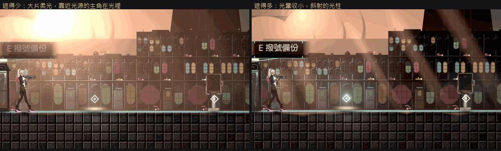
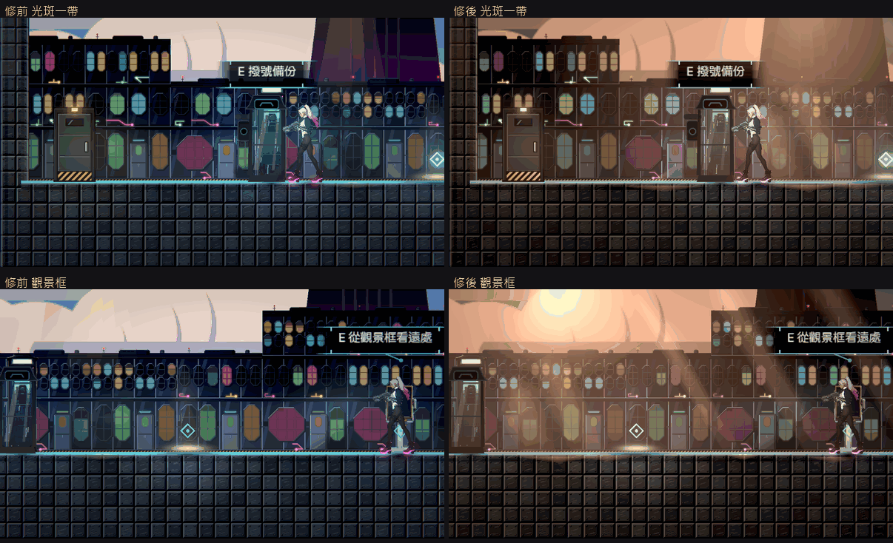
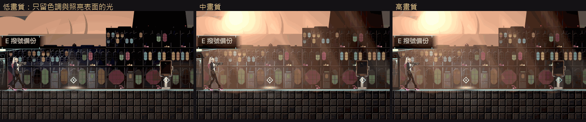
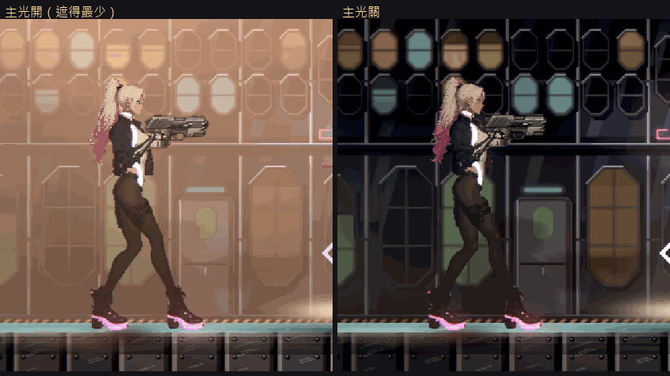

# [BG-67] 加入會被遮住的主光與單一色調

> 狀態：完成

## 內文

### 需求
場景只有一盞盞小燈，沒有一個決定整個畫面方向與顏色的光源；道具、牆面、地面各有各的顏色，畫面散。這張票加入「主光」：一個區段一個主要光源，有漫出來的大片柔光與斜射的光柱，會隨被遮住的程度緩慢變化，並把整個畫面拉進同一個色系。第一個示範場景是第三章向陽區。

### 來源
2026-11-27，使用者提供另一款像素風遊戲同一個場景的兩張參考畫面（主光沒被遮住、被遮住比較多），說這種效果很好、前景與後景做得很好，並指出本專案的前景與後景有問題、沒有類似的效果，敵人與 NPC 的圖層甚至有問題。設計與現況調查見[景深、圖層與主光](../../design/22-living-scenes/DEPTH_AND_KEY_LIGHT.md)。

### 驗收條件
- [x] 區段可以在資料裡指定一個主光：位置、顏色、光暈大小、光柱的方向與數量、被遮住的變化範圍與快慢；新增或調整不用改程式
- [x] 主光有兩種看得出差別的樣子：遮得少時光源周圍是大片柔光，靠近光源的角色與擺設變成光裡的剪影；遮得多時光暈收小，出現斜射的光柱。附同一格鏡頭兩個狀態的截圖
- [x] 兩個狀態之間緩慢變化，不會被當成閃爍；「減少動態」開啟時固定不變；「減少閃光」的限制照常生效
- [x] 有主光的區段，背景、地面、擺設與角色暗部落在同一個色系，主光是畫面上最亮最暖的東西；附修前修後同一格鏡頭
- [x] 角色朝主光的一側有同色的亮邊；主角的白髮在主光旁邊不過曝（既有的曝光檢查通過，並附主角站在光源正前方的近拍）
- [x] 玩家、敵人與可走的地面在主光下仍然清楚可辨（既有的可讀性檢查通過）
- [x] 低畫質關掉光暈與光柱，保留色調與照亮表面的那盞光；三個畫質檔各附一張
- [x] 第三章向陽區套用主光，成為其他區段的樣板；資料缺漏或不合理時該區段照常顯示（沒有主光）並記錄是哪個區域哪一項
- [x] 主光開與關的影格時間成對交替量測，數字記在票上；受影響範圍的測試全過

### 測試流程
1. 進第三章向陽區，站著看一分鐘
2. 預期畫面一側有一個暖色主光，光暈與光柱緩慢消長
3. 走到光源正前方，預期主角變成光裡的剪影但頭髮不變成一團白
4. 切換低、中、高畫質，預期低畫質沒有光暈與光柱但色調還在
5. 開啟「減少動態」，預期主光不再變化

---

# 跟其他票的關係

- Blocks：無
- Blocked by：無
- Related：BG-30、BG-33、BG-65、BG-68、BG-69、BG-70、NE-213

---

# Commit-1

## 內文

場景只有一盞盞小燈，沒有決定畫面方向與顏色的光源；第三章向陽區是全專案最該有陽光的地方，畫面上卻只有一面藍色調、各色窗戶的立面加一大塊冷灰地磚，看不出太陽在哪裡。

現在一個區域可以在地圖資料裡指定一個主光：位置、顏色、照亮表面的強度與範圍、光暈大小與亮度、角色前面那層漫射的濃淡、光柱的方向／數量／長度／寬度／散開範圍、被遮住程度的變化範圍與快慢。主光由三層組成：一盞實際照亮地面、牆與角色的大光；畫在所有角色後面的大片光暈與斜射光柱（光漫過立面與背景道具，靠近光源的角色在光前面成為剪影）；以及畫在角色前面很淡的一層漫射，用一般混合往主光的顏色靠、不會加亮，主角的白髮因此不會被加到過曝。光柱照到地面為止，落點在地面上留一條反光。

被遮住的程度在兩個不同週期的緩慢起伏之間變化（第三章向陽區約 48 秒一個來回，每秒最多變化 0.04）：遮得少時光暈大、光柱淡；遮得多時光暈收到不到一半、照亮表面的光變暗、光柱變明顯，各道光柱自己也有很慢的明暗。「減少動態」開啟時固定在中間值，「減少閃光」開啟時變化再慢一倍，閃電與爆炸閃光的既有限制照舊。有主光的區域，角色的輪廓光改成主光的顏色、從主光那一側打過來。低畫質關掉光暈、光柱與漫射，保留照亮表面的光與色調。資料缺漏或不合理（缺位置、顏色超出範圍、遮住範圍顛倒、週期短於 20 秒、漫射太濃、欄位型別錯）時，該區域照常顯示、沒有主光，並記錄是哪個區域、哪一項。

第三章向陽區套用主光，成為其他區段的樣板：午後的太陽在立面上方偏左，光柱往右下斜照到地上的光斑一帶；同時把這個區域的光影設定拉成同一個暖色系（環境光與遠景偏暖、整體降飽和、暗部偏暖褐、亮部偏暖但紅色版不超過 1.08），立面、地磚、道具與角色暗部都落在同一個琥珀色系裡，太陽是畫面上最亮最暖的東西。

驗收時發現光暈一開始蓋在走道上，太陽完全沒遮住時走道邊緣的對比掉到 0.56（門檻 1.0）；改成光暈與光柱畫在地形之下、漫射只到地面為止、光柱落點的反光畫在地面上之後，最亮的狀態是 1.04，平常狀態 1.16～1.26。

### 測試結果

| 項目 | 結果 |
|---|---|
| 受影響範圍的測試（74 個套件，6 個程序平行） | 95333 項檢查，1 項失敗：關卡鄰近貼圖索引與地圖不一致（調整向陽區主光位置後沒有重新產生索引）；重新產生後該套件單獨重跑 2142 / 2142 通過；腳本錯誤 0 |
| 主光的自動檢查 | 壞資料一律不加主光、變化速度上限與取樣、兩個狀態的光暈與光柱差別、光暈在地形與角色之後、漫射在角色前且不加亮、輪廓光同色、光柱停在地面、減少動態固定、低畫質只留照亮表面的光：全過 |
| 曝光（主角站在太陽正下方、太陽完全沒遮住，頭部同一範圍的全白像素比例） | 主光開 1.14%、主光關 1.15%（主光沒有增加過曝；既有曝光檢查套件通過） |
| 可讀性（第三章可讀性量測的「光斑」取樣點，門檻 主角 0.60 ／ 地面邊緣 1.00） | 修前 4.40 ／ 1.13；修後平常 3.44 ／ 1.16；固定在完全沒遮住 1.68 ／ 1.04；固定在全遮 4.14 ／ 1.26 |
| 影格時間（第三章向陽區邊跑 10 秒，主光開與關交替各三輪的中位數） | 中位數 2.05 ／ 1.94 毫秒；第 95 百分位 3.95 ／ 3.07；第 99 百分位 4.85 ／ 3.87；繪製次數 451 ／ 433 |
| 原生截圖 | 無錯誤 |

### 截圖

同一格鏡頭的兩個狀態（左：遮得少；右：遮得多）。

修前修後同一格鏡頭（上排光斑一帶、下排觀景框）。

低、中、高三個畫質。

主角站在太陽正下方、太陽完全沒遮住時的近拍（左主光開、右主光關），白髮沒有變成一團白。

