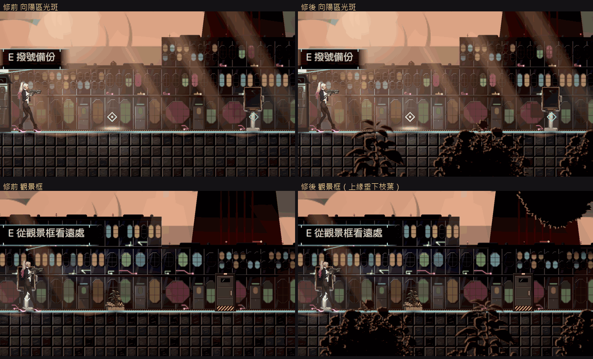
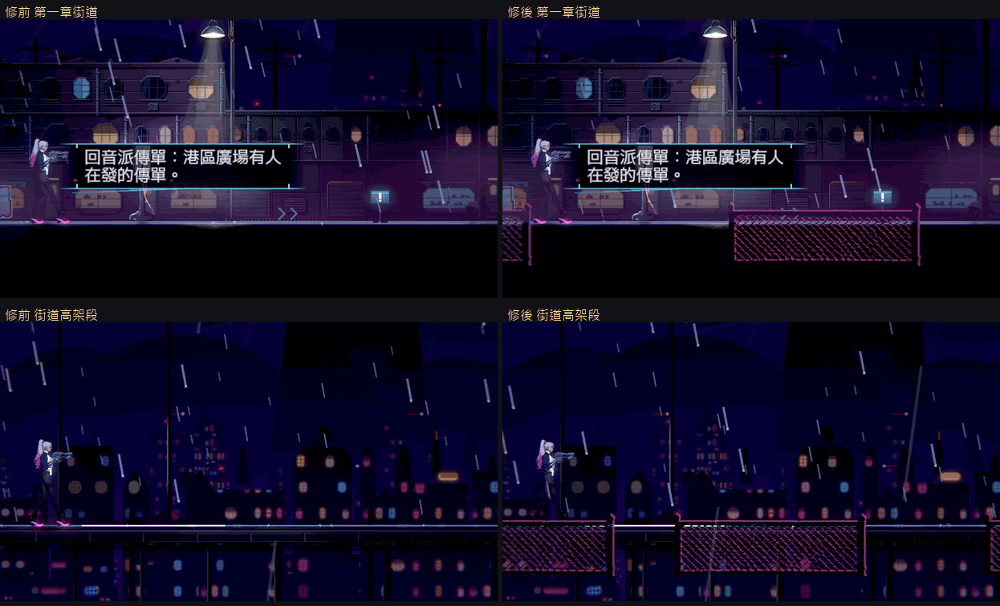
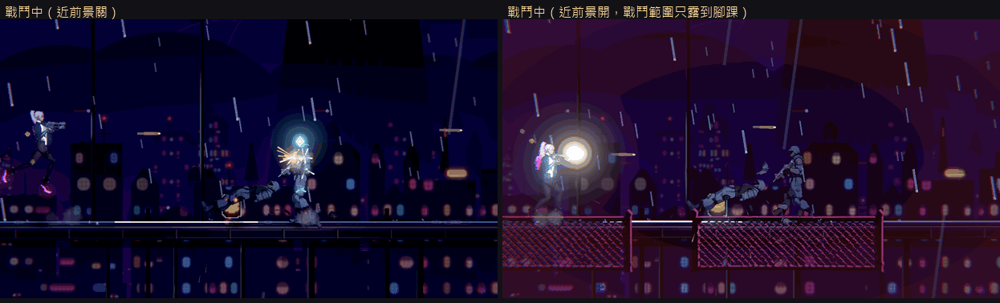

# [BG-68] 建立畫在角色前面的近前景

> 狀態：完成

## 內文

### 需求
畫面最前面只有上緣的管線與地面以下的欄杆，沒有任何東西真的擋在角色前面，場景像一張平的佈景。這張票建立「近前景」：畫在角色前面的不透明深色剪影（走道外緣的欄杆、矮牆、落葉，畫面上緣垂掛的纜線、布與枝葉），讓畫面有前、中、後三層。

### 來源
2026-11-27，使用者提供另一款像素風遊戲同一個場景的兩張參考畫面（主光沒被遮住、被遮住比較多），說這種效果很好、前景與後景做得很好，並指出本專案的前景與後景有問題、沒有類似的效果，敵人與 NPC 的圖層甚至有問題。設計與現況調查見[景深、圖層與主光](../../design/22-living-scenes/DEPTH_AND_KEY_LIGHT.md)。

### 驗收條件
- [x] 區段可以在資料裡指定近前景：走道外緣的一排物件與畫面上緣的垂掛物，各自的圖、高度與間隔；新增一種只要加圖與資料
- [x] 近前景畫在角色前面、不透明、是深色剪影並帶一點主光或環境色的邊緣光；附修前修後同一格鏡頭
- [x] 近前景只蓋到角色的小腿以下與頭頂以上，不蓋到軀幹、頭、武器、敵人的弱點、子彈、落點與互動提示；戰鬥區段更矮或不放。有自動檢查擋住超過高度的擺放
- [x] 近前景比走道捲動得略快；垂掛物會被風與經過的角色帶動，「減少動態」時靜止
- [x] 三個畫質檔都看得到近前景（它是構圖不是特效）；低畫質只關掉動態
- [x] 需要的圖用本機生成或既有素材製作，畫風與現有場景一致，不是純矩形色塊；來源與授權照素材流程登記
- [x] 第三章向陽區與第一章街道各套用一段；附兩個場景的截圖，以及戰鬥中角色、敵人、子彈都看得清楚的截圖
- [x] 近前景開與關的影格時間成對交替量測，數字記在票上；受影響範圍的測試全過

### 測試流程
1. 進第三章向陽區，沿著走道走
2. 預期走道外緣有一排欄杆或矮牆畫在主角前面，只蓋到小腿
3. 預期畫面上緣有垂掛物，走過時會被帶動
4. 進第一章街道打一場，預期近前景不擋住敵人、子彈與落點

---

# 跟其他票的關係

- Blocks：無
- Blocked by：NE-402
- Related：BG-25、BG-64、BG-67、BG-69

---

# Commit-1

## 內文

畫面最前面只有上緣的管線與地面以下的欄杆，沒有任何東西真的擋在角色前面，場景像一張平的佈景。

現在區域可以在地圖資料裡指定近前景：走道外緣一排從地面往下長的剪影（鐵網欄杆、玫瑰叢、花台），以及畫面上緣垂下來的剪影（吊纜、燈籠串、枝葉）；每一排寫用哪些零件、露出多高或從多高垂下、間隔與範圍。零件放在一份零件庫裡，新增一種只要加一筆資料（圖、往上或往下長、寬度、要不要被風吹）。剪影用既有場景素材的形狀，填成很暗的環境色，朝主光（沒有主光時是輪廓光）的一側有一圈同色的邊緣光；修剪成方塊的矮籬看起來像純黑方塊，沒有採用。

判讀優先：走道那排最多只露出小腿高（16 像素），敵人出生點附近只露到腳踝（9 像素）；垂掛物的底邊離下面的走道至少 84 像素（高個子敵人的頭頂與舉槍），戰鬥範圍與下面走道不平的地方不放。近前景畫在角色前面、子彈與提示之下。規則集中在一個地方，遊戲與自動檢查共用：每個有近前景的區域都重排一次，任何一件超過高度就失敗；把走道那排改成露出 40 像素時檢查確實會失敗。近前景比走道捲動得略快（鏡頭每移動 1 像素多移 0.06，最多 24 像素，只有鏡頭移動時才更新）；垂掛物被風吹、被經過的角色帶動；「減少動態」與低畫質時靜止，三個畫質都畫。資料寫錯（排的格式、不存在的零件、缺圖）時略過那一排或那一件並記錄是哪個區域哪一項。

第三章向陽區：走道外緣是一排大到伸出畫面下緣的玫瑰叢與花台剪影，上緣垂下枝葉與燈籠串。第一章街道：走道外緣是鐵網欄杆，戰鬥範圍只露到腳踝、不垂掛。

### 測試結果

| 項目 | 結果 |
|---|---|
| 受影響範圍的測試（6 個程序平行） | 95038 項檢查，0 失敗，腳本錯誤 0 |
| 近前景的自動檢查 | 零件庫完整、壞資料略過、走道那排不超過小腿高、戰鬥範圍不垂掛、兩個區域每一件都通過高度檢查、圖層在角色之上子彈與提示之下、低畫質照畫但靜止、「減少動態」靜止：全過 |
| 影格時間（第一章街道邊跑邊打 10 秒，近前景開與關交替各三輪的中位數） | 開 ／ 關：中位數 2.09 ／ 2.06 毫秒；第 95 百分位 3.36 ／ 3.41；第 99 百分位 3.98 ／ 4.12；繪製次數 392 ／ 391（差異在量測雜訊內） |
| 原生截圖 | 無錯誤 |

### 截圖

第三章向陽區（左：沒有近前景；右：有）。

第一章街道（左：沒有近前景；右：有）。

戰鬥中：主角、兩個敵人、子彈與命中特效都看得清楚，欄杆在戰鬥範圍只露到腳踝。

