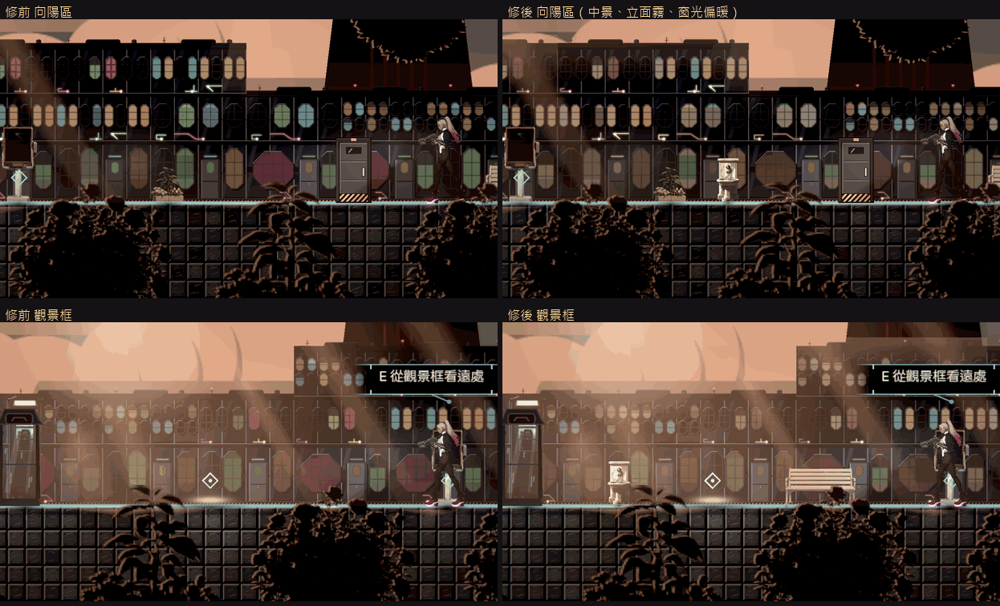
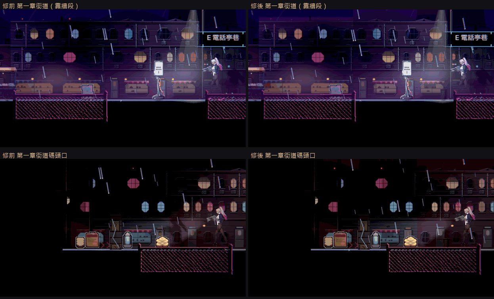

# [BG-69] 補上中景物件與立面的空氣感

> 狀態：完成

## 內文

### 需求
角色正後方是一面平的建築立面，直接接到遠景，中間沒有東西；角色像貼在牆前面。這張票在立面與走道之間補上中景物件，並讓立面依高度與距離變淡，拉開角色、牆與遠景的距離。

### 來源
2026-11-27，使用者提供另一款像素風遊戲同一個場景的兩張參考畫面（主光沒被遮住、被遮住比較多），說這種效果很好、前景與後景做得很好，並指出本專案的前景與後景有問題、沒有類似的效果，敵人與 NPC 的圖層甚至有問題。設計與現況調查見[景深、圖層與主光](../../design/22-living-scenes/DEPTH_AND_KEY_LIGHT.md)。

### 驗收條件
- [x] 立面與走道之間有一層中景物件（靠牆的花台、機櫃、管線、棚架等），比角色暗一階、比立面清楚；附修前修後同一格鏡頭
- [x] 中景物件有合理的支撐與接地（站在地上的有接地陰影，掛在牆上的在牆面範圍內），不浮空
- [x] 立面依高度與距離加上和遠景同一套的霧色：越高、越遠越淡；室內區段不套用室外的霧色
- [x] 角色、敵人與可走地面相對於中景與立面的對比不低於修前（既有的可讀性檢查通過）
- [x] 中景物件的密度有上限，不讓畫面變雜；戰鬥區段比安全區少
- [x] 第三章向陽區與第一章街道各套用一段；低畫質保留中景物件、關掉立面霧色
- [x] 受影響範圍的測試全過

### 測試流程
1. 進第三章向陽區與第一章街道
2. 預期角色後面有靠牆的物件，再後面才是立面，立面往上變淡
3. 預期敵人與主角仍然從背景裡跳出來

---

# 跟其他票的關係

- Blocks：無
- Blocked by：無
- Related：BG-20、BG-28、BG-63、BG-65、BG-67、BG-68

---

# Commit-1

## 內文

角色正後方是一面平的建築立面，直接接到遠景，中間沒有東西；立面從下到上一樣清楚，有主光的向陽區窗光仍然是綠、藍、紅各一色，和單一色系打架。

現在區域可以在地圖資料裡指定一排中景物件（用哪些場景擺設、間隔、範圍）。位置依規則排出：只放在背後真的有立面的地方（空曠的高台不放）、站在地上並和手擺的擺設一樣有接地陰影與支撐檢查、不和地圖上手擺的擺設重疊、離出入口、人物、拾取物、看板這類實體至少 28 像素；一個畫面寬最多 5 件，戰鬥範圍（敵人出生點附近）最多 2 件、間隔加倍。中景物件畫得比角色暗一階。

室外的立面依高度加上區段的霧色（和地面霧同一個顏色）：越往上越淡、越接近空氣的顏色；走道往上 80 像素以內完全不加，角色與敵人背後的牆維持原本的對比。頭上有天花板的室內段落不加；濃淡可以依區域調整（夜裡霧色比天空亮，第一章街道只加一點）；低畫質不畫。有主光的區域，立面的窗光往主光色靠，只留約一成的窗戶維持原色當點綴；這面立面用自己的一份材質，遠景、擺設與過場的窗光不受影響。

第三章向陽區：靠牆的回收桶、飲水柱、長椅，立面上半部偏向暖色的空氣，窗光偏暖。第一章街道：靠牆段落有垃圾桶，立面加一點霧；街道大多是背後沒有立面的高架段，所以中景比向陽區少。

### 測試結果

| 項目 | 結果 |
|---|---|
| 受影響範圍的測試（6 個程序平行） | 94899 項檢查，0 失敗，腳本錯誤 0 |
| 中景與立面霧的自動檢查 | 兩個區域的每一件中景都站在地上、靠著立面、不和擺設重疊、離實體夠遠、密度在上限內；不存在的擺設略過；立面霧只在室外且緊貼立面、低畫質隱藏；有主光的區域窗光偏向主光色且用自己的材質，沒有主光的區域不改色：全過 |
| 可讀性（門檻 主角 0.60 ／ 地面邊緣 1.00 ／ 敵人 0.45；雨與閃電讓同一份程式每次量的結果不同，修前修後各量多次） | 向陽區「光斑」主角 修前 3.39～3.40、修後 3.38～3.39，地面邊緣都是 1.35；第一章街道「市集」主角 4.22～4.49 ／ 4.14～4.48、敵人 2.77～2.98 ／ 2.70～2.98；「碼頭入口」主角 3.54～3.84 ／ 3.53～3.80、敵人 2.11～2.20 ／ 2.12～2.20。修後都在修前的範圍內，全部通過 |
| 原生截圖 | 無錯誤 |

### 截圖

第三章向陽區（左修前、右修後）。

第一章街道（左修前、右修後）：靠牆段落與碼頭口。

