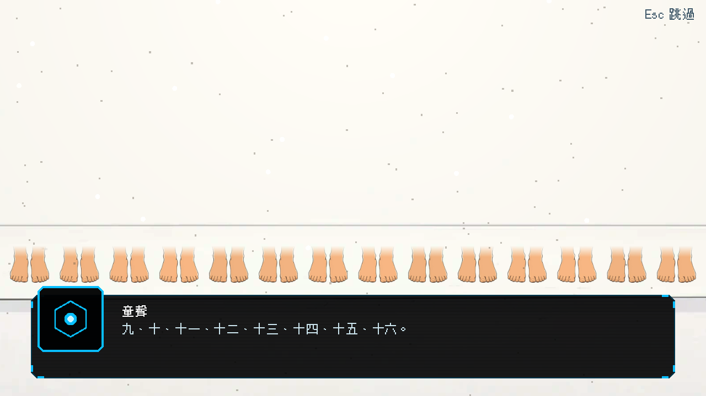
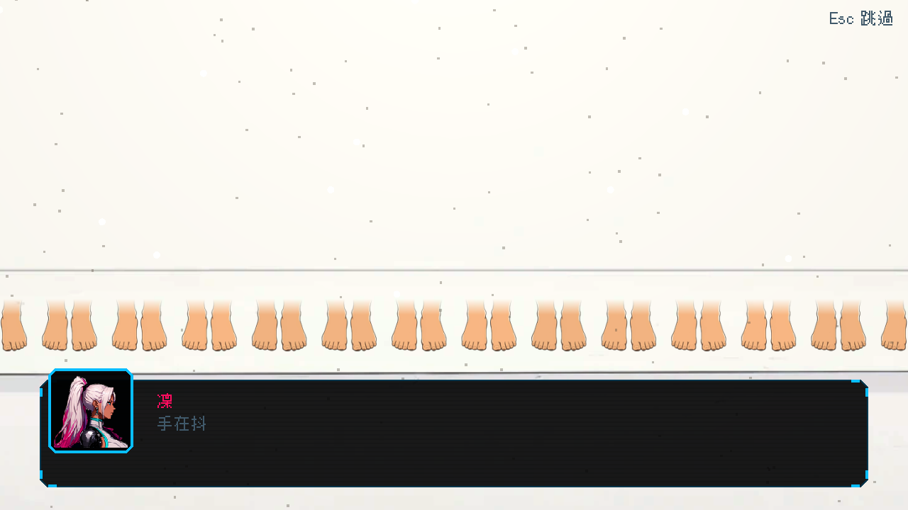

# [BG-6] 重做白房間的一排小腳

> 狀態：完成

## 內文

### 需求
第二章「記憶」過場的白房間，鏡頭會慢慢推近到那排「一排小腳」（童聲數到十六）。這十六雙小腳目前是粗糙的棕色多邊形，與已經改成賽璐璐畫風的白房間背景落差很大，鏡頭放大 1.8 倍時特別明顯。換成賽璐璐畫風的圖：十六雙赤腳排成一列、間距相等、淡色皮膚。

### 來源
2026-10-03，使用者決定道具與場景改走賽璐璐畫風；NE-65 換完室內舞台後，白房間的小腳仍是多邊形。故事設定見 `design/04-story/FORESHADOWING.md`（F10 數到十六）與 `design/10-presentation/DESIGN.md`（白房間：過曝、顆粒、一排小腳）。

### 驗收條件
- [x] 十六雙小腳改為賽璐璐畫風的圖，間距相等、位置仍在原本的地板線上
- [x] 鏡頭推近到 1.8 倍時線條與顏色仍清楚，不糊
- [x] 演出不變：童聲數到十六的台詞節奏、閃光與雜訊都照舊
- [x] 過場動畫能完整播放，略過鍵正常

### 測試流程
1. 預覽白房間舞台
2. 播放第二章記憶過場，確認推近鏡頭時的畫面
3. 執行過場動畫、章節過場相關測試套件

---

# 跟其他票的關係

- Blocks：無
- Blocked by：無
- Related：NE-65、NE-53

---

# Commit-1

## 內文

白房間那排「一排小腳」是 32 個棕色多邊形，鏡頭推近到 1.8 倍時特別粗糙。現在是賽璐璐畫風的赤腳：先生成一雙透明背景的小腳，再拼成十六雙、間距相等、整列置中，腳底落在原本的地板線上，小腿往上淡出，每雙膚色略有不同。圖以 4 倍解析度存成無損圖，推近到 1.8 倍仍然清楚；圖缺失時退回舊的多邊形並記錄錯誤。台詞節奏、閃光與雜訊沒有改。
驗收：預覽白房間舞台，並播放第二章記憶過場，童聲數到十六時小腳整列在畫面中，推近鏡頭後線條與顏色清楚；過場動畫相關測試套件通過。

### 測試結果

| 項目 | 結果 |
|---|---|
| 相關測試套件（環境元件、道具、過場動畫、第二章、轉場） | 通過 1518 / 1518 |
| 素材檢查（大小與總量） | 通過（環境素材 22.8 MB／60 MB，單檔最大 0.6 MB） |
| 執行 log | 無非預期的 ERROR |

### 截圖

