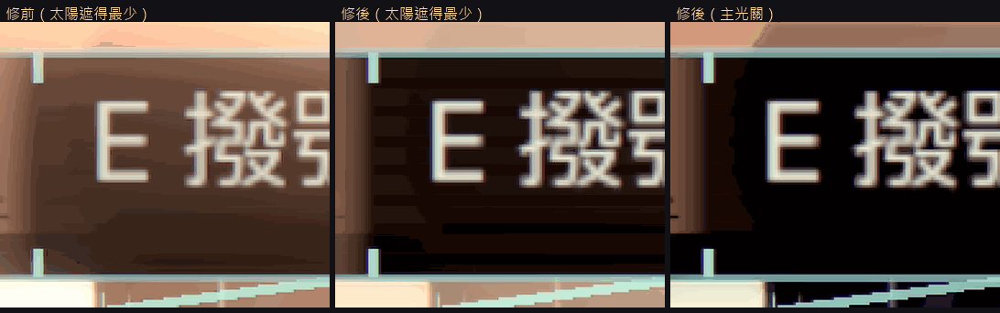
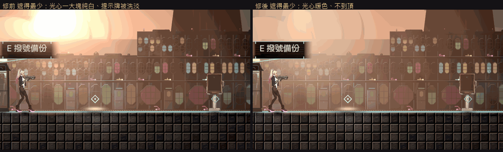

# [BG-70] 修正主光下提示牌看不清楚與光心過白

> 狀態：完成

## 內文

### 需求
第三章向陽區的主光（BG-67）在太陽遮得少的時候有兩個問題：「E 撥號備份」「E 從觀景框看遠處」這類全像提示牌整塊被光洗成灰底灰字，幾乎看不到；光心是一塊約 250 像素寬的純白。提示永遠優先於氣氛，特效要克制、不過曝。這張票讓提示牌、地圖對話氣泡與頭頂標記在主光任何狀態下都維持原本的對比，並把光心壓成帶暖色的最亮處。

### 來源
2026-11-28，主 session 驗收 BG-67 時在向陽區重拍發現，並轉述使用者「特效克制、不要過曝」的一貫要求。

### 驗收條件
- [x] 太陽遮得最少時，提示牌的文字與底板的對比和沒有主光時相同，達到提示牌既有的可讀性標準；附遮得少時提示牌的近拍
- [x] 地圖對話氣泡與頭頂標記在主光任何狀態下同樣不被洗淡
- [x] 有自動檢查：把遮住程度固定在 0 時量提示文字與底板的對比，低於標準就失敗
- [x] 光心仍然是畫面最亮的地方，但帶暖色、最亮處每個色版都不到頂；純白的面積明顯比修前小，大片柔光的範圍維持；附修前修後同一格鏡頭與純白面積的數字
- [x] 既有的曝光與可讀性檢查通過；受影響範圍的測試全過

### 測試流程
1. 進第三章向陽區，把太陽固定在遮得最少的狀態
2. 走到電話亭與觀景框旁，預期提示牌和其他區域一樣清楚
3. 看太陽本身，預期是暖色的亮光，不是一塊純白

---

# 跟其他票的關係

- Blocks：無
- Blocked by：無
- Related：BG-67、NE-390

---

# Commit-1

## 內文

太陽遮得少的時候，主光的光暈是用加法疊上去的：亮的天空再加上光暈，亮度遠超過泛光門檻，泛光把一大片光暈糊開，連帶蓋到畫在最上層的提示牌，提示牌變成灰底灰字；光心也因此是一塊約 250 像素寬的純白。

現在光暈與光柱改成「往主光色靠」的一般混合：亮度永遠不超過主光色本身，不會觸發泛光，也就不會洗淡上層的提示牌、地圖對話氣泡與頭頂標記。光心是主光色往白靠一點的暖色，經過區段調色之後每個色版都不到頂；大片柔光的範圍不變。角色前面那層淡淡的漫射改到緊貼角色的上一層，頭頂標記與水面都在它之上。向陽區的暗角從 0.3 降到 0.15：太陽在畫面左上角，原本的暗角會把光心壓暗兩成多。

提示牌的對比用原生截圖量（太陽固定在遮得最少、等提示牌完整淡入）：畫面上的提示牌取文字最亮的 3% 與底板最暗的 30% 算 WCAG 對比值，低於一般文字的業界標準 4.5:1 或低於同一格主光關掉時的八成五就算失敗；修前的版本用同一個量測會失敗。另有不需要畫面的自動檢查：光暈與光柱必須是一般混合、光心顏色不到純白、提示與氣泡與頭頂標記的圖層都在所有主光圖層之上。

### 測試結果

| 項目 | 結果 |
|---|---|
| 受影響範圍的測試（6 個程序平行） | 66723 項檢查，0 失敗；腳本錯誤只有新工作目錄「蘇」的匯入路徑（NE-402 已記錄，與本票無關） |
| 提示牌對比（太陽遮得最少，WCAG 對比值） | 修前 7.82:1（主光關 12.42:1，只剩 63%）；修後 13.11:1（主光關 14.35:1，91%） |
| 光心 | 修前天空一帶 21119 個純白像素、最亮處三個色版都到頂；修後 0 個純白像素，最亮處 (246, 214, 184) |
| 曝光（主角在太陽正下方，頭部同一範圍的全白比例） | 主光開 1.10%、關 1.12% |
| 可讀性（第三章「光斑」取樣點，門檻 主角 0.60 ／ 地面邊緣 1.00） | 太陽完全沒遮住 1.45 ／ 1.05；平常 3.36 ／ 1.34 |

### 截圖

提示牌近拍（太陽遮得最少）：修前、修後、修後主光關。

同一格鏡頭太陽遮得最少：左修前（光心一塊純白、提示牌被洗淡），右修後（光心暖色、提示牌清楚）。

