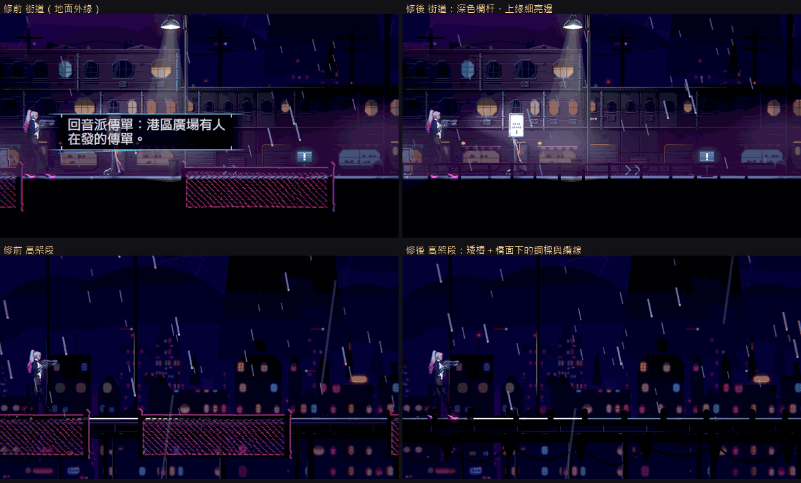
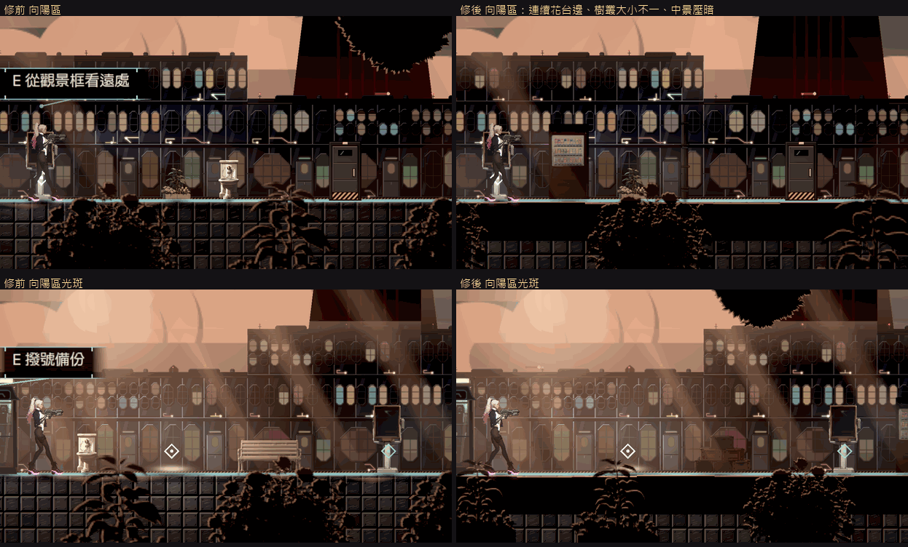
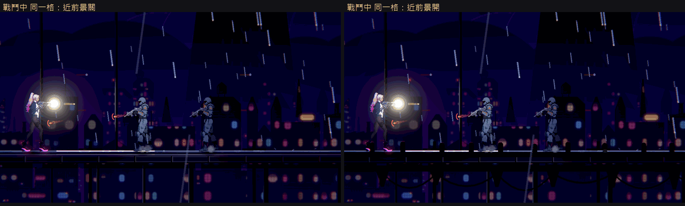

# [BG-71] 讓近前景成為合位置的深色剪影

> 狀態：完成

## 內文

### 需求
BG-68 的近前景機制正確，但畫面不對：街道的鐵網是整片粉紅色的方框，比走道上任何東西都搶眼；高架段下面是懸空的，鐵網掛在半空中；物件一塊一塊各自獨立，像一格一格的方框；向陽區的樹叢像貼在地磚牆上的幾團黑，上緣垂葉壓在同樣深色的巨構上幾乎看不見。BG-69 新放的中景物件裡，白色長椅與噴水柱是走道上最亮的東西，比主角還亮。這張票把近前景改成合位置、連成一段的深色剪影，並把中景壓到角色以下。

### 來源
2026-11-28，主 session 抽查 BG-68 與 BG-69 的截圖後退回外觀（機制與自動檢查通過），轉述使用者不喜歡「方方框框」、特效要克制的一貫要求。

### 驗收條件
- [x] 近前景整體明度低於走道最暗的地方；亮邊只留在朝主光的上緣、細細一條，細網格本身不吃亮邊；沒有主光的區段亮邊很弱，強度寫在區段資料
- [x] 擺的東西合位置：高架段用橋面下的結構（托架、鋼樑、垂下的纜線、管線）加上走道外緣的矮物；有地面的外緣才放圍欄或矮牆
- [x] 一排近前景高度有變化、輪廓破開、相鄰的物件互相壓一點，連成一段，不是一格一格的獨立方塊
- [x] 向陽區：樹叢數量減少、大小拉開、中間留空隙，用一道連續的花台邊或欄杆串起來；上緣垂葉移到看得到天空的位置或葉緣帶主光色，看得出來
- [x] 近前景比走道捲動得略快、垂掛物被風與經過的角色帶動，兩項都有做並寫在票上
- [x] 中景物件在有主光的區段吃到區段色調並壓暗到角色以下（白色擺設尤其要壓），向陽區中景多放靠牆的深色物件；自動檢查中景物件的平均明度低於同畫面主角
- [x] 街道、高架段、向陽區各一張修前修後，戰鬥中同一格的近前景開與關對照；受影響範圍的測試全過

### 測試流程
1. 進第一章街道與高架段、第三章向陽區
2. 預期近前景是深色剪影、只在上緣有細細的亮邊、合那個位置、連成一段
3. 預期中景物件比主角暗、不搶眼

---

# 跟其他票的關係

- Blocks：無
- Blocked by：無
- Related：BG-68、BG-69

---

# Commit-1

## 內文

近前景改成真正的深色剪影：顏色是環境光的一小部分，比走道最暗的地方還暗；亮邊只留在朝主光那側的上緣、一像素寬，而且要背後是實心的一塊才有亮邊，細的網格與線條本身不吃亮邊；亮邊強度是區段資料，沒有主光的區段預設很弱。街道原本整片粉紅色的鐵網拿掉了。

擺的東西依位置判斷：走道比區域地面高出很多、底下是空的高架段，不放圍欄，改放走道邊的矮樁（路緣在走道面下方）與橋面下的鋼樑、三角托架、托架之間垂下的纜線；有地面的外緣才放欄杆或花台邊。這些底座由程式畫成連續的一段，立柱與矮樁高低略有差異，不是一格一格的方塊；放在走道面下方，只讓立柱、矮樁、樹叢冒出來，走道的亮邊照樣看得到。上面再放的貼圖物件大小拉開（0.6～1.15 倍）、露出的高度跟著大小變、相鄰的可以互相壓一點。

第三章向陽區：一道連續的花台邊把整排串起來，樹叢與花台數量變少、大小拉開、中間留空隙；上緣的垂葉葉緣四周帶一點主光色，壓在深色巨構上也分得出來。

近前景的貼圖物件比走道捲動得略快（鏡頭每移動 1 像素多移 0.06，最多 24 像素），連續的底座固定在走道邊上；垂掛的纜線、燈籠串、枝葉被風吹，經過的角色會帶動它們，「減少動態」與低畫質時靜止——這兩項在 BG-68 已經做好，這次補上自動檢查。

中景：有主光的區段，中景擺設往主光色靠，並依貼圖本身的亮度壓暗（白色長椅、白色噴水柱這類壓得最多）；向陽區改放回收桶、行道樹花台、咖啡棚架、販賣機、貨箱、管線、油桶這類深色物件，不放白色長椅與噴水柱。

自動檢查新增：高架段只有矮樁與橋面下的結構、有地面的地方才有欄杆與花台邊；向陽區有一道連續的花台邊；垂掛物會被帶動；中景擺設「貼圖亮度 × 壓暗」不超過角色以下的上限。截圖情境另外量同一格裡中景與主角的平均明度，中景比主角亮就算失敗；戰鬥的開關對照改成暫停在同一格再切換近前景。

### 測試結果

| 項目 | 結果 |
|---|---|
| 受影響範圍的測試（6 個程序平行） | 94973 項檢查，0 失敗，腳本錯誤 0 |
| 中景與主角同一格的平均明度（中景／主角） | 向陽區 0.209／0.355、0.192／0.323、0.172／0.201；第一章街道 0.180／0.202 |
| 可讀性（門檻 主角 0.60 ／ 地面邊緣 1.00 ／ 敵人 0.45） | 向陽區「光斑」3.57 ／ 6.35；第一章街道「市集」4.12 ／ 2.99 ／ 2.70、「碼頭入口」3.94 ／ 3.20 ／ 2.29，全部通過（碼頭入口的地面邊緣比修前的 3.75 低一些，欄杆立柱壓在走道邊上） |
| 原生截圖 | 無錯誤 |

### 截圖

第一章街道（上：有地面的外緣；下：高架段）。

第三章向陽區（上：觀景框一帶；下：光斑一帶）。

戰鬥中同一格（暫停後切換近前景）：主角、敵人、子彈與命中特效都看得清楚。

