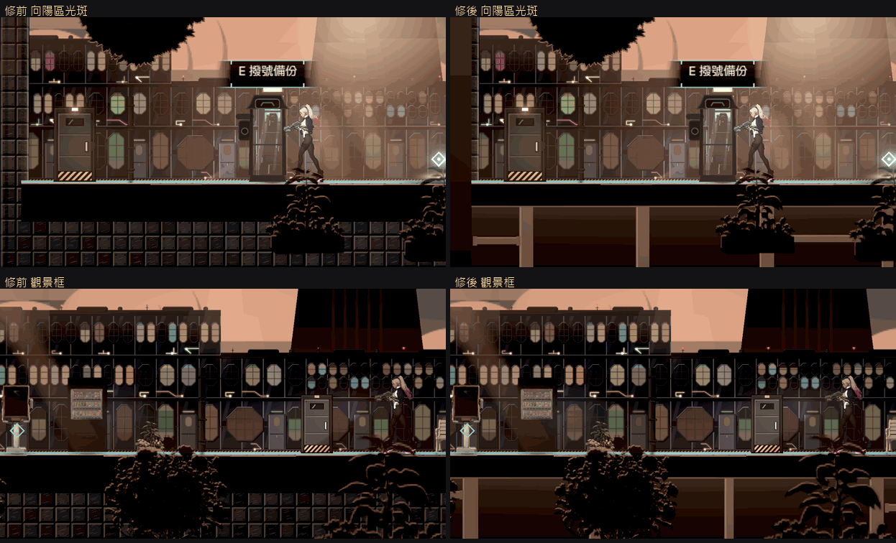

# [BG-72] 把走道下方的死黑改成有層次的地面剖面

> 狀態：完成

## 內文

### 需求
可走地面以下的大片區域常常是整塊黑或整片重複的地磚，是畫面下三分之一最空、最像貼圖的地方。這張票把走道下方改成有層次的剖面：緊貼走道的一段維持清楚的走道邊，往下逐漸變暗，中間看得出結構（橋面樑、基樁、偶爾一條管線），不再是一整片地磚。先套在第三章向陽區這個樣板。

### 來源
2026-11-28，畫面待辦清單第 3 項（`design/22-living-scenes/BACKLOG.md`）；主 session 指定在近前景外觀修正後、先套在向陽區。

### 驗收條件
- [x] 區段可以在資料裡打開地面剖面，並調整變暗的起點與濃度、基樁的間隔、管線出現的機率；資料壞掉時記錄是哪個區域哪一項並照常顯示
- [x] 走道邊緣與緊貼走道的一段維持原本的清楚度，往下逐漸變暗；看得出橋面樑、基樁與管線，不是整片重複的地磚，也不是純黑
- [x] 剖面在近前景後面、角色腳下的走道之下；不擋任何可走的地面與互動物
- [x] 既有的可讀性檢查通過（地面邊緣對比不低於修前）；三個畫質都畫；靜止不重畫
- [x] 第三章向陽區套用；附修前修後同一格鏡頭；受影響範圍的測試全過

### 測試流程
1. 進第三章向陽區
2. 預期走道下方是往下變暗的剖面，看得到基樁與管線，走道邊依舊清楚

---

# 跟其他票的關係

- Blocks：無
- Blocked by：無
- Related：BG-68、BG-69、BG-71

---

# Commit-1

## 內文

第三章向陽區走道下方原本是一整片重複的金屬地磚，往下一直到畫面底，是畫面下三分之一最空、最像貼圖的地方。

現在區域可以在地圖資料裡打開「地面剖面」：走道邊與緊貼走道的一段（預設 14 像素）維持原樣，以下換成不透明的剖面底色，往下逐漸變暗；剖面裡有一道緊貼在走道下方的橋面樑、間隔與粗細不一的基樁，基樁之間偶爾有一條兩端帶接頭的管線，結構比底色亮一點、上緣有一條很淡的主光色亮邊。顏色由區段的環境光決定（向陽區是暖褐色），不是純黑也不是地磚。變暗的起點與濃度、基樁的間隔、管線出現的機率都寫在資料裡；資料寫錯時記錄是哪個區域哪一項，這一區不畫剖面、照常顯示。只有「可走地面下面還有至少兩格實心」的地方才畫（薄平台不算，室內的天花板也不會被當成走道）。剖面畫在地形上面、所有擺設、角色與近前景下面；只畫一次、不重畫，三個畫質都畫。

為了讓剖面露出來，向陽區近前景的花台邊從 30 像素收到 18 像素（再薄的話走道邊的對比會掉到 3.9）。

### 測試結果

| 項目 | 結果 |
|---|---|
| 受影響範圍的測試（6 個程序平行） | 94985 項檢查，0 失敗，腳本錯誤 0 |
| 地面剖面的自動檢查 | 四種壞資料都不畫、向陽區有剖面且蓋住大部分走道下方、從走道邊下方開始、畫在地形之後角色之下、不重畫：全過 |
| 可讀性（第三章「光斑」取樣點，門檻 主角 0.60 ／ 地面邊緣 1.00） | 修前 3.57 ／ 6.35；修後 3.57 ／ 6.36 |
| 原生截圖 | 無錯誤 |

### 截圖

第三章向陽區同一格鏡頭（上：光斑一帶；下：觀景框一帶）。

