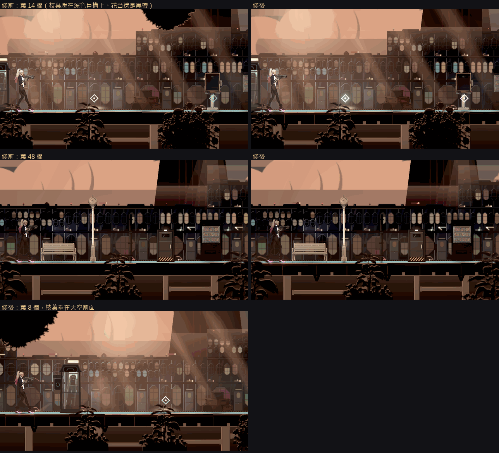
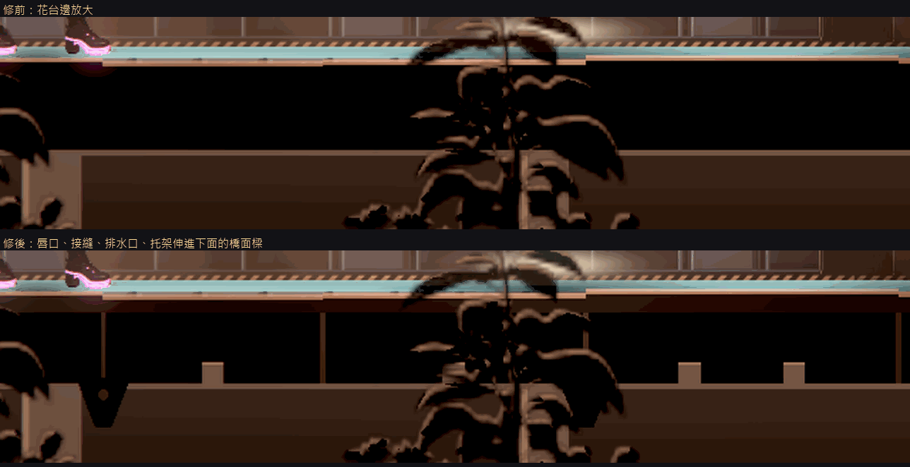

# [BG-73] 讓向陽區花台邊有輪廓並把垂葉移到天空前

> 狀態：完成

## 內文

### 需求
第三章向陽區走道外緣的花台邊是一條平的純黑橫帶，看不出是什麼東西，和下面的地面剖面也沒有接在一起；從畫面上緣垂下來的枝葉壓在深色的巨構上，糊成一團黑。這張票讓花台邊有看得出的輪廓並架在下面的結構上，枝葉只垂在後面是天空的地方。

### 來源
2026-11-28，主 session 驗收 BG-71、BG-72 時提出。

### 驗收條件
- [x] 花台邊看得出唇口、間隔的接縫、排水口與托架，不再是一條平的純黑帶；托架伸進下面的地面剖面，看起來是架在結構上
- [x] 花台邊仍比走道暗，走道邊緣的可讀性不低於修前（自動量測）
- [x] 垂下來的枝葉後面是天空，不壓在深色巨構或立面上；有自動檢查量枝葉後面的背景亮度
- [x] 受影響範圍的測試全過；附修前修後截圖與花台邊的放大比較

### 測試流程
1. 第三章向陽區走一趟：預期花台邊有唇口、接縫、排水口與托架，枝葉只在天空前面

---

# 跟其他票的關係

- Blocks：無
- Blocked by：無
- Related：BG-71、BG-72

---

# Commit-1

## 內文

花台邊：唇口是一段一段、高低略有差異的面，比身體亮一點（帶一點主光的暖色），上緣照舊一條細亮邊、下緣一條陰影；段與段之間一條接縫；身體下緣每段切出一兩個排水口，看得到後面的地面剖面；每隔一個接縫一個三角托架，往下伸進地面剖面的橋面樑，托架上一顆螺栓。身體本身維持剪影色：走道邊緣下方那一帶要暗，走道邊才讀得出來（試過在身體中間加一道凹槽，正好落在走道邊緣的量測範圍裡，對比掉到 5.5，所以拿掉）。

枝葉：新增一個掃描工具，鏡頭依序對準每一欄，量「垂掛物會在的位置」後面的背景亮度。向陽區只有第 4～22 欄後面是天空（亮度 0.40～0.71），第 24 欄以後是深色巨構與立面（0.09～0.35）。地圖把垂掛那一排拆成兩排：枝葉只放在第 4～22 欄，燈籠串放在其餘的地方。零件庫把枝葉標成「需要天空當背景」，同一個工具會對準每一件實際放的枝葉量它後面的亮度，低於 0.40 就算失敗。

### 測試結果

| 項目 | 結果 |
|---|---|
| 受影響範圍的測試（6 個程序平行，55 組） | 63478 項檢查，0 失敗，腳本錯誤 0 |
| 走道邊緣可讀性（光斑） | 邊緣對比 6.43（修前 6.35）；玩家對比 3.55（修前 3.58） |
| 枝葉後面的背景亮度 | 唯一一件枝葉在第 8 欄，亮度 0.66（門檻 0.40）；修前第 42 欄 0.16 |
| 原生截圖 | 無錯誤 |

### 截圖

向陽區修前修後：枝葉不再壓在深色巨構上；花台邊有輪廓、架在下面的結構上。最下面是枝葉的新位置。

花台邊放大比較。

