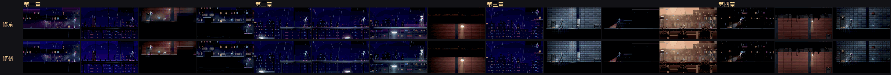
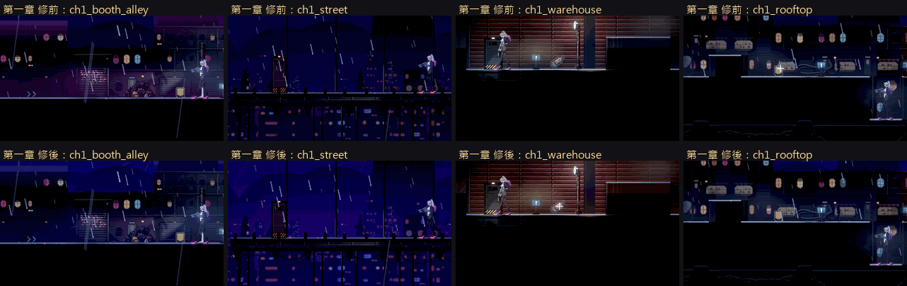
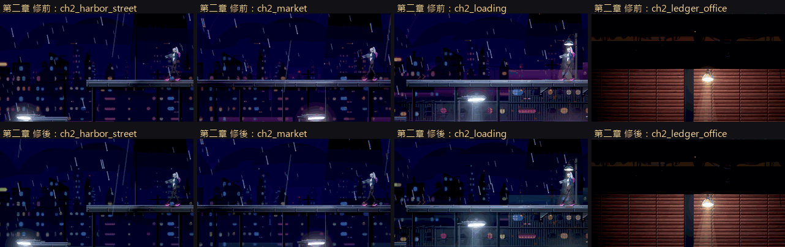
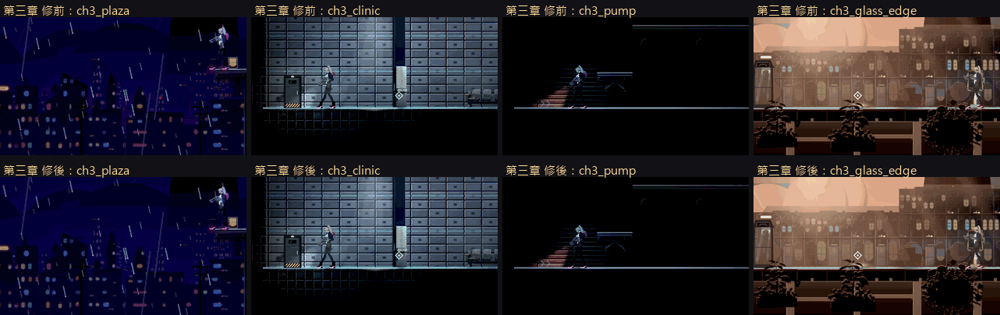
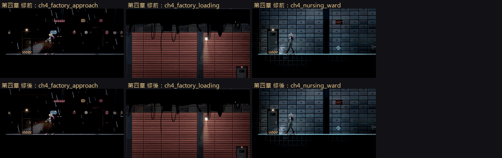
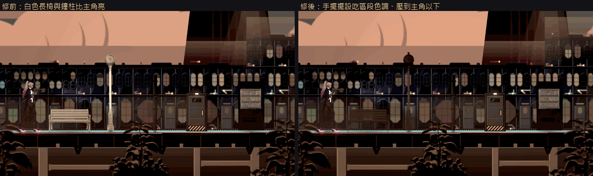

# [BG-74] 為每個區域定一份色彩腳本並套到光影

> 狀態：完成

## 內文

### 需求
向陽區做完樣板後，其他區域仍然各有各的顏色：同一章的區域色調跳來跳去，章與章之間也看不出顏色在講什麼。這張票定一份色彩腳本：每個區域一個主色、主光色與暗部色，依章節的情緒排成一張表，並套到各區域的光影上。只改色相與色調，不改明暗，原本的暗場可讀性不受影響。

### 來源
2026-11-28，畫面待辦清單第 1 項（`design/22-living-scenes/BACKLOG.md`）。

### 驗收條件
- [x] 設計文件有一張色彩腳本表：每章的情緒與用色理由，以及第一到第四章每個區域的主色、主光色、暗部色
- [x] 色彩腳本是資料：新增或調整區域只改資料；資料寫錯時記錄是哪個區域哪一項，該區域維持原本的光影
- [x] 進入區域時光影套上該區域的色彩腳本；環境光與暗部色的亮度與修前相同（自動檢查），向陽區樣板的外觀不變
- [x] 第一章與第三章的暗場可讀性檢查通過，數值不低於修前
- [x] 受影響範圍的測試全過；每章附幾個區域的修前修後並排與整章的色彩縮圖帶
- [x] 手擺的非互動、不發光擺設也吃區段色調；有主光的區段裡白色石材壓到主角以下；「擺設比主角暗」的檢查擴到手擺的擺設，逐件量（2026-11-28 主 session 驗收 BG-73 時追加）

### 測試流程
1. 依序進第一到第四章的幾個區域：預期同一章色調連貫、章與章之間顏色明顯不同，暗處的角色與敵人一樣清楚

---

# 跟其他票的關係

- Blocks：無
- Blocked by：無
- Related：BG-67、BG-69

---

# Commit-1

## 內文

色彩腳本：設計文件新增一張表（`design/22-living-scenes/COLOR_SCRIPT.md`），寫明每章的情緒與用色理由——當舖是全遊戲固定的暖色（家），第一章紫藍配洋紅霓虹（陌生的夜城），第二章灰藍綠配鈉燈琥珀（港口、工作），第三章室外暖杏、室內冷白青（有錢的地方第一次有日光，一進室內就冷），第四章鏽褐與病綠（消耗）——以及第一到第四章全部 44 個有光影的區域各自的主色、主光色、暗部色。資料是一個檔案；資料寫錯時記錄是哪個區域哪一項，該區域維持原本的光影；沒寫到的區域也維持原本的。

套用：進入區域時把腳本套到該區域光影區段的複本上（共用的光影設定檔不改）。環境光、暗部色、天空與遠景的染色、霧都只換色相，亮度維持原本的值；角色邊緣光換成主光色。燈具與霓虹是點綴色，不在腳本裡。向陽區樣板的腳本就是它原本的顏色，套上去外觀不變。廣場的遠景剛好在角色身後，偏色會讓角色對比掉 0.9，所以資料裡把它的遠景偏色調小、邊緣光維持洋紅，量回修前的水準。

手擺的擺設：不發光的手擺擺設也往區段主色偏一點（亮度不變）；有主光的區段裡貼圖很亮的（白色石材、白色長椅、鐘柱）壓到比中景亮、比主角暗，並往主光色靠。燈具、有窗光的擺設不調。互動物件（電話亭、檢查點、門）不是擺設，不受影響。近前景截圖腳本原本把中景擺設平均起來和主角比，改成中景與手擺擺設逐件和主角比（一張白色長椅不會被其他擺設平均掉）。

已知限制：夜景的天空與遠景貼圖本身是紫藍色，色彩腳本在不改亮度的前提下只能把它往主色推一部分；第一、二章夜景看得出不同但差別不大，要拉得更開要在逐章套用時換遠景或天空（寫在設計文件）。

自動檢查新增：腳本裡每個區域都是真的關卡、id 對得上；套用後環境光、暗部色、背景染色與霧的亮度不變（最大差 < 0.002）、邊緣光是主光色、共用的設定檔沒被改；向陽區樣板外觀不變（每個色版差 < 0.03）；第一到第四章有光影的區域都有腳本；沒有腳本的區域原樣回傳。

### 測試結果

| 項目 | 結果 |
|---|---|
| 受影響範圍的測試（6 個程序平行，69 組） | 95158 項檢查；兩項因資料檔放在光影設定資料夾、樣板背景偏色而失敗，修正後重跑那幾組 10728 項 0 失敗；另一項雲蛇死亡淡出的計時在負載下偶發，單獨重跑通過 |
| 第一章暗場可讀性（12 區 16 點） | 全部通過；玩家、邊緣、敵人對比與修前相同或更高。降最多的一點是看門狗前廳的玩家對比（修前 5.48，修後三次 5.25、5.49、5.28），同一份程式重跑就差 0.2，在誤差內 |
| 第三章暗場可讀性（10 區 17 點） | 全部通過；廣場調整後 7.60/4.93、7.56/2.68、5.21/2.00（修前 6.98/4.79、7.42/2.69、5.29/2.02） |
| 擺設比主角暗（向陽區四格、街道） | 中景與手擺擺設逐件都比主角暗；第 48 欄白色長椅 0.151、鐘柱 0.149，主角 0.209 |
| 原生截圖 | 無錯誤 |

### 截圖

整章色彩縮圖帶（上排修前、下排修後）。

第一章到第四章，每章幾個區域的修前修後。

向陽區第 48 欄：手擺的白色長椅與鐘柱。

