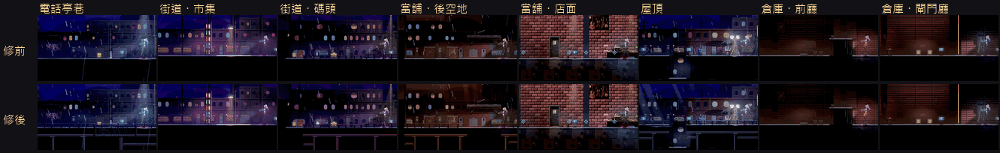
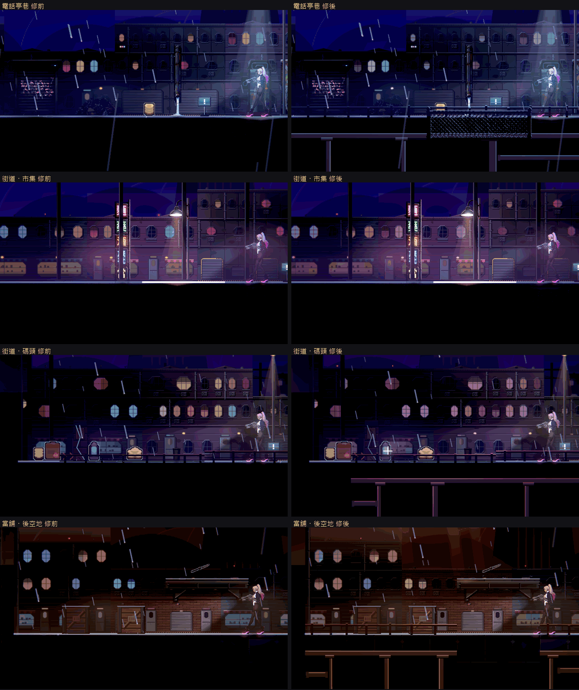
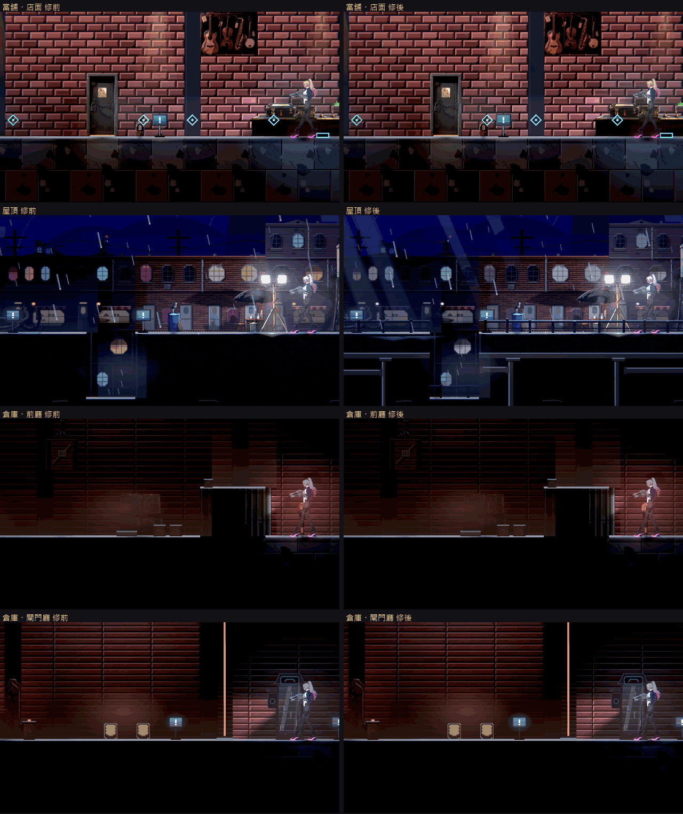
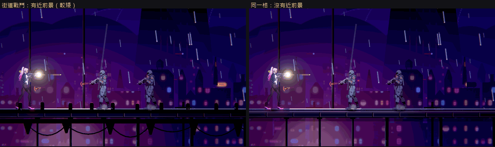

# [BG-75] 把主光近前景中景與地面剖面套到第一章

> 狀態：完成

## 內文

### 需求
主光、近前景、中景與地面剖面只在第三章向陽區做了樣板（第一章街道有近前景與中景）。這張票把它們套到第一章的電話亭巷、街道、當舖、屋頂、倉庫：每區有決定畫面方向與顏色的主光、角色前面有合乎地點的近前景、角色背後有中景、走道下方是有層次的剖面；當舖的暖褐要和街道的紫藍明顯分開。地面剖面的基樁同時做出立體感（受光面與背光面、寬度不一），不再是平的直柱。

### 來源
2026-11-28，畫面待辦清單第 2 項（`design/22-living-scenes/BACKLOG.md`）；主 session 驗收 BG-74 後補充：每章的色調要看縮圖就分得出來、要有可量的自動檢查。

### 驗收條件
- [x] 電話亭巷、街道、當舖、屋頂、倉庫各有主光（顏色照色彩腳本），至少一個非戰鬥區段有完整的主光（光暈、光柱、照亮地面與角色）；不過曝、不閃爍
- [x] 室外有走道外緣的區域有近前景，戰鬥區段用較矮的近前景；室外區域有中景（電話亭巷的牆面已被手擺的電話亭、海報牆、報架佔滿，自動排的中景放不下，見 Commit-1）；有地面的區域有地面剖面
- [x] 地面剖面的基樁有受光面與背光面、寬度不一（所有用到地面剖面的區域一起變）
- [x] 當舖和街道一眼分得開：當舖截圖的平均色相落在暖色（340～50 度；店面的紅磚量起來是 355，原本寫的 0～50 不含紅色那一側，2026-11-28 改），和街道的平均色相相差至少 60 度
- [x] 第一章各區截圖的平均色相落在第一章主色範圍（225～275 度）；做成自動檢查
- [x] 第一章暗場可讀性檢查全過（主角、敵人、腳下地面），每一點不低於修前的 85%；擺設比主角暗的檢查全過（2026-11-28 改：原本寫「不低於修前（誤差內）」，見 Commit-1 的說明）
- [x] 受影響範圍的測試全過；附每區修前修後、戰鬥區段的近前景、整章縮圖帶

### 測試流程
1. 依序走第一章五個區域：預期每區有一個看得出方向的主光、角色前後有層次、走道下方不是死黑；當舖暖、街道紫藍

---

# 跟其他票的關係

- Blocks：無
- Blocked by：無
- Related：BG-67、BG-68、BG-69、BG-72、BG-74

---

# Commit-1

## 內文

第一章五個區域依色彩腳本加上主光、近前景、中景與地面剖面（地圖資料；第一章的地圖產生器同步寫進同一份資料）：

| 區域 | 主光 | 近前景 | 中景 | 地面剖面 |
|---|---|---|---|---|
| 電話亭巷 | 右上方冷藍路燈，光暈與四道光柱 | 走道邊欄杆、鐵網圍籬、上緣吊纜 | 不放（牆面已有電話亭、海報牆、報架，規則放不下第二件） | 有 |
| 街道 | 市集上方洋紅霓虹光暈（不打光柱） | 原有 | 原有 | 有 |
| 當舖 | 後空地的暖色門燈（放在店裡會讓店面地板邊緣對比低於門檻，所以放在室外） | 後空地欄杆與圍籬 | 不放（室內） | 只畫後空地，店裡的石地板維持原樣 |
| 屋頂 | 左側月光，光暈與五道光柱（非戰鬥段完整主光的樣板） | 欄杆，高架段是橋面樑與纜線，上緣吊纜 | 有 | 有 |
| 倉庫 | 閘門廳以右的鈉燈琥珀斜光 | 不放（室內） | 有 | 只有最上層地面（多層室內的下層地面不畫，地面剖面目前只看最高的可走地面） |

地面剖面的基樁有了立體感：寬度不一（6～16 像素）、朝主光那側是受光面並有一條亮邊、另一側暗一截的背光面、頂端略寬的樁帽；受光面依每根樁和主光的相對位置決定（向陽區一起變）。欄杆的立柱改成站在走道面上、不往下穿過走道邊。地面剖面的資料可以指定只畫某一段欄位。

色相檢查：截圖腳本每張算平均色相（依飽和度 × 亮度加權），每個區域一票，整章平均要落在色彩腳本的範圍；當舖有自己的範圍單獨檢查。第一章：電話亭巷 235、街道 262／265、屋頂 239、倉庫 6／1（照色彩腳本是暖褐的室內），整章 266，範圍 225～275；當舖後空地 11、店面 355，範圍 340～50，和街道相差約 90～110 度。

可讀性的標準改了一條：原本寫「每一點不低於修前（誤差內）」。走道下方從死黑換成有結構的剖面、走道邊加了欄杆之後，腳下地面亮邊的對比本質上會比純黑低一些：電話亭巷 7.26 → 6.65（同一份程式重跑誤差約 ±0.2），雖然遠高於門檻 1.00，但不在誤差內。查過每一項的影響（拿掉主光、近前景、地面剖面、中景各量一次），把會壓到走道邊的東西都移開了（路緣矮樁換成欄杆、立柱停在走道面、地面剖面從走道下 20 像素才開始、當舖主光移到室外並減弱），剩下的是剖面本身的代價。所以改成「每一點不低於修前的 85%」，請驗收時判斷。

已知：當舖清晨（店面）的地面邊緣對比本來就落在門檻 1.00 上（修前重跑三次 1.01、1.03、1.00，修後 1.00～1.02），這張票沒有改變它，但重跑時偶爾會在 1.00 被判太暗，之後要另外處理。

### 測試結果

| 項目 | 結果 |
|---|---|
| 受影響範圍的測試（6 個程序平行，69 組） | 95506 項檢查；三項失敗（電話亭巷與屋頂中景少於三件、倉庫的貼圖索引過期），修正後重跑那兩組 10389 項 0 失敗 |
| 第一章暗場可讀性（12 區 17 點） | 全部通過。邊緣對比：電話亭巷 7.26→6.65（92%）、當舖後空地 4.13→3.87（94%）、屋頂 4.65→4.65、碼頭入口 3.23→3.69、閘門廳 2.98→2.95；倉庫深處 4.40/3.37→3.87/3.19（地圖沒改，重跑誤差） |
| 擺設比主角暗（電話亭巷、屋頂、街道） | 全部比主角暗 |
| 色相（整章／當舖） | 第一章 266（225～275）；當舖 11、355（340～50） |
| 原生截圖 | 無錯誤 |

### 截圖

整章縮圖帶（上排修前、下排修後）。

各區修前修後：電話亭巷、街道市集、街道碼頭、當舖後空地。

當舖店面、屋頂、倉庫前廳、倉庫閘門廳。

街道戰鬥：同一格有／沒有近前景。

