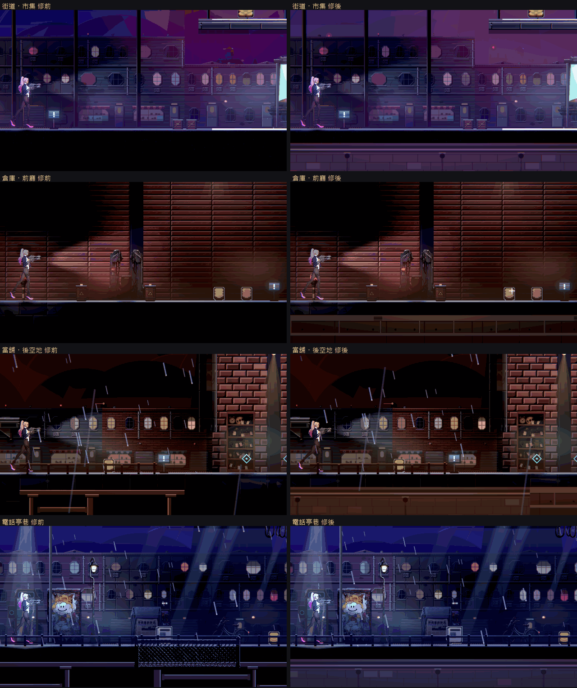
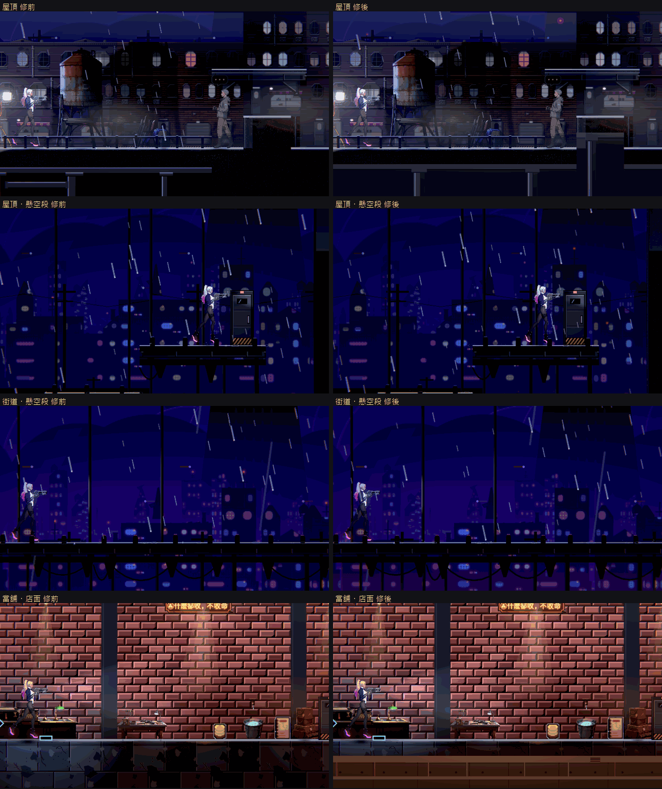
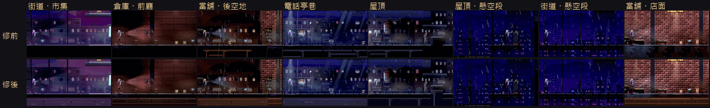

# [BG-76] 讓夜景走道下方不再是整片死黑

> 狀態：完成

## 內文

### 需求
第一章套上地面剖面之後，夜景區的走道下方仍然是畫面下三到四成的純黑：剖面依環境光染色，夜裡環境光太暗就等於黑；多層的區域（街道市集、倉庫）剖面只畫在最上層的地面，下層完全沒變；有鋼樑的地方，鋼樑是浮在一片黑裡的幾條細線。這張票讓走道下方看得出東西：實心地形是有材質的剖面（室外是地基、磚、管溝、排水，室內用室內的材質），懸空的高架段看得到後面的遠景、霧與遠處的燈；最暗處只留在畫面最底部一小段。電話亭巷橋面下那塊獨立的矩形鐵網面板一併換掉。

### 來源
2026-11-28，主 session 驗收 BG-75 時提出（畫面待辦清單第 3 項在夜景區沒有解決）。

### 驗收條件
- [x] 走道下方的剖面在夜景區有最低明度：讀得出材質與結構、仍然比走道暗，往下漸暗；畫面下方 40% 的「接近純黑」像素比例（三個色版都低於 0.05）不超過 35%，做成自動檢查，第一章每區都過
- [x] 實心地形用剖面材質；室外是地基、磚、管溝、排水，室內用室內的材質，不拿室外的鋼樑套；多層的區域每一層的地面下面都有
- [x] 懸空的高架段（下面沒有實心地形）看得到後面的東西（遠景往下延伸、霧、遠處的燈），不是黑底上幾條鋼樑
- [x] 剖面不出現和平台頂面一樣的亮邊（不會被誤認成可以站的地方）
- [x] 第一章暗場可讀性：絕對門檻與「不低於修前的 85%」兩條都要過，兩條都由檢查工具自動判斷
- [x] 近前景不放獨立的矩形面板（電話亭巷的鐵網面板換掉）
- [x] 只畫一次；附剖面開關對照的影格時間；受影響範圍的測試全過
- [x] 附街道市集、倉庫前廳、當舖後空地、電話亭巷、屋頂各一張修前修後

### 測試流程
1. 走第一章五個區域：預期走道下方看得出地基、管溝或遠景，最黑只在畫面最底下；走道邊緣仍然最清楚

---

# 跟其他票的關係

- Blocks：無
- Blocked by：無
- Related：BG-72、BG-75

---

# Commit-1

## 內文

為什麼夜景走道下方是黑的：剖面的顏色從環境光算，夜裡環境光很暗，算出來就接近黑；剖面又只畫在每一欄最上面那層地面下，多層的街道市集、倉庫下層完全沒畫到。

改法：

- 剖面的頂端有最低明度（資料 min_level，第一章室外 0.26、室內 0.16～0.22），往下在 260 像素內漸暗到最暗色，最暗色也有下限（不是純黑）；結構比底色亮一截。
- 每一層地面下面都有剖面：實心格上面不是實心、下面還有兩格以上實心的，就從那裡往下畫到這塊實心的底。
- 三種材質：鋼構（橋面樑、受光與背光面的基樁、管線，屋頂與向陽區）、室外地基（上方一道管溝與管線、錯縫的石塊、間隔的排水口與往下的水痕；電話亭巷、街道、當舖後空地）、室內樓板（混凝土樓板、有對拉孔的牆板、吊在樓板下的線槽、地漏格柵；倉庫、當舖店裡）。同一區可以分段用不同材質（當舖：後空地是地基、店裡是樓板）。
- 剖面不畫水平的亮邊（橋面樑、樁帽、管線的上緣都改成暗縫），只有朝主光的直邊有亮邊，不會被看成可以站的平台。
- 懸空段（走道下面空三格以上）：從橋面下緣畫一層由透明漸濃的霧與零星的遠處燈點，畫在立面後面、不蓋擺設。第一章的懸空段（街道的上層通道下、屋頂右側）後面本來就看得到城市的遠景，霧只補在遠景畫到底之後的黑底上，看起來差別不大；遠景本身沒有改。
- 電話亭巷與當舖後空地的近前景拿掉獨立的鐵網面板，只留連續的欄杆。
- 當舖店面的地面邊緣原本就落在門檻 1.00 上（重跑會偶爾判太暗），店裡的剖面加一道地板邊緣下方的影子，邊緣對比到 2.0 左右。

檢查：

- 死黑的量法：一開始用感知亮度，結果深藍的夜空也被算成黑（藍色在感知亮度裡權重很低），改成「三個色版都低於 0.05」才算接近純黑。第一章十個位置修前 0.20～0.61、修後 0.06～0.30，上限定 35%（向陽區樣板 0.29，主要是近前景本來就暗的剪影）。做在截圖腳本裡，有地面剖面的區域每張都檢查。拍之前關掉閃電並把主角放回原位，同一位置重拍的數值才一致。
- 可讀性：檢查工具加上基準檔，每一點的玩家、邊緣、敵人對比除了絕對門檻，還要不低於基準的 85%，兩條都由工具判斷。第一章的基準是 BG-75 之前的量測值。
- 效能：剖面原本是一個橫跨整關的節點、漸層用貼圖，量起來每格多 3.3 毫秒、多八百多次繪製呼叫；改成分塊（每塊 512 像素，畫面外整塊不畫）、漸層用頂點顏色、細線用 1 像素矩形之後，和關掉剖面在誤差內。

### 測試結果

| 項目 | 結果 |
|---|---|
| 受影響範圍的測試（3 個程序平行，69 組） | 95516 項檢查，0 失敗，腳本錯誤 0 |
| 第一章暗場可讀性（絕對門檻＋基準的 85%） | 12 區 18 點全過。電話亭巷邊緣 6.65、後空地 3.87、店面 2.06（修前 1.08）、清晨店面 1.68（修前 1.00）、屋頂 4.58、市集 3.05、碼頭入口 3.72、閘門廳 2.95 |
| 向陽區可讀性 | 3.55／6.43，和修前相同 |
| 畫面下方死黑（第一章十個位置，上限 35%） | 0.06～0.30（修前 0.20～0.61） |
| 影格時間（街道，剖面開／關，各兩次） | 中位數 2.26～2.28／2.11～2.46 毫秒，在誤差內（同一台電腦有其他 session 在跑）；繪製呼叫多約 30 次 |
| 原生截圖 | 無錯誤 |

### 截圖

街道市集、倉庫前廳、當舖後空地、電話亭巷（左修前、右修後）。

屋頂、屋頂與街道的懸空段、當舖店面。

整章縮圖帶。

