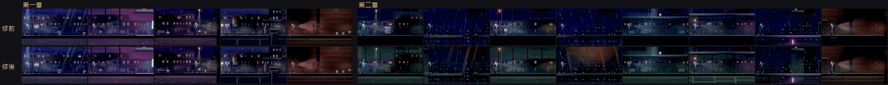
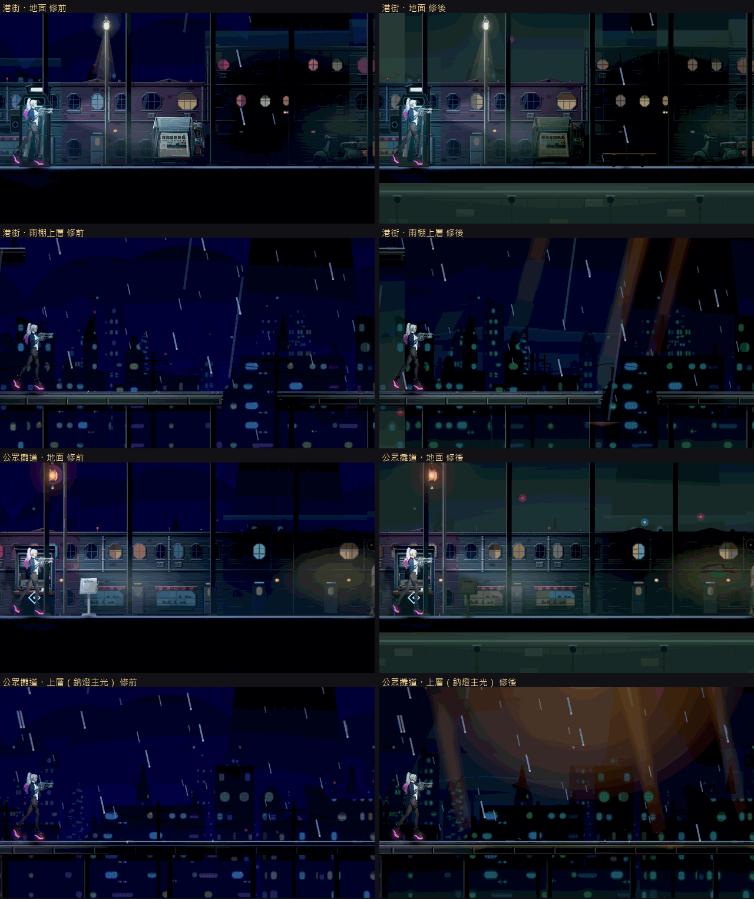
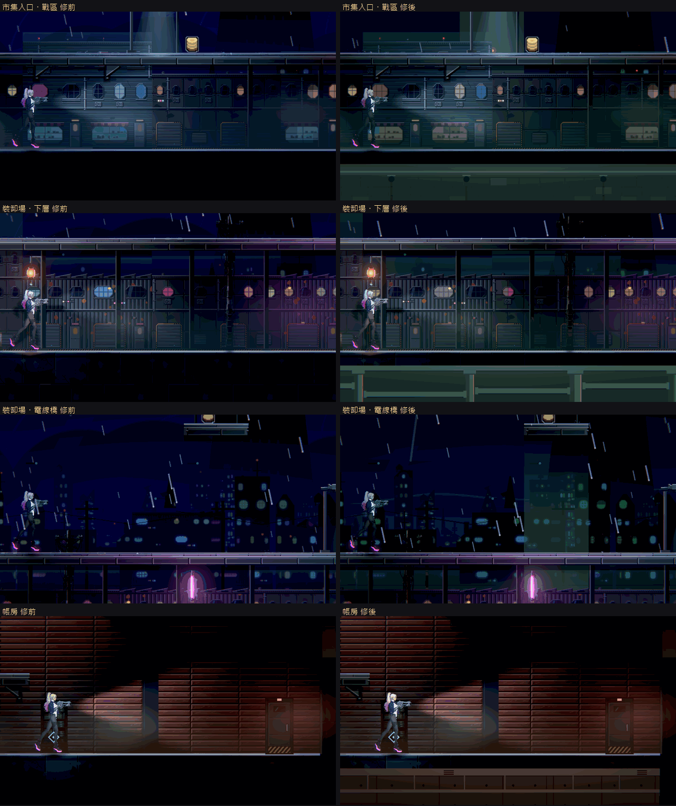

# [BG-77] 把主光前中景與地面剖面套到第二章並拉開章節色調

> 狀態：完成

## 內文

### 需求
第二章（港街、市集入口、公眾攤道、裝卸場、帳房）和第一章在縮圖上分不出來：兩章的平均色相只差 6 度，同樣是一片紫藍夜景，色彩腳本寫的「灰藍綠加鈉燈琥珀」沒有出現在畫面上。這張票把主光、近前景、中景與地面剖面套到第二章，天空與遠景用這一章自己的染色與霧拉到灰藍綠（遠景偏色幅度可以比角色層大），鈉燈琥珀真的成為主光；同時把走道和剖面之間那段平的暗帶改成由暗漸到剖面材質。這張票是色彩腳本成不成立的關鍵。

### 來源
2026-11-28，畫面待辦清單第 2 項；主 session 驗收 BG-74、BG-76 時補充（章節色相差距要可量、遠景要跟著變、鈉燈要真的當主光、走道下的平黑帶要改）。

### 驗收條件
- [x] 第二章各區截圖的平均色相落在第二章的範圍，和第一章的平均色相至少差 40 度（修前兩章只差 8 度）；做成自動檢查
- [x] 天空與遠景跟著這一章的主色變（遠景偏色可以比角色層大），縮圖帶上和第一章一眼分得開
- [x] 鈉燈琥珀在畫面上是主光：至少一個非戰鬥區段有完整的主光（光暈、光柱、照亮地面與角色），不只是邊緣光的顏色
- [x] 室外區域有合乎地點的近前景（戰鬥區段較矮）、中景與地面剖面；室內用室內材質；走道和剖面之間的暗帶收窄（見 Commit-1：走道邊緣下方那一段要暗，可讀性才量得到亮邊）
- [x] 第二章暗場可讀性：絕對門檻與「不低於修前的 85%」兩條都過（工具自動判斷）；畫面下方死黑不超過 35%；擺設比主角暗
- [x] 不過曝、不閃爍；受影響範圍的測試全過；附每區修前修後與第一、二章並排的縮圖帶

### 測試流程
1. 從第一章街道走到第二章港街：預期顏色明顯從紫藍換成灰藍綠與鈉燈琥珀，角色與敵人一樣清楚

---

# 跟其他票的關係

- Blocks：無
- Blocked by：無
- Related：BG-74、BG-75、BG-76

---

# Commit-1

## 內文

色調：第二章的室外區域（港街、市集入口、公眾攤道、裝卸場、屋頂）主色改成灰藍綠（色相約 172），天空與遠景的偏色開到最大；但天空貼圖本身是純藍紫，乘法染色拉不出綠，所以第二章室外換成灰藍的霧天（遠景素材裡現成的一張，色相 220、綠比紅多），再染成灰藍綠。帳房是琥珀色的室內，和當舖一樣有自己的色相範圍（340～60），不算進章節平均。結果：第二章平均色相 211（範圍 170～230），第一章 268，差 57 度；門檻定 40 度（修前只差 8 度），和每章的範圍一起寫進色彩腳本資料，截圖腳本自動檢查相鄰兩章。

主光：鈉燈琥珀當主光。公眾攤道（非戰鬥）是完整主光的樣板：光暈、三道光柱、照亮地面與角色；港街的主光放在畫面上方，只看得到斜下來的光柱；市集入口、裝卸場（戰鬥）較弱、光柱少或不打；帳房是室內的檯燈光。一開始攤道與港街的光暈太大（畫面中間一顆圓盤、整片變成紫褐色），已縮小並移到畫面外，光柱也減到三道、變窄。

前中景與剖面：室外有欄杆（戰鬥範圍自動變矮）、上緣吊纜與燈籠、靠牆中景（攤道的間隔調過，排得出三件以上）；地面剖面室外是地基、裝卸場是鋼構、帳房是室內樓板。高架段原本照第一章街道的寫法放了「路緣與矮樁＋橋面鋼樑」：路緣壓在走道邊緣下方，四個上層取樣點的邊緣對比掉到門檻以下；鋼樑則讓上層通道下方變成「黑底上幾條鋼樑」。第二章的高架段兩樣都拿掉，只留欄杆，走道下面直接看到後面的城市。

走道和剖面之間的暗帶：試過讓剖面從走道下 6 像素就開始、由暗漸到材質，結果兩章幾乎每個取樣點的邊緣對比都掉到門檻以下（走道邊緣下方那一段就是可讀性量「亮邊」時比較的暗部）。所以改成收窄：剖面從走道下 14 像素開始（量測的那一段不動），地基上方的管溝只比結構暗一點，不再疊一條黑；第一章五區一起改。暗帶從約 27 像素（畫面上約 54）收到 14 像素。

檢查的改法：死黑原本量畫面固定的下方 40%，站在上層通道時那一段大半是天際線的建築剪影（本來就暗），所以改成量「主角腳下到畫面底」，並且先把近前景藏起來再量（近前景的剪影本來就是畫面上最暗的東西）。

順手修掉的：第一章的地圖產生器把第一章的主光等資料依區域 id 併進「第一、二章共用」的函式，第二章也有當舖、屋頂，重跑第二章產生器會把第一章的燈搬過去；改成各章在自己的寫檔迴圈裡併。

已知（不是這張票造成的）：第一章「當舖清晨」的可讀性取樣在目前的 main 上整張是 0（畫面全黑），把這張票的改動拿掉也一樣，看起來是章節卡或轉場蓋住了取樣畫面；已回報。

### 測試結果

| 項目 | 結果 |
|---|---|
| 受影響範圍的測試（3 個程序平行，56 組） | 64330 項檢查；兩項失敗（攤道中景少於三件、港街的貼圖索引過期），修正後重跑那兩組 10730 項 0 失敗 |
| 第二章暗場可讀性（絕對門檻＋基準的 85%） | 11 區 22 點全過 |
| 第一章暗場可讀性（絕對門檻＋基準的 85%） | 全過；「當舖清晨」在 main 上本來就是 0，見上 |
| 色相 | 第二章 211（170～230），第一章 268（225～275），差 57（至少 40）；帳房 8～18（340～60） |
| 走道下方死黑（上限 35%） | 第二章 0.11～0.34，第一章 0.03～0.24 |
| 原生截圖 | 無錯誤 |

### 截圖

第一、二章並排的縮圖帶（上排修前、下排修後）。

港街（地面、雨棚上層）、公眾攤道（地面、上層的鈉燈主光）。

市集入口、裝卸場（下層、電線橋）、帳房。

