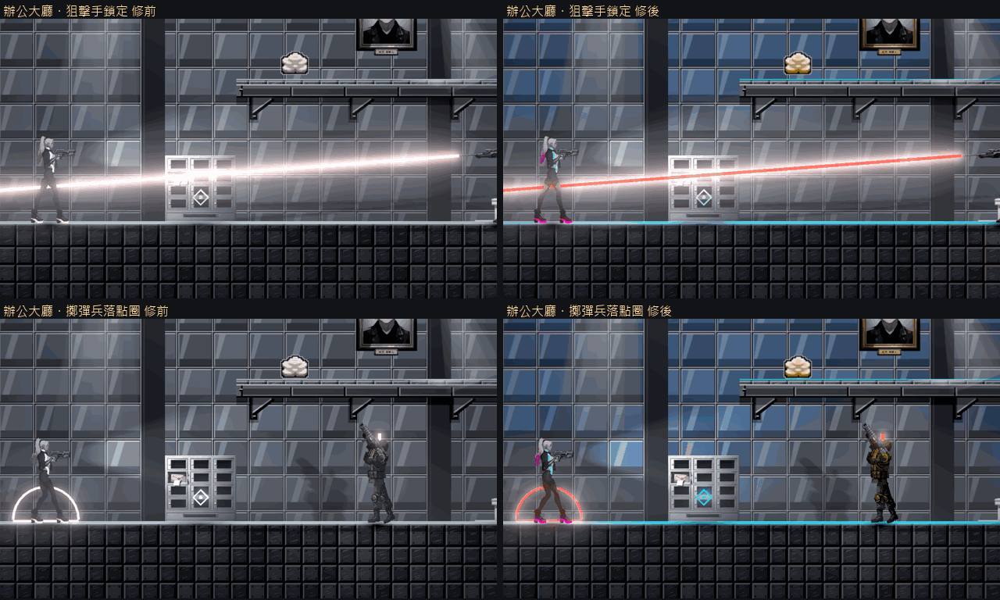

# [BG-78] 讓區域色調不再吃掉預兆主角與提示的顏色

> 狀態：完成

## 內文

### 需求
第三章天穹辦公接待廊與辦公大廳整個畫面是灰階：擲彈兵的落點圈、狙擊雷射、頭頂的驚嘆號從紅色變成白色，主角的粉紅頭髮與霓虹、敵人與互動標記也被洗成灰。玩家靠顏色分辨危險的訊號因此消失。區域的色調與降飽和只能作用在場景上，不能吃掉遊戲性的顏色：危險預兆、主角的霓虹與頭髮、敵人的識別色、互動標記與提示，在任何區域的色調下都要維持原本的色相與足夠的飽和度；場景想要冷白無菌可以很淡，但角色與預兆的顏色反而要更跳出來。

### 來源
2026-11-28，主 session 轉述敵人線與地圖線的截圖（NE-470、NE-419）。

### 驗收條件
- [x] 票上寫明原因（這一區原本的光影設定，或色彩腳本套上去之後）
- [x] 全域的保證：在任何區域的光影下，紅色預兆、主角的霓虹與頭髮、互動標記的色相偏移不超過 20 度、飽和度至少 0.45（主角取最鮮豔的 5% 像素，至少 0.4）；不是只修這一區
- [x] 自動檢查：四章每個有色彩腳本的區域，在該區的光影下畫出紅色預兆、主角、互動標記，量色相與飽和度；檢查失敗的區域一併修
- [x] 場景本身的色調不變（冷白的區域仍然冷白、降飽和的區域場景仍然淡）；可讀性檢查照舊通過
- [x] 修前修後各一張：辦公大廳，擲彈兵落點圈與狙擊雷射的情境

### 測試流程
1. 在辦公大廳讓擲彈兵丟彈、狙擊手瞄準：預期落點圈與雷射是紅的，主角的粉紅頭髮與霓虹看得出顏色，場景仍然是冷白

---

# 跟其他票的關係

- Blocks：無
- Blocked by：無
- Related：BG-74

---

# Commit-1

## 內文

原因：這一區原本的光影設定就是這樣，不是色彩腳本造成的。辦公大廳與接待廊共用的光影設定把畫面飽和度降到 0.15（2026-11-18 的光影調整就這樣設），後製的降飽和作用在整個畫面上，所以紅色預兆、主角、敵人、互動標記也一起變灰。色彩腳本只換色相、不碰飽和度。另外一個獨立的原因讓紅色變成白色：落點圈與雷射用很亮的紅（線性亮度 1.5～2.5 倍），螢幕上每個色版都到頂，就算不降飽和也會偏白；冷白的區域只是讓它更明顯。

改法（全域，所有區域一起）：

- 後製的降飽和與陰影／亮部色調只作用在場景：本來就很鮮豔、而且色相落在遊戲性顏色帶裡的像素保留原本的飽和度，色調也大半不套。遊戲性顏色帶是暖色帶（270～50 度：危險紅、主角的粉紅頭髮與鞋、洋紅霓虹、敵人的紅色識別、橘紅）與青色帶（169～205 度：互動標記、主角衣服的霓虹）。場景的藍色玻璃（約 210～220 度）、綠色招牌不在帶裡，冷白的區域仍然冷白。
- 危險紅（0 度附近）很亮時把亮度壓到最亮色版 1.3，色相保住、泛光仍留一點。只對紅色做：走道邊緣的青色亮邊、鈉燈的琥珀亮邊維持原本的亮度（可讀性量的就是它們，第一版對所有遊戲性顏色都壓，邊緣對比掉了一截，已改）。
- 地面霧移到地形之上、所有角色之下（原本在角色、子彈與特效之上，貼地的霧把預兆與腳洗成灰白）。
- 兩個區域的資料：電話亭巷的主光從冷藍調成偏白的冷光（藍光把紅色推向洋紅 26 度），閘門廳的主色調亮一點。

檢查：新增一個截圖情境，在四章 43 個有色彩腳本的區域，各在該區的光影下放一塊危險紅、一塊互動標記青，並量主角本身，記錄色相偏移與飽和度。門檻：預兆與標記色相偏移不超過 20 度、飽和度至少 0.45（原色是 0.69 與 0.79，約保留 65%，旁邊有彩色燈時會被照偏一點）；主角最鮮豔的 5% 像素飽和度至少 0.4。修前辦公大廳的預兆飽和度 0.16、主角 0.21、標記 0（全灰）；修後 43 區全過，最差：預兆色相偏 18 度（電話亭巷）、標記偏 9 度、主角 0.52。

可讀性的取樣、色彩腳本與遊戲性顏色的截圖情境在取樣前都會等轉場與章末卡結束（演出線的 UiLayers.presentation_busy）；第一章「當舖清晨」之前量到全黑就是這個原因，現在量得到（2.19／2.89），從已知項目移除。

### 測試結果

| 項目 | 結果 |
|---|---|
| 遊戲性顏色（43 區） | 全過；最差預兆偏 18 度、標記偏 9 度、主角飽和度 0.52 |
| 第一、二、三章暗場可讀性（絕對門檻；第一、二章另加基準的 85%） | 全過；唯一一次低於 85% 的是港街雨棚上層的玩家對比 3.42（門檻 3.46），重跑兩次 3.53、3.57，在誤差內 |
| 受影響範圍的測試（3 個程序平行，65 組） | 66070 項檢查；35 項失敗都是地圖索引過期（電話亭巷的主光顏色改了、又接上別條線的地圖），重新產生後重跑那兩組 3032 項 0 失敗 |
| 原生截圖 | 無錯誤 |

### 截圖

辦公大廳，和 NE-470 同樣的情境：狙擊手鎖定的雷射、擲彈兵的落點圈（左修前、右修後）。

