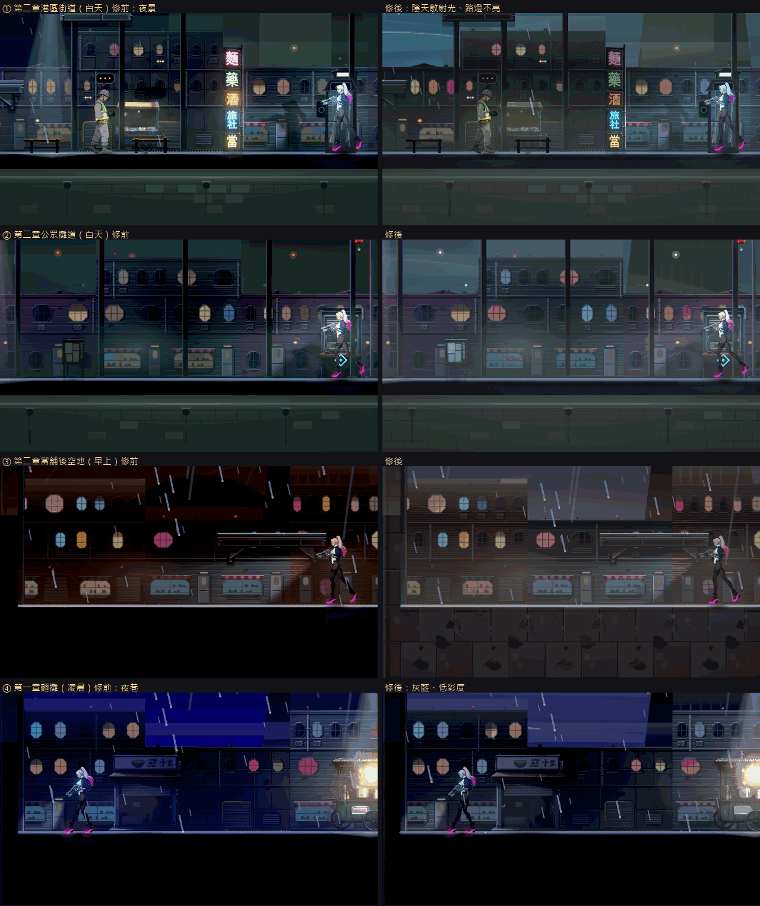
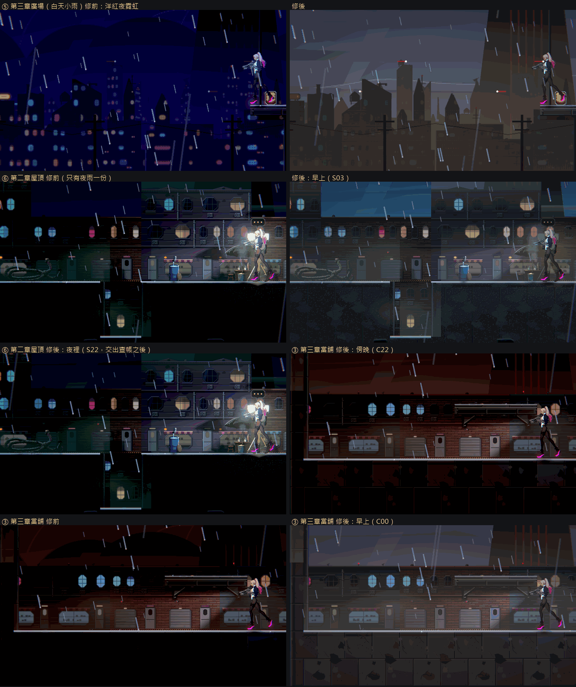
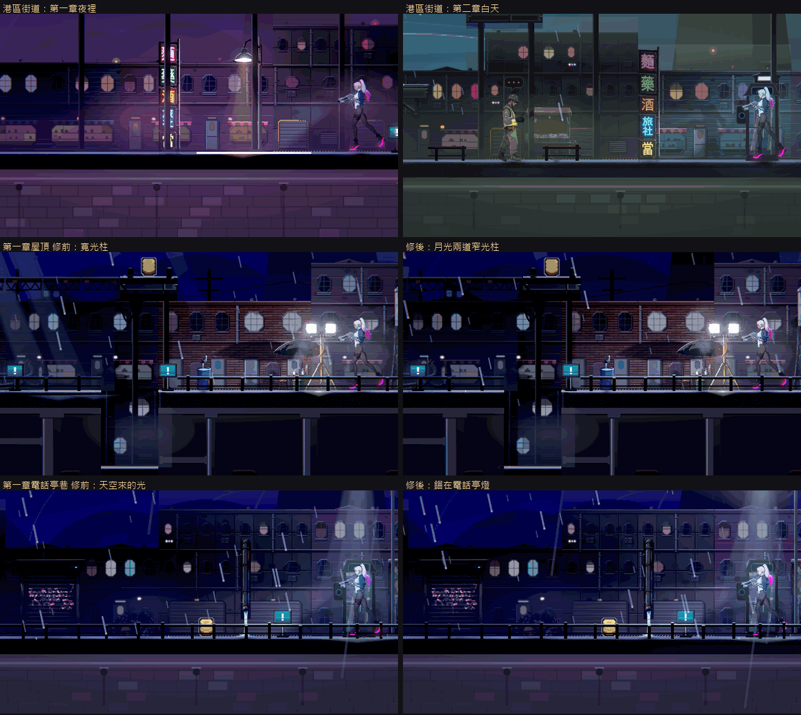

# [BG-79] 讓每區的光影符合劇情的時段並讓夜景主光有燈具來源

> 狀態：完成

## 內文

### 需求
光影和劇情的時段對不上：第二章白天的港區街道、市集入口、公眾攤道用的是夜景；第二、三、四章早上或傍晚的當舖沿用第一章夜晚的光影；第一章凌晨的麵攤用夜巷；第三章白天的廣場是洋紅夜霓虹；第二章屋頂同一區要演早上與夜裡兩場卻只有夜雨一份。夜景的主光則是從向陽區（太陽）搬過來的做法：半個畫面大的光暈、橫跨畫面的斜光柱，夜空裡沒有任何東西會發出這樣的光，第一章屋頂的光柱還蓋過主角與提示。

這張票讓每區的光影照故事線的時段表（`design/22-living-scenes/STORY_CONSTRAINTS.md`「每區的時間與天氣」）：白天下雨是陰天的散射光（天空亮、影子軟、路燈不亮或很弱、窗燈少），清晨與凌晨是灰藍、低彩度；同一地點不同時段各有自己的光影，用同一份基底加時段的差異。夜景的主光一定有畫面上看得到的燈具，光暈和燈具相稱，光柱只是燈下短而窄的錐形；大片斜光柱只留給天空開闊的月光或陽光，而且收斂。表上標「未定」的區維持現狀。

### 來源
2026-11-28，主 session 轉述：BG-77 夜景主光退回、第一章屋頂光柱太強（NE-420 的截圖）、故事線的時段表與其中列出的六處不合。

### 驗收條件
- [x] 時段表列出的六處不合全部修正；色彩腳本每區有時段欄位，標「未定」的區維持現狀
- [x] 白天下雨是陰天散射光：天空亮、影子軟、室外的路燈與霓虹很弱；清晨灰藍低彩度；同一地點不同時段（港區街道夜與日、當舖夜與早與傍晚、第二章屋頂早與夜）一眼分得出來，用基底加時段差異而不是整份複製
- [x] 夜景主光一定錨在畫面上的燈具，光暈半徑有上限，光柱是燈下短而窄的錐形；月光的斜光柱數量、寬度、亮度收斂（第一章屋頂）
- [x] 自動檢查：每區時段欄位和故事線的表一致（表改了會提醒）；白天室外區的天空比夜晚室外區亮、路燈狀態符合時段；夜景主光的光暈上限、對應的燈具存在、主角站在光裡時可讀性不低於無光時的 85%
- [x] 色相、死黑、遊戲性顏色、暗場可讀性的既有檢查照舊通過（第二章的色相範圍依白天調整，「看縮圖分得出第幾章」不變）
- [x] 附六處各一張修前修後、港區街道日夜並排、第一章屋頂修前修後

### 測試流程
1. 從第一章夜裡的港區街道走到第二章白天的港區街道：預期一眼看出是白天下雨（天空亮、路燈不亮），但仍是第二章的灰藍綠
2. 第一章屋頂：預期光從看得到的燈或天空來，沒有橫跨畫面的寬光柱蓋過主角

---

# 跟其他票的關係

- Blocks：無
- Blocked by：無
- Related：BG-67、BG-74、BG-77、ST-60

---

# Commit-1

## 內文

時段：色彩腳本每區加上時段欄位，照故事線的時段表；同一區後來的另一場用劇情旗標切換（第二章屋頂交出查帳之後是夜裡，第三章當舖看到老 K 去辦公室之後是傍晚）。表上標「未定」的區（第二章中段四區、第四章大多數）維持原本的光影。時段的差異是一份共用的設定，套在該區原本的光影上，只改室外的區段（當舖只改後空地，店裡的暖燈不動）：

- 白天下雨：陰天的散射光，環境光至少 0.42、天空與霧往淺灰靠並拉亮、暗部與亮部的色調往中性靠、室外的路燈與遠景窗光降到 0.25、霓虹 0.45 倍、不打雷、沒有主光。
- 清晨：灰藍、低彩度。
- 傍晚：往暖橘靠、燈全亮。

六處不合：第二章港區街道、市集入口、公眾攤道改成白天（拿掉原本的鈉燈主光）；第二、三、四章當舖的後空地改成早上，第三章另有傍晚；第一章麵攤改成凌晨；第三章廣場改成白天小雨（色彩腳本從洋紅夜霓虹換成暖灰）；第二章屋頂有早上與夜裡兩份。只有白天的室外區域換成灰色的天空貼圖，同一區有日有夜的用藍灰的霧天。

順著找到的兩個全域問題：遠景層之間的霧原本固定是洋紅色，白天與青綠色的區域都被染成紫，改成跟著區段的霧色；遠景的窗光原本不受燈的開關影響，現在跟著場景燈一起變弱（白天窗燈少）。

夜景主光：主光資料加上來源。燈（lamp）一定錨在地圖上最近的那盞燈，附近四格內沒有燈就不加主光並記錄；光暈 72 像素以內、光柱最多兩道、幾乎往正下方、160 像素以內，超出就整個不收。月光（moon）光柱最多三道、20 像素寬、亮度 0.5 以內。第一章：電話亭巷錨在電話亭燈；街道錨在霓虹招牌下的燈；倉庫錨在閘門廳的探照燈（照劇本改成冷白）；屋頂改成月光，光柱從五道寬的減成兩道 14 像素、亮度減半；當舖後空地沒有燈可以錨，拿掉主光（店裡的暖燈照舊）。

檢查：
- 每區的時段和故事線的時段表一致（直接讀那張表，表改了會失敗並說是哪一區）；白天室外的天空比夜晚室外亮；白天室外的燈很弱、夜晚室外的燈全亮；夜景的主光一定是燈或月光，燈的主光附近一定有燈；太大的燈光主光不收。
- 新增截圖情境：主角站在每個主光底下，主光開關各量一次主角對比；夜景主光（燈、月光）至少 85%。第一章四區 1.03～1.25（主光都讓主角更清楚）；向陽區是陽光，只記錄（0.66，它有自己的可讀性取樣點 3.55）。
- 可讀性基準：時段改了的區（第二章港區街道、市集入口、公眾攤道、屋頂，第一章麵攤）的基準換成新時段的量測值。白天的散射光讓這個量法的對比數值普遍變低（量法除以周圍的亮度，越亮的畫面數值越小），夜裡的基準不適用；絕對門檻照舊，全部通過。請驗收時確認這個做法。第三章廣場（沒有基準檔）從夜裡的 7.60／4.93、7.56／2.68、5.21／2.00 變成 4.06／2.79、3.10／1.56、1.13／1.56，都在門檻以上。

### 測試結果

| 項目 | 結果 |
|---|---|
| 第一、二、三章暗場可讀性（絕對門檻＋基準的 85%） | 全過（時段改了的區用新的基準） |
| 色相 | 第一章 260（225～275）、第二章 210（170～230），差 50；當舖只在夜裡檢查自己的暖色範圍 |
| 畫面下方死黑（上限 35%） | 0～0.20 |
| 遊戲性顏色（43 區） | 全過；最差預兆偏 12 度、標記偏 20 度（門檻 20）、廣場的主角 0.41（門檻 0.4） |
| 受影響範圍的測試（3 個程序平行，70 組） | 96402 項檢查；一項失敗是 BG-74 的「色彩腳本不改亮度」，現在時段會刻意調亮，改成只量色彩部分（時段另有檢查）；重跑那一組 8719 項 0 失敗 |
| 主角站在夜景主光裡 | 第一章四區 103%～125% |
| 原生截圖 | 無錯誤 |

### 截圖

六處不合（一）：港區街道、公眾攤道、第二章當舖、麵攤。

六處不合（二）：廣場、第二章屋頂早上與夜裡、第三章當舖早上與傍晚。

港區街道日夜並排、第一章屋頂修前修後、電話亭巷的主光錨在燈上。

