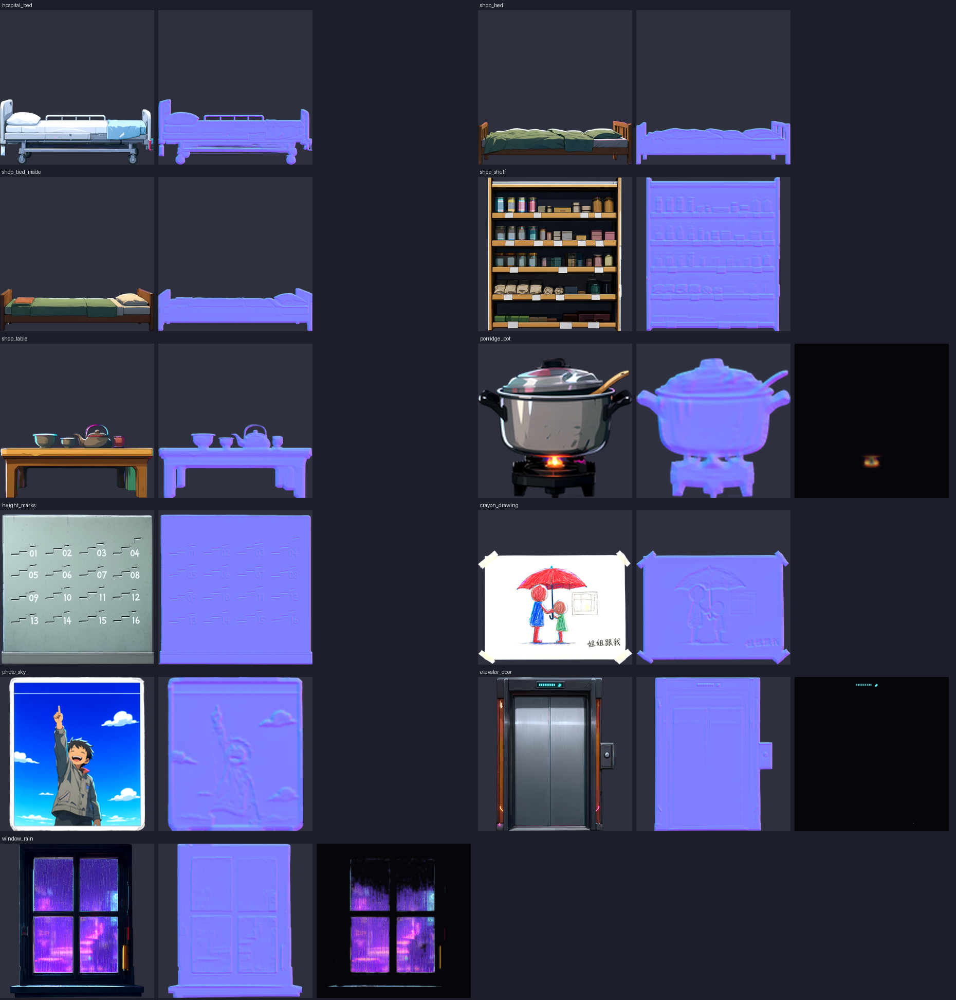
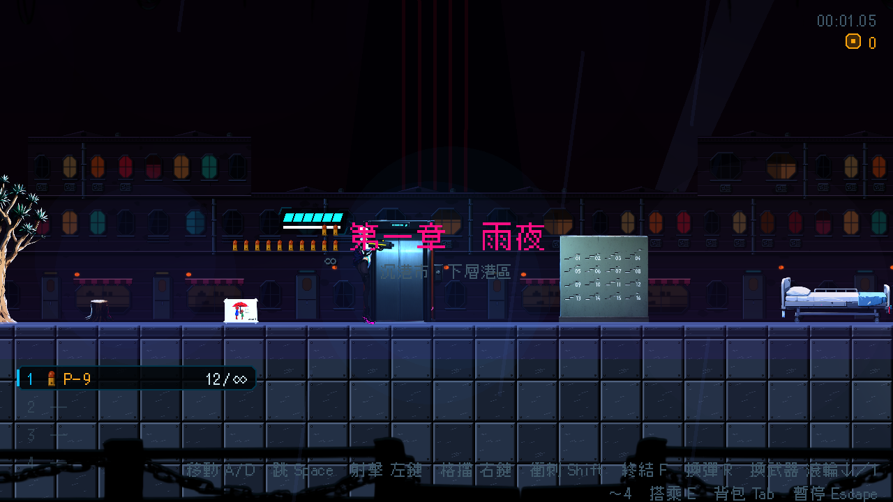
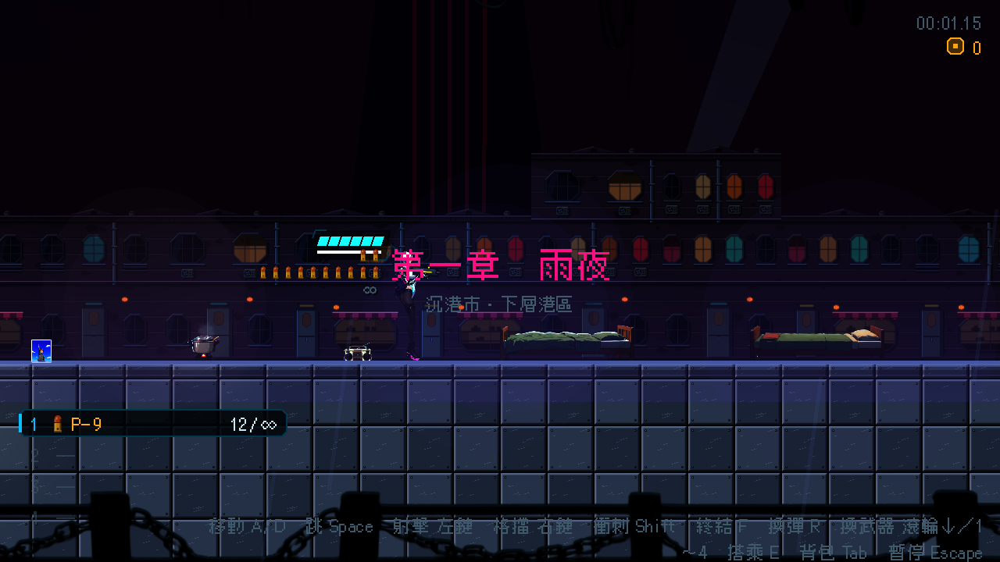

# [BG-7] 改用賽璐璐畫風重做室內道具

> 狀態：完成

## 內文

### 需求
室內類道具（病床、床、貨架、桌子、粥鍋、身高刻痕牆、蠟筆畫、窗外照片、電梯門、雨窗）還是舊的像素色塊暫代圖。第二章的場景（轉運站病房、夾層區住宅、電力室）會用到它們（NE-55），其中身高刻痕與蠟筆畫還是伏筆物件（F10）。換成賽璐璐畫風、依真實尺寸放大，並附法線與自發光層（粥鍋蒸汽、雨窗、電梯燈）。

### 來源
2026-10-03，使用者決定道具與場景改走賽璐璐畫風；NE-62、63 只處理室外與工業類道具，室內道具沒有被換。設計見 `design/11-free-assets/DESIGN.md`、`design/04-story/FORESHADOWING.md`。

### 驗收條件
- [x] 所有室內類道具改為賽璐璐畫風，依真實高度換算尺寸，畫廊逐個看過
- [x] 每個道具有法線貼圖；會發光或有動畫的（粥鍋蒸汽、雨窗、電梯燈）有自發光層
- [x] 伏筆物件（身高刻痕牆、蠟筆畫、窗外照片）的細節清楚可讀，與劇本描述一致
- [x] 既有的單向平台、遮光等行為不變

### 測試流程
1. 開道具畫廊檢查室內類道具
2. 預覽使用這些道具的過場舞台與第二章場景
3. 執行環境元件、道具相關測試套件

---

# 跟其他票的關係

- Blocks：無
- Blocked by：無
- Related：NE-55、NE-62、NE-65

---

# Commit-1

## 內文

室內類道具還是舊的像素色塊暫代圖。11 件（病床、單人床與整理過的床、貨架、矮桌、粥鍋、身高刻痕牆、蠟筆畫、窗外照片、電梯門、雨窗）改用本機 AI 以賽璐璐畫風生成，依真實尺寸放大，每件有法線；粥鍋的火焰、電梯樓層燈、雨窗有自發光層，粥鍋保留蒸汽動畫，單向平台與遮光行為沒有變。
伏筆物件與劇本一致：身高刻痕牆有十六道往上遞增的刻痕，旁邊的 01 到 16 全部清楚可讀；蠟筆畫是紅傘下的兩個人、窗邊一個淡黃的小人影與「姐姐跟我」；窗外照片是對著藍天比手勢的笑臉男孩，上緣有一道細縫。這三件的貼圖解析度另外提高，小字與小人影才看得清楚。
驗收：道具畫廊（本次補進之前漏掉的 25 個道具，包含全部室內道具與植物）逐個看過；過場舞台使用的電梯門看過；環境與道具相關測試套件通過。擺放尺寸變動的道具都以底邊對齊地面。

### 測試結果

| 項目 | 結果 |
|---|---|
| 相關測試套件（環境元件、道具、過場動畫、第二章、轉場） | 通過 1518 / 1518 |
| 素材檢查（大小與總量） | 通過（環境素材 22.8 MB／60 MB，單檔最大 0.6 MB） |
| 執行 log | 無非預期的 ERROR |

### 截圖

