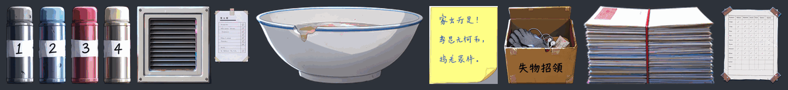
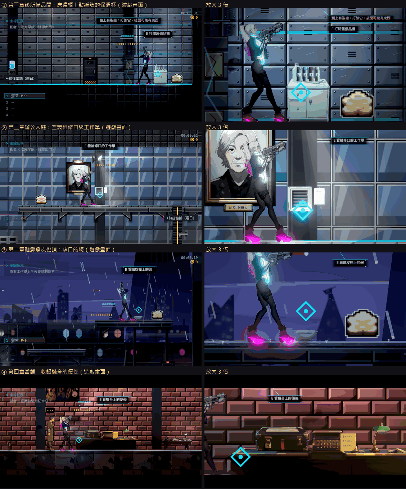
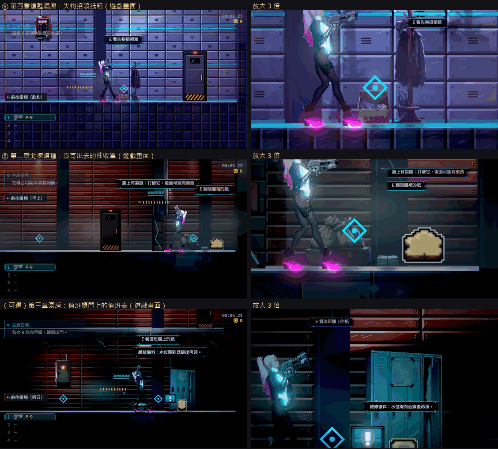

# [BG-80] 補上可讀物件的小擺設並加一個各區共用的小物件包

> 狀態：完成

## 內文

### 需求
故事線加的可讀物件有幾件只有互動點、沒有自己的圖：玩家走到提示前，畫面上看不到它在說的那樣東西。照 `design/22-living-scenes/STORY_COVERAGE.md`「可以讀的物件與它需要的圖」的清單，把標「要新做」的六件補成看得到的小擺設：

1. 第三章診所備品間（第 99 欄）床邊櫃上一排三四個貼編號的保溫杯
2. 第三章辦公大廳空調維修廊（第 24 欄、第 13 列）室內的空調維修口（有格柵），旁邊貼一張工作單
3. 第一章麵攤鐵皮棚頂（第 41 欄、第 12 列）缺口的碗（沿用阿梨家的碗圖，補擺設資料）
4. 第四章當舖（第 52 欄）櫃台收銀機上的便條
5. 第四章復甦酒廊（第 50 欄）寫著「失物招領」的紙箱
6. 第二章北棟前室暗櫃（第 59 欄）一疊沒寄出去的催收單

擺設現在只能從該區主題的擺設包裡挑，跨包沿用每次都要改主題。加一個各區都找得到的共用小物件包（紙張、杯碗、紙箱、便條這類），這六件放進去，之後的小物件也放這裡。

### 來源
2026-11-28，主 session 轉述故事線的可讀物件清單（ST-60～ST-64）。

### 驗收條件
- [x] 六件都有自己的圖與擺設資料；畫風、解析度、受光（法線）與其他擺設一致，有接地陰影，吃區域的色調，遊戲性的顏色保護照舊
- [x] 圖和故事的狀態不衝突（會變的只在文字裡，圖畫不變的部分）
- [x] 共用小物件包：每一區的擺設都找得到，不必改主題；用法寫一行進 free-asset-pipeline（三份副本）與 STORY_COVERAGE.md
- [x] 每件一張遊戲比例的近拍與一張放大，互動提示在畫面裡
- [x] 素材檢查與受影響範圍的測試通過

### 測試流程
1. 走到清單上任一個可讀物件前：預期先看到那樣東西，再看到提示
2. 在任一區的地圖寫一個共用包的擺設：預期不用改主題就擺得出來

---

# 跟其他票的關係

- Blocks：無
- Blocked by：無
- Related：ST-60、ST-61、ST-62、ST-63、ST-64、BG-63、BG-78

---

# Commit-1

## 內文

共用小物件包：`data/environment/scene_props/common/`（圖在 `art/environment/scene_props/common/`），id 以 `common__` 開頭。每一區的擺設搜尋最後都會找這個包，地圖直接寫 id，主題不用列它。用法寫進 free-asset-pipeline（兩份副本；`.agent/skills` 這一份在 repo 裡不存在）與 STORY_COVERAGE.md，表上原本「要新做」的列改成指向新的擺設與擺放位置。

七件擺設（六件加泵房的值班表）照場景包的流程用本機 Qwen 生成，有法線貼圖、接地資料（scenery_contacts 只加這七筆），吃區域的色調，畫風、解析度與其他擺設一致：

| 擺設 | 大小（世界像素） | 放在 |
|---|---|---|
| 貼 1～4 號的保溫杯 `common__numbered_thermos_cups` | 12.9×8.1 | 第三章診所第 99 欄床邊櫃頂 |
| 空調維修口與工作單 `common__ac_service_hatch` | 20.4×14.1 | 第三章辦公大廳第 24 欄牆上 |
| 缺口的碗（碗底一點湯）`common__chipped_bowl` | 14.7×6.9 | 第一章麵攤鐵皮棚頂第 41 欄 |
| 收銀機旁的黃便條 `common__register_note` | 8.6×9.9 | 第四章當舖櫃台頂、收銀機右邊 |
| 「失物招領」紙箱 `common__lost_and_found_box` | 15×15.9 | 第四章復甦酒廊第 50 欄地上 |
| 沒寄出去的催收單 `common__unsent_dunning_letters` | 10×6 | 第二章北棟暗櫃第 60 欄地上 |
| 值班表（最後一列空白）`common__taped_duty_roster` | 11.1×14.1 | 第三章泵房值班櫃門上 |

狀態會變的部分（月報後紙條多一行、排水後多日期、鉛筆字）只在文字裡，圖畫的是不變的部分。便條上的手寫字只是筆跡的樣子，內容在對話文字裡。

擺進地圖的項目由地圖線寫進產生器（這張沒有改地圖檔）：每一筆的 x、y、支撐與偏移在 `tools/scenarios/story_props_scenario.gd` 的 PLACEMENTS，已用遊戲的放置與支撐檢查驗過。

截圖情境 `story_props`：只在記憶體裡把擺設加進該區地圖，主角站到可讀物件旁、等互動提示出現，各拍一張遊戲畫面與放大 3 倍；擺不上去或沒出現在關卡裡算失敗。

順手修：
- 生成工具啟動本機 ComfyUI 時，PowerShell 用系統字碼頁輸出，以 UTF-8 讀會整個中斷；改成容錯讀取。
- BG-79 檢查燈光主光過大的測試，故意觸發的錯誤訊息改用已列在預期清單的名稱，平行測試不再誤報腳本錯誤。

### 測試結果

| 項目 | 結果 |
|---|---|
| 受影響範圍的測試（3 個程序，41 組） | 64112 項檢查 0 失敗；腳本錯誤的誤報修掉後重跑 EnvironmentSuite 8778 項 0 失敗、無非預期錯誤 |
| 受影響的探針（clinic 動作） | 通過 |
| 新增檢查：共用包每區都找得到、圖與法線都在 | 通過 |
| 截圖情境 story_props（七區） | 全部擺得上去、都出現在關卡、互動提示在畫面裡 |
| 素材檢查 | 新素材合規；另有兩項不是這張的既有問題（其他包 9 個匯入設定過期、`sluice_hall__catwalk_span` 缺法線） |

### 截圖

七件擺設。

遊戲畫面與放大（一）：保溫杯、維修口與工作單、缺口的碗、便條。

遊戲畫面與放大（二）：失物招領紙箱、催收單、值班表。

