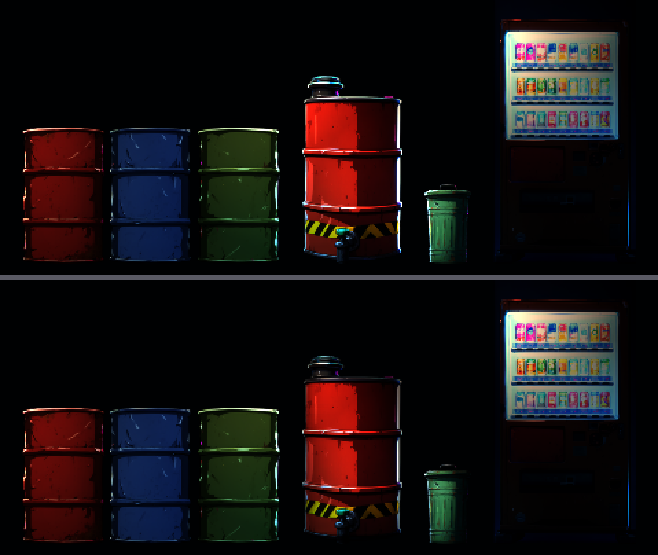
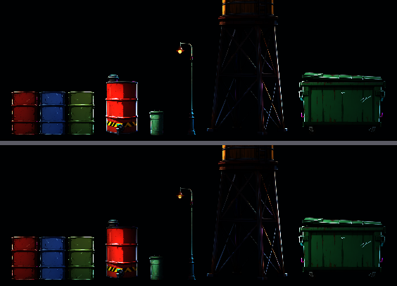

# [BG-8] 改善道具法線的立體感

> 狀態：完成

## 內文

### 需求
道具的法線貼圖（讓路燈、霓虹與爆炸閃光照到道具時有明暗變化）目前是由圖片的明暗細節加上輪廓倒角「推算」出來的近似值，賽璐璐的平塗色塊上凹凸感偏弱，圓柱（油桶）、曲面（水塔）看起來像貼紙。改由「輪廓推算的深度」產生更準確的立體感：圓柱的物件側面漸層、圓角物件邊緣圓潤、平面保持平整，讓光照上去的效果更明顯，但不能讓畫面變髒或在平面上出現假凹凸。

### 來源
2026-10-03，使用者詢問道具附帶的輔助圖是不是深度圖、為什麼要產生，得知法線貼圖目前是由圖片推算的近似值。此票為品質提升，優先度低於畫風統一的票。2026-10-04 使用者決定不下載深度估計模型（要多下載約 100～200 MB 的權重檔），改用不需要模型的做法：從圖的輪廓與明暗推算高度，驗收條件中的「深度估計」依此調整。

### 驗收條件
- [x] 道具的法線改由輪廓推算的高度產生，圓柱與曲面在側光下有符合形狀的明暗漸層
- [x] 平面（門板、看板、貨櫃側面）不出現假凹凸或雜訊
- [x] 在道具畫廊與第一章實景中，同一盞燈照到新舊兩版的對照截圖，新版立體感較明顯
- [x] 法線貼圖的大小與格式不變，不影響效能與檔案大小上限

### 測試流程
1. 道具畫廊以側光比較新舊法線
2. 從頭玩第一章，確認路燈與霓虹照到道具時的效果
3. 執行環境元件相關測試套件

---

# 跟其他票的關係

- Blocks：無
- Blocked by：無
- Related：NE-23、NE-62、NE-63

---

# Commit-1

## 內文

道具的法線貼圖由圖片明暗加線性倒角推算，在賽璐璐平塗色塊上幾乎是平的，圓柱像貼紙，貼圖雜訊還會在平面上變成假凹凸。依你的決定不下載深度估計模型，改成從輪廓推算高度：圓柱（油桶、水塔、燈柱、樹幹、鍋）左右各自鼓起，門、箱、機器、床是平整的面加圓潤的邊，看板與刻痕牆只有極薄的邊，每個道具的輪廓放在清單裡可單獨調整；明暗細節只取色塊之間的明顯邊線（有閘門，小於閘門的亮度差不算），所以平面不會出現假凹凸。66 個 Qwen 生成的道具全部重算，法線貼圖的大小與格式不變。
驗收：用同一組暖光與冷光側照新舊兩版，油桶與燃料桶出現符合圓柱形狀的左亮右暗漸層（油桶法線的左右變化量由 0.04 提高到 0.28），垃圾桶與販賣機的邊緣更圓潤，門板與貨櫃側面保持平整；環境與道具相關測試套件通過。對照截圖用專用的預覽場景拍（同一個引擎、同一組光源）；道具畫廊與第一章實景則確認新法線在遊戲裡畫面正常、不髒，沒有逐件做新舊並排。

### 測試結果

| 項目 | 結果 |
|---|---|
| 相關測試套件（環境元件、道具、過場動畫、第二章、轉場） | 通過 1518 / 1518 |
| 素材檢查（大小與總量） | 通過（環境素材 22.8 MB／60 MB，單檔最大 0.6 MB） |
| 執行 log | 無非預期的 ERROR |

### 截圖

