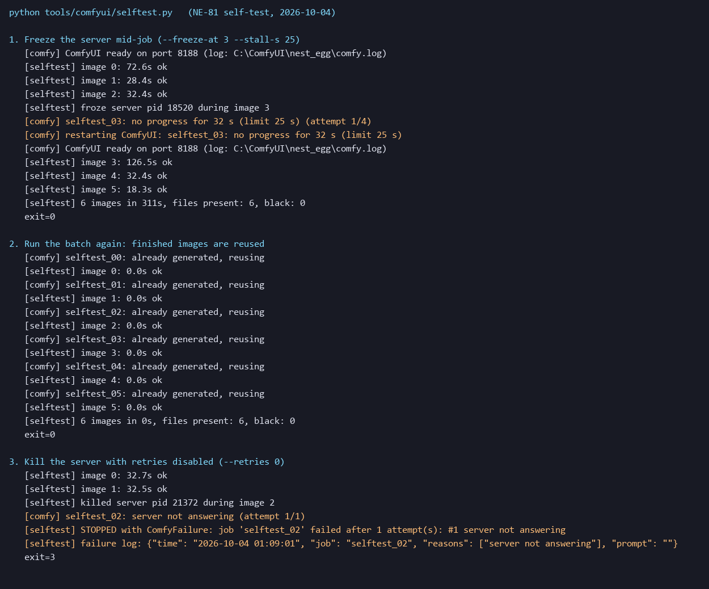

# [BG-9] 建立 ComfyUI 啟動與重試腳本

> 狀態：完成

## 內文

### 需求
本機用 ComfyUI 生成素材時，常因顯示記憶體不足而卡死：編輯模式（給參考圖）、連續多張大圖、電腦重開機後第一次載入模型，都出現過。卡死時工作佇列顯示執行中但不再前進，生成腳本就一直等下去，要人工發現、殺掉、重啟。做一個標準的啟動腳本與生成端的自動偵測重試，讓批次生成可以放著跑，不用有人盯著。

### 來源
2026-10-03，使用者要求用本機 Qwen 生成大量道具與場景；生成過程中 ComfyUI 先後卡死六次以上，每次都要人工重啟。處理方式目前只記在 Skill 裡（`free-asset-pipeline` 第 8 節）。

### 驗收條件
- [x] 一個指令啟動 ComfyUI（含固定的啟動參數），啟動完成才回傳
- [x] 生成端偵測到卡死（長時間沒有進度、或伺服器回報顯示記憶體不足）時，自動重啟 ComfyUI 並重送未完成的工作，最多重試固定次數
- [x] 重送的工作不會重複生成已經成功的圖
- [x] 重試仍失敗時記錄具體是哪個工作、什麼錯誤，並停止，不會無限等待
- [x] 說明文件寫清楚怎麼用，Skill 對應段落改成指向這個腳本

### 測試流程
1. 啟動腳本，確認參數正確、伺服器可用
2. 手動讓 ComfyUI 卡死（例如殺掉再重送），確認生成端自動恢復並完成批次
3. 連續跑一批十張以上的生成，確認沒有人工介入也能跑完

---

# 跟其他票的關係

- Blocks：無
- Blocked by：無
- Related：NE-17、NE-62

---

# Commit-1

## 內文

本機生成素材時，ComfyUI 常卡死（佇列顯示執行中但不再前進），要人工發現、殺掉、重啟，批次一直等下去；電腦記憶體也曾被吃滿到整台當機。
現在一個指令啟動（固定參數，等伺服器可用才回傳；可重啟、關閉、切換保守模式），生成工具也會在伺服器沒開時自動啟動。生成端偵測四種卡死：伺服器沒回應、5 分鐘沒有任何進度（冷啟動放寬到 15 分鐘）、顯示記憶體不足、系統記憶體持續耗盡（低於 0.4 GB 超過 90 秒）；偵測到就自動重啟並重送，最多 3 次，顯示記憶體不足後的重啟改用保守模式。已完成的圖不會重複生成；重試用完就把具體是哪個工作、什麼原因寫進失敗記錄並停止，不再無限等待；同一時間只允許一個生成端。
另外量測發現原本的啟動參數會讓每張圖都從硬碟重讀約 16 GB 的模型（硬碟滿載、每張 49 秒），拿掉後模型常駐、每張 18 秒，預設改為不加；說明文件與 Skill 已改成指向這個腳本，並提醒用完要關閉。
驗收：附自我檢查工具，四個情境都通過：12 張批次中途殺掉伺服器，自動重啟後 12 張全部完成（332 秒）；批次中途凍結伺服器，32 秒後偵測到無進度並自動恢復；重新執行同一批，已完成的圖 0 秒直接重用；重試次數設為 0 時，失敗工作被記錄並停止。測試中先後找到兩個漏洞並修正：凍結的伺服器會讓請求永遠等不到回應（補上逾時）、兩個生成端會互相重啟對方的伺服器（加上單一生成端鎖）。

### 測試結果

| 項目 | 結果 |
|---|---|
| 自我檢查（殺掉、凍結、重用、不重試） | 4 / 4 通過 |
| 啟動腳本（重啟到可用） | 21 秒 |
| 相關測試套件（環境元件、道具、過場動畫） | 通過 1299 / 1299 |

### 截圖

