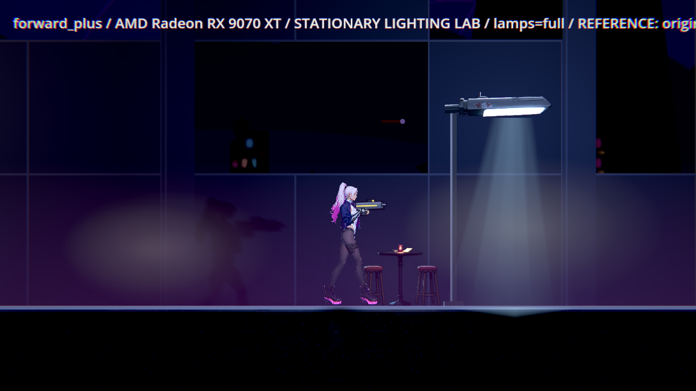
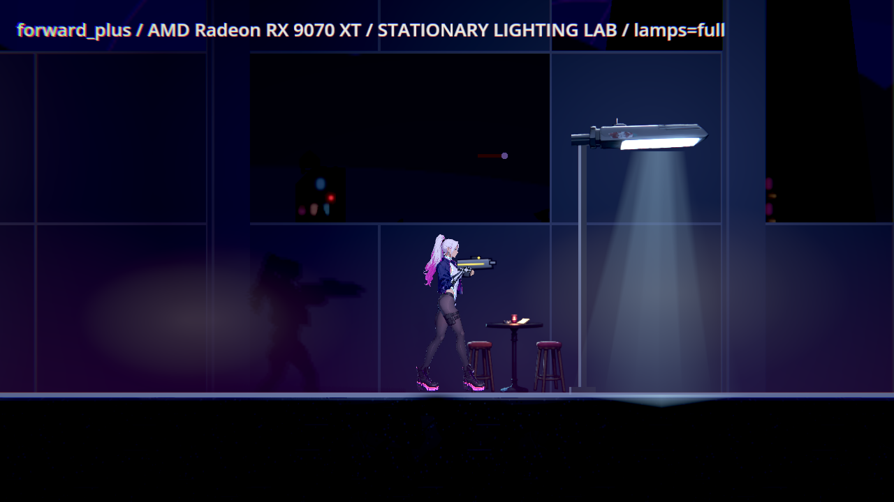
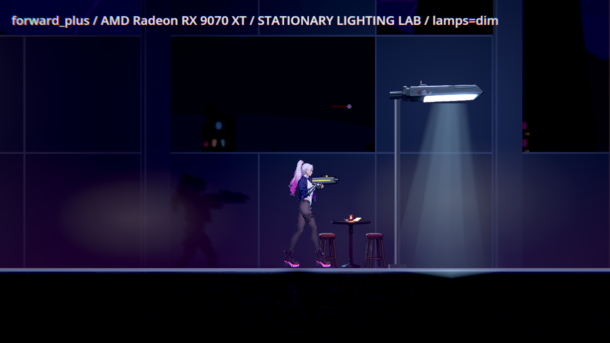

# BG-48：正確像素面積的本機原生新量測

2026-11-11，Godot4.7.2 official、Radeon RX9070XT、Vulkan Forward+、HDR2D、1280×720、亮度0.5。每次單一Godot持GPU lock。這是固定角色／相機／腳本朝右瞄準的照明取樣，不是人工路線或實體手把操作；不作全機獨占效能主張。

## 歷史量測更正

BG-53前所有亮度與對比的像素面積不一致，歷史數字失效。原fog=1.0在修正工具下也通過；不能再把原數值當作真實輪廓不足或宣稱候選霧量修正重現紅→綠。原因必須分清：歷史數值不足來自量測錯誤；霧量1→0.5是現行局部視覺選擇，並非本批證明的必要過關修復。原文／原圖／失敗保留、不覆寫。

## 同格局部參照

只在程序內將lounge_front霧量恢復為原market的1.0，結束還原；其餘相機、角色、燈、環境光、陰影、材質沿用現行正式內容。這是當前版本的局部單因素參照，不是完整歷史checkout。兩邊的自然動畫時間不同，不把差量冒稱精確因果估計。

| hold參數 | 原fog1主角／地面 | 現fog0.5主角／地面 |
|---|---|---|
| full | 5.348／5.768 | 6.103／5.742 |
| dim | 5.404／5.768 | 6.316／5.740 |

Lamp觀察顯示本場兩盞燈均為stable、energy約1.44／1.6；full／dim hold不會讓stable燈變暗，因此不能把這兩輪冒稱已拍到原生路燈閃爍亮暗段。自然循環另存每次真實state／energy／fog_clock。

| 原fog1參照 | 現fog0.5 |
|---|---|
|  |  |
|  |  |

## 復原館外完整格網

每輪9圖，其中6格有站立點、3格無地面不造數值。門檻維持主角0.6、地面1.0。每格五次中位數；自然循環每格另16次，間隔0.2秒，全部原值與燈狀態保留。

| 程序 | 主角最低 | 地面最低 | 循環主角／地面最低 |
|---|---:|---:|---|
| cycle-high | 4.285 | 5.584 | 4.235／5.468 |
| cycle-low | 4.651 | 5.512 | 4.563／5.511 |
| tour-high-dim | 4.350 | 5.495 | N/A |
| tour-high-full | 4.356 | 5.500 | N/A |
| tour-low | 4.552 | 5.512 | N/A |

## 相鄰區域的自然時序重驗

三區每輪54圖，高低品質參照與現行各一次。reference只改lounge_front，而這三區正式使用market等其他資源；光影資料沒有隨參照切換變更。但跨程序自然霧／其他動畫時間不同，數值有升有降，不能據此把「不下降」勾過。另有固定霧相位的宣告控制，後續紀錄分開列。

| 程序／區域 | 主角最低 | 地面最低 | 敵人最低 |
|---|---:|---:|---:|
| related-high-after／ch1_handoff | 3.216 | 5.668 | N/A |
| related-high-after／ch2_market | 2.838 | 4.640 | N/A |
| related-high-after／ch2_market_gate | 2.112 | 4.333 | 0.153 |
| related-high-before／ch1_handoff | 3.230 | 5.670 | N/A |
| related-high-before／ch2_market | 2.854 | 4.823 | N/A |
| related-high-before／ch2_market_gate | 2.626 | 3.819 | 0.209 |
| related-low-after／ch1_handoff | 4.823 | 5.765 | N/A |
| related-low-after／ch2_market | 2.768 | 4.874 | N/A |
| related-low-after／ch2_market_gate | 2.425 | 5.209 | 0.103 |
| related-low-before／ch1_handoff | 4.827 | 5.765 | N/A |
| related-low-before／ch2_market | 2.773 | 4.800 | N/A |
| related-low-before／ch2_market_gate | 2.546 | 4.884 | 0.102 |

市集入口敵人低於原門檻0.45，不能藏在exit0內。原巡覽退出判定只含主角／地面；本報告另外列出所有enemy_contrast最小值。此獨立地區缺陷交BG-55，沒有靠調整整區環境光或關閉陰影讓它變綠。BG-48仍保持進行中。

## 原始證據

本批13程序真正exit0、無SCRIPT ERROR／ERROR，265原PNG、全部JSON、log與實際來源共416原始檔，分13ZIP保存。[archives.json](archives.json)列SHA／大小；各ZIP內manifest逐byte驗證。[summary.json](summary.json)列樣本、來源、真正退出與敵人結果。每輪source-before／after相同；不同工具觀察版本逐輪保存實際source bytes，不宣稱所有輪次整檔SHA相同。PNG使用BG-54修正後的helper；數值直接讀線性HDR，沒有從PNG反推。

```powershell
python pm/Nest-Egg-BG/attachments/BG-48-corrected-2026-11-11/verify.py
$env:NE_READABILITY_OUT='C:/Users/stanl/Github/Nest-Egg/work/bg48-fresh'
python pm/Nest-Egg-BG/attachments/BG-48-corrected-2026-11-11/run.py focus
python pm/Nest-Egg-BG/attachments/BG-48-corrected-2026-11-11/run.py sweep
python pm/Nest-Egg-BG/attachments/BG-48-corrected-2026-11-11/run.py related
```

使用新輸出目錄，拒絕覆寫原案例；full/dim僅是hold參數，實際燈狀態以索引為準。霧與陰影沒有被隱藏。PNG先拍、之後取中位數，兩者不是同一渲染frame，不能對PNG逐像素反推該中位數。
