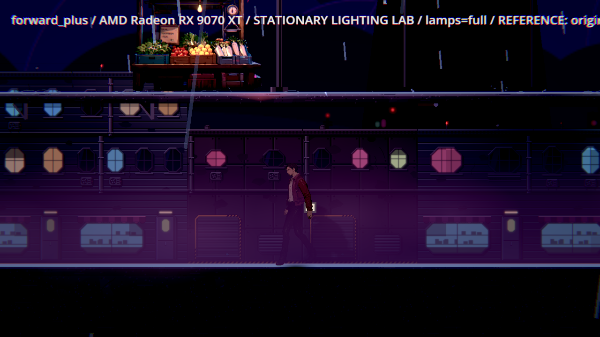
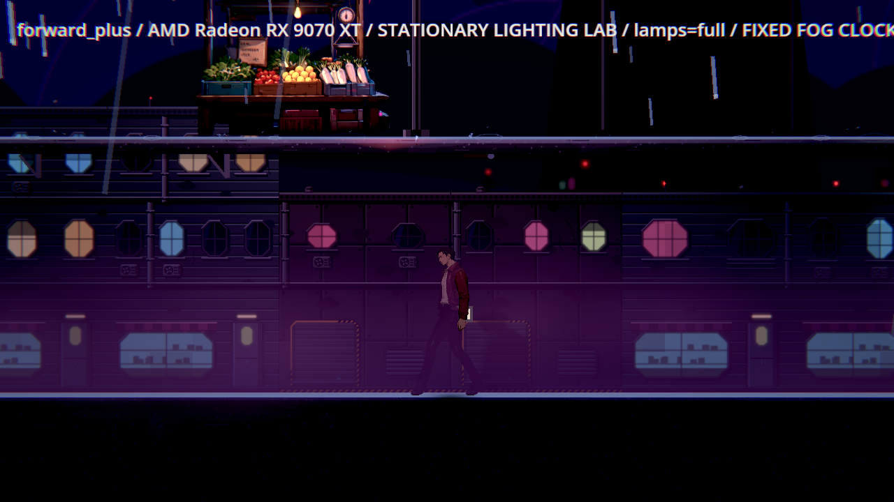

# BG-48：固定霧時間的追加控制

2026-11-11，原生Radeon RX9070XT／Godot4.7.2／Vulkan Forward+／HDR2D、亮度0.5、1280×720、固定朝右瞄準。四個程序各54原圖，全部真正exit0、無SCRIPT ERROR／ERROR；每輪真正來源SHA前後相同，268個原始檔逐byte ZIP驗證通過。產品光影沒有變更。

## 控制與限制

原自然時序記錄在[前13輪](../BG-48-corrected-2026-11-11/README.md)；這次只額外把正式霧的動畫時間固定為12.0秒，保留霧濃度、顏色、光染色與陰影。每格索引實際fog_clock皆12.0；Lamp hold=full不會讓stable燈變成閃爍。這不是移除霧的診斷。

跨程序角色在24個process frame後才停住；AI移動／idle、雨滴、後製等其他動態沒有全部同步，故固定霧仍不是嚴格同源A/A或A/B。下表只是原值；主角與地面都超過0.6／1.0，但仍有升降，不能把未知來源的差異當成產品下降，也不能據此勾「不下降」。敵人低於0.45另由BG55處理，BG48維持進行中。

| 區域／品質 | 主角最低 參照→現行 | 地面最低 參照→現行 | 敵人最低 參照→現行 |
|---|---|---|---|
| ch1_handoff high | 3.211→3.293 | 5.733→5.621 | N/A |
| ch2_market high | 2.667→2.779 | 4.831→4.963 | N/A |
| ch2_market_gate high | 2.217→2.323 | 5.293→5.013 | 0.118→0.104 |
| ch1_handoff low | 4.711→4.766 | 5.762→5.762 | N/A |
| ch2_market low | 2.793→2.740 | 4.920→4.813 | N/A |
| ch2_market_gate low | 2.794→2.375 | 4.679→4.956 | 0.119→0.106 |

這三區不使用被參照切換的lounge_front資源。原霧在正確工具下已通過；歷史低分的成因是BG53量測錯誤，不再反覆重跑希望重現假低分。真正嚴格的不下降比較需要先證明同程序A/A能重現，再做A/B；本批沒有把這項限制藏成通過。

[summary.json](summary.json)列真正exit、engine錯誤行與所有門檻；[pair-analysis.json](pair-analysis.json)列同格原值與差量，不將未標id的敵人陣列靠順序配對。[archives.json](archives.json)列四個原ZIP SHA與大小；ZIP內包含命令、log、PNG、全部index、source bytes、逐檔manifest。原工作目錄仍保留，canonical以ZIP內容為準。

```powershell
python pm/Nest-Egg-BG/attachments/BG-48-corrected-paired-2026-11-11/verify.py
$env:NE_READABILITY_OUT='C:/Users/stanl/Github/Nest-Egg/work/bg48-paired-fresh'
python pm/Nest-Egg-BG/attachments/BG-48-corrected-2026-11-11/run.py paired-related
```

下圖為市集入口同格、高品質兩個獨立程序的真原圖；只固定霧時間，沒有宣稱敵人姿勢／粒子完全同步，也不作改善結論。

| 參照程序 | 現行程序 |
|---|---|
|  |  |
