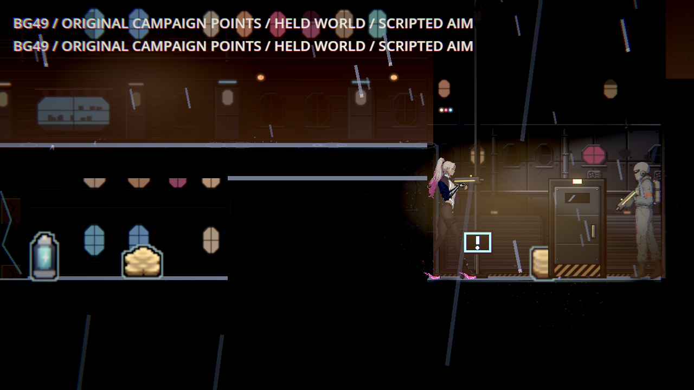
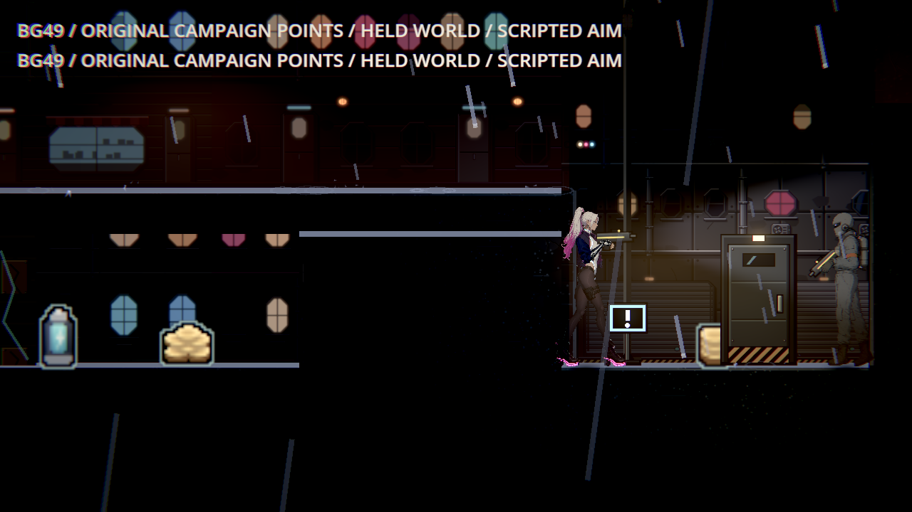
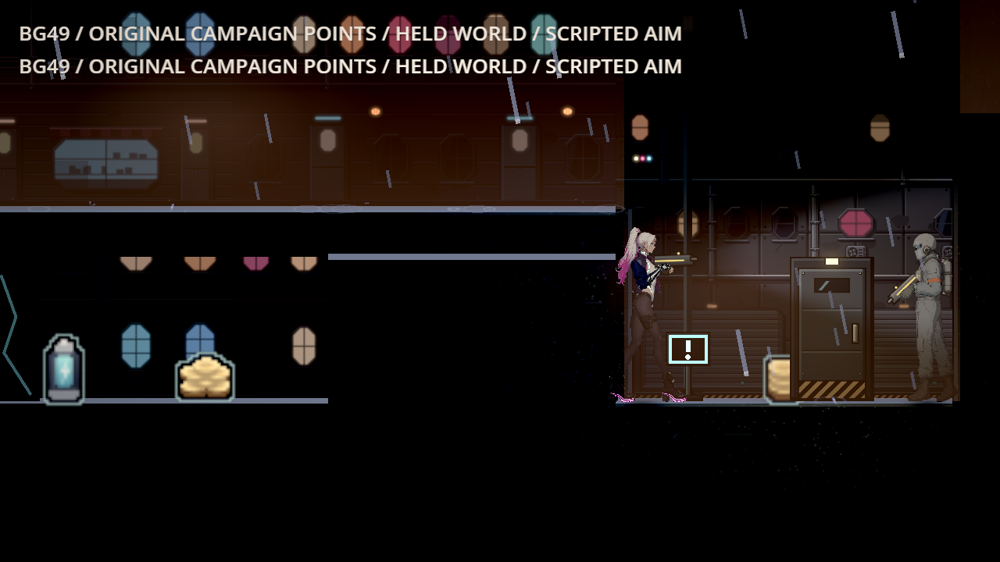
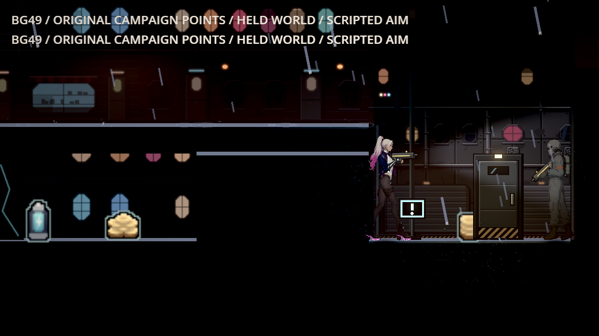
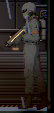
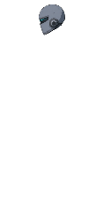
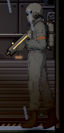

# BG49：本機原生、正確像素面積的完整重驗

2026-11-11，Godot 4.7.2、Vulkan Forward+、AMD Radeon RX 9070 XT、HDR 2D，1280×720、亮度0.5，高／低品質。全部正式渲染在隔離專案 `D:/NestEggVerification/native-ticket-batch-20261111`，共享 GPU 鎖逐程序串行。這是原第一章18點的腳本量測及安排的靜止敵人；畫面原生渲染，未宣稱真人通關、實體手把或效能測試。已看四張碼頭原圖、放大敵人／頭部及兩品質全18點導航圖。

本次沒有修改產品光影。歷史0.43～0.44使用錯誤像素面積，不能重現為有效低對比，也不能當成紅→綠。正確工具下，舊 freight 參照和現行 harbor_approach 都過門檻；現行敵人數值反而較低，下表照實列出。舊 profile 在同一個現況場景中替換，**不是歷史關卡checkout**：freight 與 `83e7d318` 的原檔逐byte相同，SHA `d369a5cdc48959ec271de1e8f65f2ba268354f40ad4880e7fc85d0312aadc674`。

## 正式結果

| 品質 | 世界巡覽碼頭：主角／敵人／地面 | 五步固定場景：主角／敵人／地面 | 光池：舊參照→現況 |
|---|---|---|---|
| high | 3.080143／1.970720／2.343517 | 2.475755／1.915391／2.298038 | 5.723775→6.472230 |
| low | 3.209489／2.104849／2.353858 | 2.468252／1.999444／2.431400 | 5.981962→6.683917 |

- 世界巡覽：高低各18／18，保留原1.2秒落地等待及每點16×0.2秒取樣。共576筆实际浮點ROI，獨立NumPy逐body／ring／ground、原16次累加與最終均值重算通過；每次都驗真物理空間、on_floor、支撐射線、足底誤差≤0.1、朝右瞄準及沒有可見WorldPrompt。
- 固定場景：高低各18點×5步＝90觀測，A0→A1→B→A→B。碼頭換舊freight／現況，其餘17點兩者同原profile。其餘每點五份原始HDR byte完全一致（對比下降0），碼頭A/A、回A與兩次B也完全還原。保存雨霧、燈時計、角色姿態、相機、正式LightBudget、WallShadows及接觸陰影owner，保持真物理支撐；不以跨程序自然時間差判定退步。
- 光池：僅原港口區域符合原背牆／取樣範圍的亮燈176，各品質5步。用跟隨燈的不碰撞observer及真zone blend；原PNG轉linear、背牆帶／外圈、lower median公式不變。A/A與還原原byte相同，原值／現況皆非錯位，兩品質不下降。
- 六正式程序都exit0、來源before／after完全相同、無engine／script ERROR及退出洩漏。正式受影響 `run_tests_changed.sh` 實際選1套ReadabilityTargetsSuite：158 checks、0新／0已知失敗，exit0，日誌無ERROR。它的9個候選是本票唯一共用工具delta加8個BG48工具，基底為已發布c78d；完整command、selector、known failures及逐源SHA在 [正式原byte包](official-changed-raw.zip)，SHA `9be3ebe76c89abc4ba28dc0690c7dd18ed5189c101927de66464b7f4106db2fc`，25,830 bytes／20原始members。

## 曝光保守上限與原圖

全角色及持械外接矩形內W個全白像素，只用作敵人全白數上限；分母H是當格真正變形頭部drawable的可見不透明像素下限，**不是背景矩形面積**。主viewport final×canvas、完整6個數值矩陣、相同sampling及透明RGBA float SubViewport；alpha≥0.999、範圍外0、來源姿態不變、無未處理GPU蒙皮／sway／祖先透明。已實看四張全圖和放大原裁切，頭部未被前景遮擋。只適用這組固定站位，不通用為移動／戰鬥遮擋時的純敵人精確比例；`enemy_only_ratio`保持null。

| 品質 | 舊參照主角／敵人／地面 | W／H：舊參照、現況皆同 | 全白比例上限 |
|---|---|---|---|
| high | 2.253721／3.269413／2.235044 | 1／603 | 0.165837% ≤ 2% |
| low | 2.299040／3.494571／2.359234 | 1／604 | 0.165563% ≤ 2% |

同版空mask負控制 `bound-dock-blank-v6` 真exit1；五份RGBA float全alpha=0、H=0、upper=null，原生及獨立verifier都拒絕，無engine ERROR。初版v4空mask也保留，沒有把無法判定改報0%。

| 品質 | 舊freight參照（同現況幾何） | 現行harbor_approach |
|---|---|---|
| high |  |  |
| low |  |  |

| 品質 | 實際敵人裁切 | 同格透明頭部遮罩 |
|---|---|---|
| high |  |  |
| low |  |  |

移除的是會自行重新顯示的WorldPrompt說明UI。藍色驚嘆號是實體HintSign，所有原圖都保留。工具標題在畫面上緣，沒有進入取樣框。PNG先linear→sRGB再RGBA8，使用已固定的viewport_capture；HDR／alpha仍保存原生浮點bytes、格式／尺寸／SHA。原圖與原裁切來源見 [image-origins.json](image-origins.json)。[高品質18點導航](world18-high-navigation.png)、[低品質18點導航](world18-low-navigation.png)是CPU縮圖排版，原全圖在ZIP內。

## 取樣與來源範圍

世界巡覽在原ContrastProbe加完每次原公式累加後，同步保存实际輸入的player/enemy outer浮點ROI（包含body、ring、edge、below）；不是每次保存全畫面HDR。每張完整PNG保留作看圖，拍攝時點在該點16次取樣之後，沒有冒稱它就是每次ROI的同一幀。numeric座標、final/canvas、密度、實際PNG大小與原圖格式都隨每筆保存，足以獨立重算全部公式。

`readability_check`只增加兩個預設no-op：觀察原樣本、準備copied LevelData。Python已知答案8／0，逐字移除兩方法／呼叫後，整檔SHA精確還原已發布6f061e39的 `b677c123ff80b77293a377bff5d009a66d913aedda5cf065d8ace48fc6f1b77d`；原生前headless另4／0，驗證預設hook不修改傳入的取樣物件、累加器、intro或complete旗標；不將headless當成原生渲染像素的比較。

天亮店面原copy會因`complete_after_intro`自動開結局卡，暫停角色重力，v4第一批世界樣本與held尚浮空2px。只在本票copied fixture關掉這個自動呈現，資源及產品流程不變，仍用原落地等待。v5重驗每次都真接地；沒有延長等待預算或改量測框／門檻。固定敵人HP999、detect/attack/move0，玩家HP999及安排座標都明示在封存工具中，為靜止取樣用途。

正式world/pool是v5，held是補齊same-profile五步的v6。各run保存自己的實際tool/runtime before/after SHA和被測bytes；world/pool收據中的未使用held旁支leaf可為前一版，不能聲稱六份廣域字典每個檔案都同版。每個实际role的源碼與所有共用runtime在各ZIP可核對；本次共用sampler SHA `7bfe44f933b7e8f62c445178efba9f7fc3b731a5937125e67084b968de85e852`。

## 失敗與歷史資料

所有已產生的本票診斷原byte一併保存，使用者設定cache除外。v1/v2有相機／owner／尺寸時點／UI污染或少原浮點ROI；v3碼頭已真接地但含背景W=1而沒有可靠分母，正確exit1。v4全批world高低雖engine exit0，Dawn前10樣本浮空被獨立NP拒絕；held高v4真exit1，未作正式驗收。Dawn v5單點重驗有效，但最終held正式資料用v6五步。

已知只有3步的held-v5在原生啟動前被明示skip；沒有生成那兩個native case。排程器的skip return0只代表跳過操作成功，不是原生通過。marker及原排程index在supplement ZIP。沒有用重拍覆蓋任何原case。

[archives.json](archives.json)列所有case／ZIP／原byte SHA／exit／ERROR，歷史錯誤與負控制照實保留，不宣稱歷史全乾淨。每個ZIP含完整case及part manifest，切包皆<95MB；source與log／JSON原bytes一起封存，避免Git換行正規化改SHA。各case的`offline-verifier.py`保存當時verifier版本，最終獨立工具另保存完整來源。

## 重驗

在repo根目錄執行（只讀封包、外部臨時目錄解壓，無GPU）：

```powershell
python -X utf8 tools/verify_bg49_delivery.py pm/Nest-Egg-BG/attachments/BG-49-native-readability-2026-11-11 --out=work/bg49-independent-recheck.json
python -X utf8 tools/test_bg49_evidence.py
```

第一支逐ZIP member驗byte SHA、正式changed包20members、六正式case來源與原始退出碼，再獨立NumPy重算576 ROI、180張held觀測及兩品質五步光池。需要原生重拍時，先把ZIP中的source還原到獨立Godot專案、匯入，按其中`command.json`及`runner.py`，使用共享gpu_lock串行；輸出須新目錄。原18點與原公式存於同份source，無需依賴雲端或模型服務。

封包獨立重驗結果：31個case、42個切包、11,282個原始members逐byte通過，另正式changed原包20members；六正式role的438份共用來源一致。[完整重算結果](independent-delivery.json)、[各實際role SHA與耗時](role-sources.json)。切包合計803,598,878 bytes，最大58,027,865 bytes。
